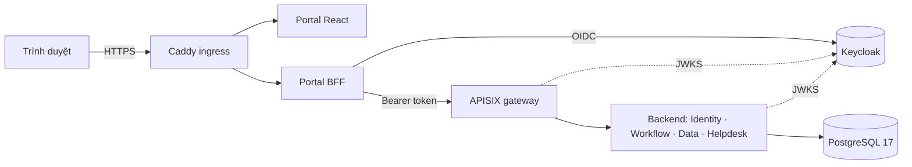
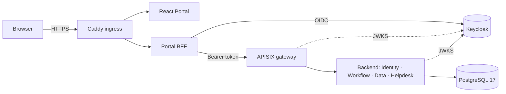

# OpenTrix

> **Ngôn ngữ / Language:** [Tiếng Việt](#opentrix--tổng-quan) · [English](#opentrix--overview)

---

## OpenTrix — Tổng quan

OpenTrix là nền tảng nguồn mở để xây dựng các ứng dụng dịch vụ nội bộ trên một lõi dùng chung,
theo kiến trúc DX-OS Open-Core. Lõi cung cấp định danh, cổng API, quy trình (workflow) và dữ liệu;
mỗi ứng dụng chỉ định nghĩa nghiệp vụ của mình. Ứng dụng đầu tiên là **IT Helpdesk**: tiếp nhận,
phân công, xử lý và xác nhận yêu cầu hỗ trợ IT. Mã nguồn phát hành theo
[Apache License 2.0](LICENSE).

Bắt đầu nhanh: [chạy thử bằng một lệnh](#chạy-cục-bộ). Người đóng góp: [CONTRIBUTING.md](CONTRIBUTING.md).
Toàn bộ tài liệu: [mục lục tài liệu](docs/README.md).

## Phạm vi hiện tại

| Lĩnh vực | Đã có trong mã nguồn |
| --- | --- |
| IT Helpdesk | Tạo yêu cầu, tiếp nhận, phân công, bắt đầu xử lý, ghi kết quả, xác nhận hoàn thành; danh sách, chi tiết, lịch sử xử lý; 9 API HTTP |
| Định danh | Keycloak OIDC; Portal BFF dùng Authorization Code + PKCE, phiên phía server, chống CSRF; backend kiểm JWT (issuer, audience, chữ ký) |
| Phân quyền | Theo tổ chức (tenant) và từng yêu cầu; vai trò nghiệp vụ lưu trong cơ sở dữ liệu, không lấy từ header do client gửi |
| Quy trình | Định nghĩa, phiên bản, chuyển trạng thái và lịch sử dùng chung cho mọi ứng dụng; chặn ghi đè đồng thời bằng phiên bản |
| Cổng API | Apache APISIX ở biên: kiểm token qua JWKS, giới hạn tần suất, chuẩn hóa header chuyển tiếp |
| Dữ liệu | PostgreSQL 17, migration Flyway, tách schema và tài khoản theo quyền tối thiểu |
| Giao diện | Portal React tiếng Việt cho ba vai trò; chế độ MOCK để xem giao diện không cần backend |
| Chạy thử | Một lệnh dựng toàn bộ stack từ mã nguồn bằng Docker trên Windows, Linux, macOS |
| Chưa cung cấp | Engine BPMN Flowable ([ADR-009](docs/08-decisions/ADR-009-modular-monolith-flowable.md)), lưu tệp S3 ([ADR-016](docs/08-decisions/ADR-016-s3-compatible-storage.md)), ứng dụng Facility, thông báo, báo cáo, triển khai production |

### Vai trò trong IT Helpdesk

| Vai trò | Làm được |
| --- | --- |
| Nhân viên | Gửi yêu cầu, theo dõi yêu cầu của mình, xác nhận khi đã xử lý xong |
| Điều phối viên | Tiếp nhận yêu cầu mới, phân công kỹ thuật viên, theo dõi toàn bộ yêu cầu |
| Kỹ thuật viên | Bắt đầu xử lý yêu cầu được giao, ghi kết quả xử lý |

Một tài khoản có thể giữ nhiều vai trò. Nút thao tác trên giao diện chỉ hiện khi máy chủ cho phép.

Vòng đời yêu cầu: **Mới gửi → Đã tiếp nhận → Đang xử lý → Chờ xác nhận → Hoàn thành**.

## Sơ đồ kho mã

| Đường dẫn | Trách nhiệm | Bắt đầu đọc |
| --- | --- | --- |
| [`backend/`](backend/) | Java 21 / Spring Boot; lõi Identity, Workflow, Data và ứng dụng Helpdesk | [backend/README.md](backend/README.md) |
| [`portal-bff/`](portal-bff/) | Spring Boot; đăng nhập OIDC, phiên, CSRF, chuyển tiếp API cho trình duyệt | [portal-bff/README.md](portal-bff/README.md) |
| [`frontend/`](frontend/) | React + TypeScript + Vite; Portal IT Helpdesk | [frontend/README.md](frontend/README.md) |
| [`infra/`](infra/) | Docker Compose, realm Keycloak, cấu hình APISIX, script chạy thử | [infra/demo/README.md](infra/demo/README.md) |
| [`scripts/`](scripts/) | Công cụ kiểm tra cục bộ, tuân thủ giấy phép, đóng gói phát hành | [scripts/README.md](scripts/README.md) |
| [`docs/`](docs/) | Kiến trúc, API, tích hợp, kiểm thử, triển khai, quyết định kiến trúc (ADR) | [docs/README.md](docs/README.md) |

## Kiến trúc tổng quan



Backend là một **modular monolith**: các mô-đun lõi và ứng dụng chạy chung một tiến trình nhưng
tách ranh giới phụ thuộc, được kiểm bằng ArchUnit. Trình duyệt không giữ access token; BFF giữ
token phía server và gọi backend thay người dùng. Chi tiết: [ARCHITECTURE.md](docs/ARCHITECTURE.md).

## Chạy cục bộ

Yêu cầu: Git, Docker kèm Compose 2.24 trở lên; trên Windows cần **PowerShell 7.4 trở lên**
(`winget install --id Microsoft.PowerShell`).

```bash
git clone https://github.com/tricore-opentrix/opentrix.git
cd opentrix

# Linux / macOS
bash infra/demo/demo-up.sh --gateway

# Windows (PowerShell 7)
pwsh -File infra/demo/demo-up.ps1 -Gateway -TrustCa
```

Lần chạy đầu build toàn bộ image từ mã nguồn (vài phút). Khi xong, script in kết quả kiểm tra
từng thành phần. Mở **https://localhost:8443** và đăng nhập bằng một trong ba tài khoản thử:

| Tài khoản | Vai trò |
| --- | --- |
| `employee-demo` | Nhân viên |
| `coordinator-demo` | Điều phối viên |
| `worker-demo` | Kỹ thuật viên |

Mật khẩu được sinh ngẫu nhiên vào `infra/.env` (không đưa lên Git). Đổi vai trò bằng nút
**Đăng xuất** rồi đăng nhập tài khoản khác.

| Lệnh | Tác dụng |
| --- | --- |
| `demo-down.ps1` / `demo-down.sh` | Dừng, giữ dữ liệu |
| `demo-down.ps1 -Reset` / `demo-down.sh --reset` | Dừng và xóa dữ liệu thử |

Cổng, xử lý lỗi thường gặp và tin cậy chứng chỉ HTTPS: [infra/demo/README.md](infra/demo/README.md).

### Xem giao diện không cần backend

```bash
cd frontend
npm ci
npm run dev        # http://127.0.0.1:5173, dữ liệu mẫu, có nhãn MOCK
```

Cần Node.js 22.12 trở lên.

## Làm việc với mã nguồn

| Phần | Build và kiểm tra |
| --- | --- |
| Backend | `cd backend && ./gradlew test build` (Windows: `.\gradlew.bat test build`) |
| Portal BFF | `./backend/gradlew -p portal-bff test build` |
| Frontend | `cd frontend && npm ci && npm test && npm run build` |
| Giấy phép | CI chạy kiểm tra REUSE/SPDX trên mọi pull request |

**Gói SOURCE-ONLY đã giải nén:** Các lệnh `./gradlew` / `gradlew.bat` ở bảng trên dành cho **Git checkout**. Archive không phân phối `gradle-wrapper.jar`; cần cài **Gradle 8.14.3 bên ngoài** và JDK 21, rồi chạy `gradle -p backend test build` và `gradle -p portal-bff test build`. CI R24 kiểm thử build từ archive không có `.git`; xem [R24 release](docs/06-deployment/r24-release.md).

Hướng dẫn đầy đủ: [DEVELOPMENT.md](docs/DEVELOPMENT.md) và [TESTING.md](docs/TESTING.md).

## Lộ trình

| Phiên bản | Nội dung |
| --- | --- |
| `v0.1.0` (đã phát hành) | API IT Helpdesk, Portal BFF với OIDC, Portal React |
| Bản tiếp theo (đang phát triển) | Chạy thử một lệnh, APISIX gateway, giao diện IT Helpdesk mới, nhãn trạng thái tiếng Việt |
| Kế hoạch | Flowable BPMN, lưu tệp S3, tài liệu OpenAPI, trao đổi trong yêu cầu, ứng dụng thứ hai trên cùng lõi |

Thay đổi theo phiên bản: [CHANGELOG.md](CHANGELOG.md). Công việc được theo dõi bằng
[Issues](https://github.com/tricore-opentrix/opentrix/issues) và milestone.

## Đọc thêm

- [Mục lục tài liệu](docs/README.md): chọn tài liệu theo việc cần làm.
- [Kiến trúc](docs/ARCHITECTURE.md) · [API](docs/API.md) · [Tích hợp ứng dụng mới](docs/INTEGRATION.md)
- [Triển khai](docs/DEPLOYMENT.md) · [Phát hành](docs/RELEASE.md) · [Giấy phép và nguồn mở](docs/OPEN_SOURCE.md)
- [Quyết định kiến trúc (ADR)](docs/08-decisions/README.md) · [Thuật ngữ](GLOSSARY.md)
- [Đóng góp](CONTRIBUTING.md) · [Quản trị dự án](GOVERNANCE.md) · [Báo cáo lỗ hổng](SECURITY.md)

## Giấy phép

Mã nguồn OpenTrix phát hành theo [Apache License 2.0](LICENSE), bản quyền 2026 TRICORE
contributors; xem [NOTICE](NOTICE). Thư viện bên thứ ba, container image và dịch vụ đi kèm giữ
giấy phép riêng; xem [THIRD-PARTY-NOTICES.md](THIRD-PARTY-NOTICES.md). Từng tệp mang thông tin
giấy phép theo chuẩn [REUSE](https://reuse.software/).

---

## OpenTrix — Overview

OpenTrix is an open-source platform for building internal service applications on a shared core,
following the DX-OS Open-Core architecture. The core provides identity, an API gateway, workflow
and data; each application defines only its business rules. The first application is
**IT Helpdesk**: submitting, triaging, assigning, resolving and confirming IT support requests.
Licensed under the [Apache License 2.0](LICENSE).

Quick start: [run it with one command](#run-locally). Contributors: [CONTRIBUTING.md](CONTRIBUTING.md).
All documentation: [documentation index](docs/README.md).

## Current scope

| Area | Available in the source |
| --- | --- |
| IT Helpdesk | Create, triage, assign, start, resolve and confirm requests; list, detail and activity history; 9 HTTP APIs |
| Identity | Keycloak OIDC; Portal BFF with Authorization Code + PKCE, server-side session and CSRF protection; backend validates JWTs (issuer, audience, signature) |
| Authorization | Scoped per tenant and per request; business roles are stored in the database, never taken from client headers |
| Workflow | Shared definitions, versions, transitions and history; optimistic version checks prevent lost updates |
| API gateway | Apache APISIX at the edge: JWKS token validation, rate limiting, forwarded-header normalization |
| Data | PostgreSQL 17, Flyway migrations, least-privilege schemas and roles |
| User interface | Vietnamese React Portal for three roles; a MOCK mode for UI work without a backend |
| Trial run | One command builds and starts the whole stack from source with Docker on Windows, Linux and macOS |
| Not provided yet | Flowable BPMN engine ([ADR-009](docs/08-decisions/ADR-009-modular-monolith-flowable.md)), S3 file storage ([ADR-016](docs/08-decisions/ADR-016-s3-compatible-storage.md)), Facility application, notifications, reports, production deployment |

### IT Helpdesk roles

| Role | Can |
| --- | --- |
| Employee | Submit requests, follow their own requests, confirm completion |
| Coordinator | Triage new requests, assign technicians, monitor all requests |
| Technician | Start work on assigned requests, record the resolution |

One account may hold several roles. Action buttons appear only when the server allows them.

Request lifecycle: **Submitted → Triaged → In progress → Awaiting confirmation → Completed**.

## Repository map

| Path | Responsibility | Start with |
| --- | --- | --- |
| [`backend/`](backend/) | Java 21 / Spring Boot; Identity, Workflow and Data core plus the Helpdesk application | [backend/README.md](backend/README.md) |
| [`portal-bff/`](portal-bff/) | Spring Boot; OIDC login, session, CSRF and API forwarding for the browser | [portal-bff/README.md](portal-bff/README.md) |
| [`frontend/`](frontend/) | React + TypeScript + Vite; IT Helpdesk Portal | [frontend/README.md](frontend/README.md) |
| [`infra/`](infra/) | Docker Compose, Keycloak realm, APISIX configuration, trial scripts | [infra/demo/README.md](infra/demo/README.md) |
| [`scripts/`](scripts/) | Local checks, license compliance, release packaging | [scripts/README.md](scripts/README.md) |
| [`docs/`](docs/) | Architecture, API, integration, testing, deployment, architecture decisions (ADR) | [docs/README.md](docs/README.md) |

## Architecture at a glance



The backend is a **modular monolith**: core and application modules run in one process with
dependency boundaries enforced by ArchUnit. The browser never holds an access token; the BFF keeps
tokens server-side and calls the backend on the user's behalf. Details:
[ARCHITECTURE.md](docs/ARCHITECTURE.md).

## Run locally

Requirements: Git, Docker with Compose 2.24 or later; on Windows, **PowerShell 7.4 or later**
(`winget install --id Microsoft.PowerShell`).

```bash
git clone https://github.com/tricore-opentrix/opentrix.git
cd opentrix

# Linux / macOS
bash infra/demo/demo-up.sh --gateway

# Windows (PowerShell 7)
pwsh -File infra/demo/demo-up.ps1 -Gateway -TrustCa
```

The first run builds every image from source (a few minutes). When it finishes, the script prints
a health check for each component. Open **https://localhost:8443** and sign in with one of the
trial accounts:

| Account | Role |
| --- | --- |
| `employee-demo` | Employee |
| `coordinator-demo` | Coordinator |
| `worker-demo` | Technician |

Passwords are generated into `infra/.env`, which is never committed. Switch roles with
**Sign out**, then sign in with another account.

| Command | Effect |
| --- | --- |
| `demo-down.ps1` / `demo-down.sh` | Stop and keep data |
| `demo-down.ps1 -Reset` / `demo-down.sh --reset` | Stop and delete trial data |

Ports, troubleshooting and HTTPS certificate trust: [infra/demo/README.md](infra/demo/README.md).

### UI without a backend

```bash
cd frontend
npm ci
npm run dev        # http://127.0.0.1:5173, sample data, labelled MOCK
```

Requires Node.js 22.12 or later.

## Working on the code

| Part | Build and check |
| --- | --- |
| Backend | `cd backend && ./gradlew test build` (Windows: `.\gradlew.bat test build`) |
| Portal BFF | `./backend/gradlew -p portal-bff test build` |
| Frontend | `cd frontend && npm ci && npm test && npm run build` |
| Licensing | CI runs REUSE/SPDX checks on every pull request |

**Extracted SOURCE-ONLY archive:** The `./gradlew` / `gradlew.bat` commands above apply to a **Git checkout**. The archive omits `gradle-wrapper.jar`; install **external Gradle 8.14.3** and JDK 21, then run `gradle -p backend test build` and `gradle -p portal-bff test build`. R24 CI verifies the extracted archive without `.git`; see [R24 release](docs/06-deployment/r24-release.md).

Full guides: [DEVELOPMENT.md](docs/DEVELOPMENT.md) and [TESTING.md](docs/TESTING.md).

## Roadmap

| Version | Content |
| --- | --- |
| `v0.1.0` (released) | IT Helpdesk API, Portal BFF with OIDC, React Portal |
| Next release (in development) | One-command trial stack, APISIX gateway, new IT Helpdesk UI, Vietnamese status labels |
| Planned | Flowable BPMN, S3 file storage, OpenAPI reference, in-request messaging, a second application on the same core |

Changes by version: [CHANGELOG.md](CHANGELOG.md). Work is tracked in
[Issues](https://github.com/tricore-opentrix/opentrix/issues) and milestones.

## Further reading

- [Documentation index](docs/README.md): pick a guide by task.
- [Architecture](docs/ARCHITECTURE.md) · [API](docs/API.md) · [Integrating a new application](docs/INTEGRATION.md)
- [Deployment](docs/DEPLOYMENT.md) · [Release](docs/RELEASE.md) · [Licensing and open source](docs/OPEN_SOURCE.md)
- [Architecture decisions (ADR)](docs/08-decisions/README.md) · [Glossary](GLOSSARY.md)
- [Contributing](CONTRIBUTING.md) · [Governance](GOVERNANCE.md) · [Security reports](SECURITY.md)

## License

OpenTrix source code is licensed under the [Apache License 2.0](LICENSE), copyright 2026 TRICORE
contributors; see [NOTICE](NOTICE). Third-party libraries, container images and bundled services
keep their own licenses; see [THIRD-PARTY-NOTICES.md](THIRD-PARTY-NOTICES.md). Every file carries
license information following the [REUSE](https://reuse.software/) specification.