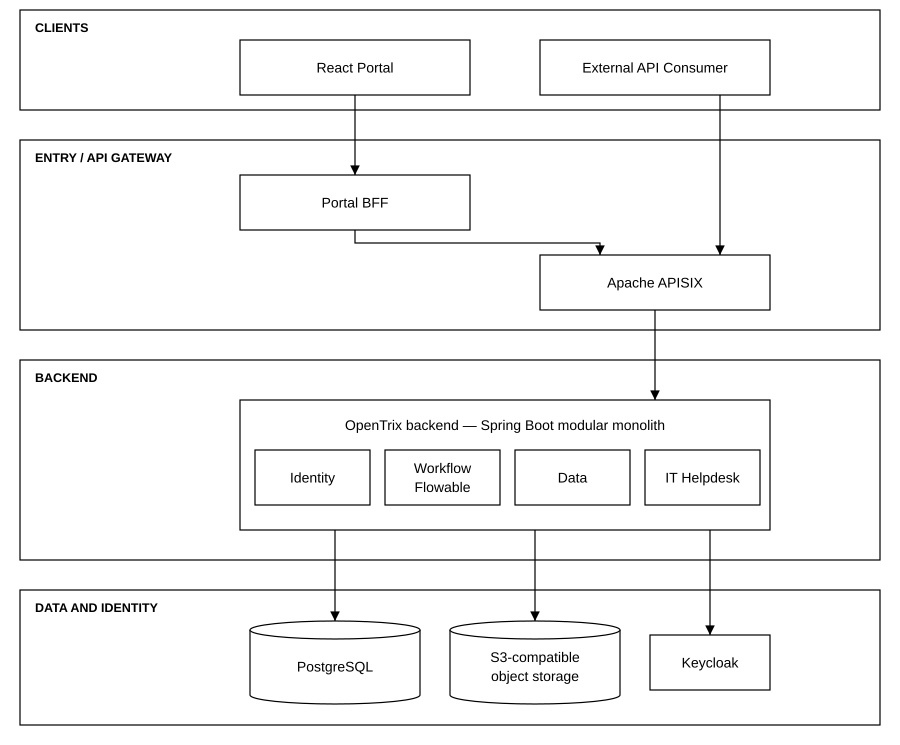
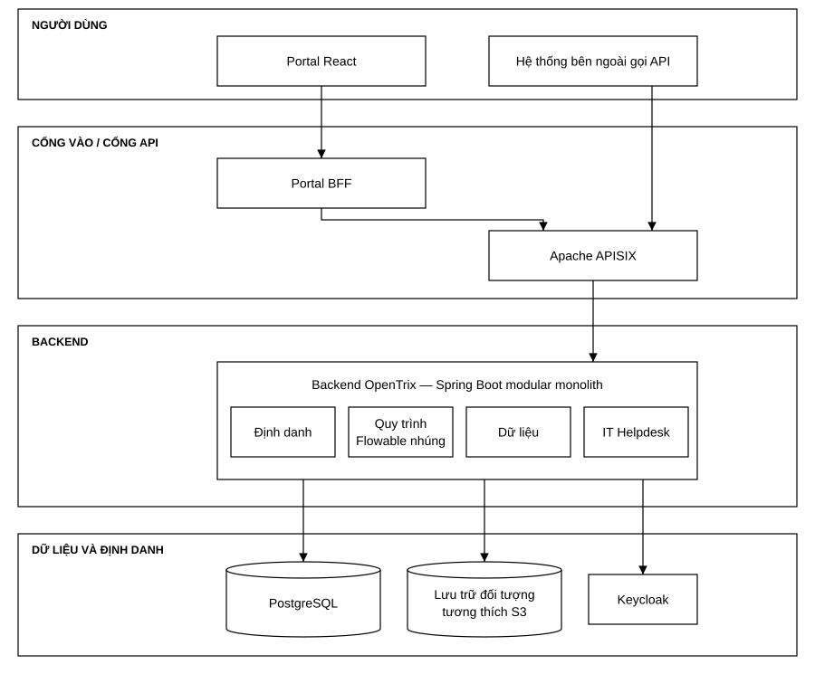

# OpenTrix

> **Language / Ngôn ngữ:** [English](#en) · [Tiếng Việt](#vi)

---

<a id="en"></a>

## Overview

OpenTrix is an open-source platform for building internal service applications on a shared core,
licensed under the [Apache License 2.0](https://github.com/tricore-opentrix/opentrix/blob/main/LICENSE). The core provides identity, an API gateway,
workflow and data; each application defines only its own business rules. The first application
is **IT Helpdesk**: submitting, triaging, assigning, resolving and confirming IT support requests.

Start with [running it locally](#run-locally), then read the [architecture](https://github.com/tricore-opentrix/opentrix/blob/main/docs/ARCHITECTURE.md),
[API reference](https://github.com/tricore-opentrix/opentrix/blob/main/docs/API.md) and [deployment guide](https://github.com/tricore-opentrix/opentrix/blob/main/docs/DEPLOYMENT.md). Contributors:
[CONTRIBUTING.md](https://github.com/tricore-opentrix/opentrix/blob/main/CONTRIBUTING.md).

> OpenTrix is the product name. Internal identifiers such as the Java package `com.tricore.dxos`
> and existing configuration keys intentionally keep their current names; this does not change
> any integration contract.

## Current scope

| Area             | Available in the source                                                                                                                                                                                                                                                                                                                                                 |
| ---------------- | ----------------------------------------------------------------------------------------------------------------------------------------------------------------------------------------------------------------------------------------------------------------------------------------------------------------------------------------------------------------------- |
| IT Helpdesk      | Create, triage, assign, start, resolve and confirm requests; list, detail and activity history; 9 HTTP operations                                                                                                                                                                                                                                                       |
| Identity         | Keycloak OIDC; Portal BFF with Authorization Code + PKCE, server-side session and CSRF protection; the backend validates JWT issuer, audience and signature                                                                                                                                                                                                             |
| Authorization    | Scoped per tenant and per request; business roles are stored in the database, never taken from client headers                                                                                                                                                                                                                                                           |
| Workflow         | Shared definitions, versions, transitions and history; optimistic version checks prevent lost updates                                                                                                                                                                                                                                                                   |
| API gateway      | Apache APISIX at the edge: JWKS token validation, rate limiting, forwarded-header normalization                                                                                                                                                                                                                                                                         |
| Data             | PostgreSQL 17, Flyway migrations, least-privilege schemas and roles                                                                                                                                                                                                                                                                                                     |
| User interface   | Vietnamese React Portal for three roles; a MOCK mode for UI work without a backend                                                                                                                                                                                                                                                                                      |
| Local deployment | One command builds and starts the whole stack from source with Docker on Windows, Linux and macOS                                                                                                                                                                                                                                                                       |
| Not provided yet | Flowable BPMN engine ([ADR-009](https://github.com/tricore-opentrix/opentrix/blob/main/docs/08-decisions/ADR-009-modular-monolith-flowable.md)), S3-compatible file storage ([ADR-016](https://github.com/tricore-opentrix/opentrix/blob/main/docs/08-decisions/ADR-016-s3-compatible-storage.md)), Facility application, notifications, reports, production deployment |

Repository code alone is not evidence of a production-ready service: identity, gateway and
database configuration must be verified and hardened in your own environment. See
[DEPLOYMENT.md](https://github.com/tricore-opentrix/opentrix/blob/main/docs/DEPLOYMENT.md) and [SECURITY.md](https://github.com/tricore-opentrix/opentrix/blob/main/SECURITY.md).

### IT Helpdesk roles

| Role        | Can                                                            |
| ----------- | -------------------------------------------------------------- |
| Employee    | Submit requests, follow their own requests, confirm completion |
| Coordinator | Triage new requests, assign technicians, monitor all requests  |
| Technician  | Start work on assigned requests, record the resolution         |

One account may hold several roles. Action buttons appear only when the server allows them.

Request lifecycle: **Submitted → Triaged → In progress → Awaiting confirmation → Completed**.

## Repository map

| Path                                                                               | Responsibility                                                                        | Start with                                                                                          |
| ---------------------------------------------------------------------------------- | ------------------------------------------------------------------------------------- | --------------------------------------------------------------------------------------------------- |
| [`backend/`](https://github.com/tricore-opentrix/opentrix/tree/main/backend)       | Java 21 / Spring Boot; Identity, Workflow and Data core plus the Helpdesk application | [backend/README.md](https://github.com/tricore-opentrix/opentrix/blob/main/backend/README.md)       |
| [`portal-bff/`](https://github.com/tricore-opentrix/opentrix/tree/main/portal-bff) | Spring Boot; OIDC login, session, CSRF and API forwarding for the browser             | [portal-bff/README.md](https://github.com/tricore-opentrix/opentrix/blob/main/portal-bff/README.md) |
| [`frontend/`](https://github.com/tricore-opentrix/opentrix/tree/main/frontend)     | React + TypeScript + Vite; IT Helpdesk Portal                                         | [frontend/README.md](https://github.com/tricore-opentrix/opentrix/blob/main/frontend/README.md)     |
| [`infra/`](https://github.com/tricore-opentrix/opentrix/tree/main/infra)           | Docker Compose, Keycloak realm, APISIX configuration, local deployment scripts        | [infra/demo/README.md](https://github.com/tricore-opentrix/opentrix/blob/main/infra/demo/README.md) |
| [`scripts/`](https://github.com/tricore-opentrix/opentrix/tree/main/scripts)       | Local checks, license compliance, release packaging                                   | [scripts/README.md](https://github.com/tricore-opentrix/opentrix/blob/main/scripts/README.md)       |
| [`docs/`](https://github.com/tricore-opentrix/opentrix/tree/main/docs)             | Architecture, API, integration, testing, deployment, architecture decisions (ADR)     | [docs/README.md](https://github.com/tricore-opentrix/opentrix/blob/main/docs/README.md)             |

## Architecture



The backend is a **modular monolith**: core and application modules run in one Spring Boot
process, with dependency boundaries enforced by ArchUnit. The browser never holds an access token;
the Portal BFF keeps tokens server-side and calls the backend through the APISIX gateway. Embedded
Flowable ([ADR-009](https://github.com/tricore-opentrix/opentrix/blob/main/docs/08-decisions/ADR-009-modular-monolith-flowable.md)) and S3-compatible
object storage ([ADR-016](https://github.com/tricore-opentrix/opentrix/blob/main/docs/08-decisions/ADR-016-s3-compatible-storage.md)) are being
integrated and are not yet in the current release. Details: [ARCHITECTURE.md](https://github.com/tricore-opentrix/opentrix/blob/main/docs/ARCHITECTURE.md).

## Run locally

Requirements: Git and Docker with Compose 2.24 or later; on Windows, **PowerShell 7.4 or later**
(`winget install --id Microsoft.PowerShell`).

```bash
git clone https://github.com/tricore-opentrix/opentrix.git
cd opentrix

# Linux / macOS
bash infra/demo/demo-up.sh --gateway

# Windows (PowerShell 7)
pwsh -File infra/demo/demo-up.ps1 -Gateway -TrustCa
```

The first run builds every image from source, which takes a few minutes. When it finishes, the
script prints a health check for each component. Open **https://localhost:8443** and sign in with
one of the sample accounts:

| Account            | Role        |
| ------------------ | ----------- |
| `employee-demo`    | Employee    |
| `coordinator-demo` | Coordinator |
| `worker-demo`      | Technician  |

Passwords are generated into `infra/.env`, which is never committed. To switch roles, select
**Sign out** and sign in with another account.

| Command                                         | Effect                     |
| ----------------------------------------------- | -------------------------- |
| `demo-down.ps1` / `demo-down.sh`                | Stop and keep data         |
| `demo-down.ps1 -Reset` / `demo-down.sh --reset` | Stop and delete local data |

Ports, troubleshooting and HTTPS certificate trust: [infra/demo/README.md](https://github.com/tricore-opentrix/opentrix/blob/main/infra/demo/README.md).

### UI without a backend

```bash
cd frontend
npm ci
npm run dev        # http://127.0.0.1:5173, sample data, labelled MOCK
```

Requires Node.js 22.12 or later.

## Working on the code

| Part       | Build and check                                                            |
| ---------- | -------------------------------------------------------------------------- |
| Backend    | `cd backend && ./gradlew test build` (Windows: `.\gradlew.bat test build`) |
| Portal BFF | `./backend/gradlew -p portal-bff test build`                               |
| Frontend   | `cd frontend && npm ci && npm test && npm run build`                       |
| Licensing  | CI runs REUSE/SPDX checks on every pull request                            |

**Building from a source archive:** the `./gradlew` / `gradlew.bat` commands above apply to a Git
checkout. Source archives do not include `gradle-wrapper.jar`; install Gradle 8.14.3 and JDK 21,
then run `gradle -p backend test build` and `gradle -p portal-bff test build`. CI verifies that an
extracted archive builds without `.git`. See [RELEASE.md](https://github.com/tricore-opentrix/opentrix/blob/main/docs/RELEASE.md).

Full guides: [DEVELOPMENT.md](https://github.com/tricore-opentrix/opentrix/blob/main/docs/DEVELOPMENT.md) and [TESTING.md](https://github.com/tricore-opentrix/opentrix/blob/main/docs/TESTING.md).

## Further reading

- [Documentation index](https://github.com/tricore-opentrix/opentrix/blob/main/docs/README.md): pick a guide by task.
- [Releases](https://github.com/tricore-opentrix/opentrix/releases) and [changelog](https://github.com/tricore-opentrix/opentrix/blob/main/CHANGELOG.md).
- [Architecture](https://github.com/tricore-opentrix/opentrix/blob/main/docs/ARCHITECTURE.md) · [API](https://github.com/tricore-opentrix/opentrix/blob/main/docs/API.md) · [Integrating a new application](https://github.com/tricore-opentrix/opentrix/blob/main/docs/INTEGRATION.md)
- [Deployment](https://github.com/tricore-opentrix/opentrix/blob/main/docs/DEPLOYMENT.md) · [Release](https://github.com/tricore-opentrix/opentrix/blob/main/docs/RELEASE.md) · [Licensing and open source](https://github.com/tricore-opentrix/opentrix/blob/main/docs/OPEN_SOURCE.md)
- [Architecture decisions (ADR)](https://github.com/tricore-opentrix/opentrix/blob/main/docs/08-decisions/README.md) · [Glossary](https://github.com/tricore-opentrix/opentrix/blob/main/GLOSSARY.md)
- [Contributing](https://github.com/tricore-opentrix/opentrix/blob/main/CONTRIBUTING.md) · [Governance](https://github.com/tricore-opentrix/opentrix/blob/main/GOVERNANCE.md) · [Security](https://github.com/tricore-opentrix/opentrix/blob/main/SECURITY.md)

## License

OpenTrix is licensed under the [Apache License 2.0](https://github.com/tricore-opentrix/opentrix/blob/main/LICENSE), copyright 2026 TRICORE
contributors; see [NOTICE](https://github.com/tricore-opentrix/opentrix/blob/main/NOTICE). Third-party libraries, container images and bundled services
keep their own licenses; see [THIRD-PARTY-NOTICES.md](https://github.com/tricore-opentrix/opentrix/blob/main/THIRD-PARTY-NOTICES.md). Every file carries
license information following the [REUSE](https://reuse.software/) specification.

---

<a id="vi"></a>

## Tổng quan

OpenTrix là nền tảng nguồn mở để xây dựng các ứng dụng dịch vụ nội bộ trên một lõi dùng chung,
phát hành theo [Apache License 2.0](https://github.com/tricore-opentrix/opentrix/blob/main/LICENSE). Lõi cung cấp định danh, cổng API, quy trình
(workflow) và dữ liệu; mỗi ứng dụng chỉ định nghĩa nghiệp vụ của mình. Ứng dụng đầu tiên là
**IT Helpdesk**: tiếp nhận, phân công, xử lý và xác nhận yêu cầu hỗ trợ IT.

Bắt đầu từ [chạy cục bộ](#chạy-cục-bộ), sau đó xem [kiến trúc](https://github.com/tricore-opentrix/opentrix/blob/main/docs/ARCHITECTURE.md),
[tham chiếu API](https://github.com/tricore-opentrix/opentrix/blob/main/docs/API.md) và [hướng dẫn triển khai](https://github.com/tricore-opentrix/opentrix/blob/main/docs/DEPLOYMENT.md). Người đóng góp:
[CONTRIBUTING.md](https://github.com/tricore-opentrix/opentrix/blob/main/CONTRIBUTING.md).

> OpenTrix là tên sản phẩm. Các định danh nội bộ như package Java `com.tricore.dxos` và các khóa
> cấu hình hiện có được cố ý giữ nguyên; điều này không thay đổi hợp đồng tích hợp nào.

## Phạm vi hiện tại

| Lĩnh vực          | Đã có trong mã nguồn                                                                                                                                                                                                                                                                                                                                         |
| ----------------- | ------------------------------------------------------------------------------------------------------------------------------------------------------------------------------------------------------------------------------------------------------------------------------------------------------------------------------------------------------------ |
| IT Helpdesk       | Tạo yêu cầu, tiếp nhận, phân công, bắt đầu xử lý, ghi kết quả, xác nhận hoàn thành; danh sách, chi tiết, lịch sử xử lý; 9 thao tác HTTP                                                                                                                                                                                                                      |
| Định danh         | Keycloak OIDC; Portal BFF dùng Authorization Code + PKCE, phiên phía server, chống CSRF; backend kiểm JWT (issuer, audience, chữ ký)                                                                                                                                                                                                                         |
| Phân quyền        | Theo tổ chức (tenant) và từng yêu cầu; vai trò nghiệp vụ lưu trong cơ sở dữ liệu, không lấy từ header do client gửi                                                                                                                                                                                                                                          |
| Quy trình         | Định nghĩa, phiên bản, chuyển trạng thái và lịch sử dùng chung cho mọi ứng dụng; chặn ghi đè đồng thời bằng phiên bản                                                                                                                                                                                                                                        |
| Cổng API          | Apache APISIX ở biên: kiểm token qua JWKS, giới hạn tần suất, chuẩn hóa header chuyển tiếp                                                                                                                                                                                                                                                                   |
| Dữ liệu           | PostgreSQL 17, migration Flyway, tách schema và tài khoản theo quyền tối thiểu                                                                                                                                                                                                                                                                               |
| Giao diện         | Portal React tiếng Việt cho ba vai trò; chế độ MOCK để làm giao diện không cần backend                                                                                                                                                                                                                                                                       |
| Triển khai cục bộ | Một lệnh dựng toàn bộ hệ thống từ mã nguồn bằng Docker trên Windows, Linux, macOS                                                                                                                                                                                                                                                                            |
| Chưa cung cấp     | Engine BPMN Flowable ([ADR-009](https://github.com/tricore-opentrix/opentrix/blob/main/docs/08-decisions/ADR-009-modular-monolith-flowable.md)), lưu tệp tương thích S3 ([ADR-016](https://github.com/tricore-opentrix/opentrix/blob/main/docs/08-decisions/ADR-016-s3-compatible-storage.md)), ứng dụng Facility, thông báo, báo cáo, triển khai production |

Chỉ có mã nguồn trong repo chưa phải là bằng chứng dịch vụ sẵn sàng cho production: cấu hình định
danh, cổng API và cơ sở dữ liệu phải được kiểm chứng và gia cố trong môi trường của riêng bạn. Xem
[DEPLOYMENT.md](https://github.com/tricore-opentrix/opentrix/blob/main/docs/DEPLOYMENT.md) và [SECURITY.md](https://github.com/tricore-opentrix/opentrix/blob/main/SECURITY.md).

### Vai trò trong IT Helpdesk

| Vai trò        | Làm được                                                                 |
| -------------- | ------------------------------------------------------------------------ |
| Nhân viên      | Gửi yêu cầu, theo dõi yêu cầu của mình, xác nhận khi đã xử lý xong       |
| Điều phối viên | Tiếp nhận yêu cầu mới, phân công kỹ thuật viên, theo dõi toàn bộ yêu cầu |
| Kỹ thuật viên  | Bắt đầu xử lý yêu cầu được giao, ghi kết quả xử lý                       |

Một tài khoản có thể giữ nhiều vai trò. Nút thao tác trên giao diện chỉ hiện khi máy chủ cho phép.

Vòng đời yêu cầu: **Mới gửi → Đã tiếp nhận → Đang xử lý → Chờ xác nhận → Hoàn thành**.

## Sơ đồ kho mã

| Đường dẫn                                                                          | Trách nhiệm                                                                | Bắt đầu đọc                                                                                         |
| ---------------------------------------------------------------------------------- | -------------------------------------------------------------------------- | --------------------------------------------------------------------------------------------------- |
| [`backend/`](https://github.com/tricore-opentrix/opentrix/tree/main/backend)       | Java 21 / Spring Boot; lõi Identity, Workflow, Data và ứng dụng Helpdesk   | [backend/README.md](https://github.com/tricore-opentrix/opentrix/blob/main/backend/README.md)       |
| [`portal-bff/`](https://github.com/tricore-opentrix/opentrix/tree/main/portal-bff) | Spring Boot; đăng nhập OIDC, phiên, CSRF, chuyển tiếp API cho trình duyệt  | [portal-bff/README.md](https://github.com/tricore-opentrix/opentrix/blob/main/portal-bff/README.md) |
| [`frontend/`](https://github.com/tricore-opentrix/opentrix/tree/main/frontend)     | React + TypeScript + Vite; Portal IT Helpdesk                              | [frontend/README.md](https://github.com/tricore-opentrix/opentrix/blob/main/frontend/README.md)     |
| [`infra/`](https://github.com/tricore-opentrix/opentrix/tree/main/infra)           | Docker Compose, realm Keycloak, cấu hình APISIX, script triển khai cục bộ  | [infra/demo/README.md](https://github.com/tricore-opentrix/opentrix/blob/main/infra/demo/README.md) |
| [`scripts/`](https://github.com/tricore-opentrix/opentrix/tree/main/scripts)       | Công cụ kiểm tra cục bộ, tuân thủ giấy phép, đóng gói phát hành            | [scripts/README.md](https://github.com/tricore-opentrix/opentrix/blob/main/scripts/README.md)       |
| [`docs/`](https://github.com/tricore-opentrix/opentrix/tree/main/docs)             | Kiến trúc, API, tích hợp, kiểm thử, triển khai, quyết định kiến trúc (ADR) | [docs/README.md](https://github.com/tricore-opentrix/opentrix/blob/main/docs/README.md)             |

## Kiến trúc



Backend là một **modular monolith**: các mô-đun lõi và ứng dụng chạy chung một tiến trình Spring
Boot, ranh giới phụ thuộc được kiểm bằng ArchUnit. Trình duyệt không giữ access token; Portal BFF
giữ token phía server và gọi backend qua cổng APISIX. Flowable nhúng
([ADR-009](https://github.com/tricore-opentrix/opentrix/blob/main/docs/08-decisions/ADR-009-modular-monolith-flowable.md)) và lưu trữ đối tượng tương thích
S3 ([ADR-016](https://github.com/tricore-opentrix/opentrix/blob/main/docs/08-decisions/ADR-016-s3-compatible-storage.md)) đang được tích hợp, chưa có trong
bản phát hành hiện tại. Chi tiết: [ARCHITECTURE.md](https://github.com/tricore-opentrix/opentrix/blob/main/docs/ARCHITECTURE.md).

## Chạy cục bộ

Yêu cầu: Git, Docker kèm Compose 2.24 trở lên; trên Windows cần **PowerShell 7.4 trở lên**
(`winget install --id Microsoft.PowerShell`).

```bash
git clone https://github.com/tricore-opentrix/opentrix.git
cd opentrix

# Linux / macOS
bash infra/demo/demo-up.sh --gateway

# Windows (PowerShell 7)
pwsh -File infra/demo/demo-up.ps1 -Gateway -TrustCa
```

Lần chạy đầu build toàn bộ image từ mã nguồn, mất vài phút. Khi xong, script in kết quả kiểm tra
từng thành phần. Mở **https://localhost:8443** và đăng nhập bằng một trong các tài khoản mẫu:

| Tài khoản          | Vai trò        |
| ------------------ | -------------- |
| `employee-demo`    | Nhân viên      |
| `coordinator-demo` | Điều phối viên |
| `worker-demo`      | Kỹ thuật viên  |

Mật khẩu được sinh vào `infra/.env` (không đưa lên Git). Để đổi vai trò, chọn **Đăng xuất** rồi
đăng nhập bằng tài khoản khác.

| Lệnh                                            | Tác dụng                   |
| ----------------------------------------------- | -------------------------- |
| `demo-down.ps1` / `demo-down.sh`                | Dừng, giữ dữ liệu          |
| `demo-down.ps1 -Reset` / `demo-down.sh --reset` | Dừng và xóa dữ liệu cục bộ |

Cổng, xử lý lỗi thường gặp và tin cậy chứng chỉ HTTPS: [infra/demo/README.md](https://github.com/tricore-opentrix/opentrix/blob/main/infra/demo/README.md).

### Xem giao diện không cần backend

```bash
cd frontend
npm ci
npm run dev        # http://127.0.0.1:5173, dữ liệu mẫu, có nhãn MOCK
```

Cần Node.js 22.12 trở lên.

## Làm việc với mã nguồn

| Phần       | Build và kiểm tra                                                          |
| ---------- | -------------------------------------------------------------------------- |
| Backend    | `cd backend && ./gradlew test build` (Windows: `.\gradlew.bat test build`) |
| Portal BFF | `./backend/gradlew -p portal-bff test build`                               |
| Frontend   | `cd frontend && npm ci && npm test && npm run build`                       |
| Giấy phép  | CI chạy kiểm tra REUSE/SPDX trên mọi pull request                          |

**Build từ gói mã nguồn:** các lệnh `./gradlew` / `gradlew.bat` ở bảng trên dành cho bản Git
checkout. Gói mã nguồn không kèm `gradle-wrapper.jar`; cần cài Gradle 8.14.3 và JDK 21, rồi chạy
`gradle -p backend test build` và `gradle -p portal-bff test build`. CI kiểm tra gói đã giải nén
build được mà không cần `.git`. Xem [RELEASE.md](https://github.com/tricore-opentrix/opentrix/blob/main/docs/RELEASE.md).

Hướng dẫn đầy đủ: [DEVELOPMENT.md](https://github.com/tricore-opentrix/opentrix/blob/main/docs/DEVELOPMENT.md) và [TESTING.md](https://github.com/tricore-opentrix/opentrix/blob/main/docs/TESTING.md).

## Đọc thêm

- [Mục lục tài liệu](https://github.com/tricore-opentrix/opentrix/blob/main/docs/README.md): chọn tài liệu theo việc cần làm.
- [Các bản phát hành](https://github.com/tricore-opentrix/opentrix/releases) và [nhật ký thay đổi](https://github.com/tricore-opentrix/opentrix/blob/main/CHANGELOG.md).
- [Kiến trúc](https://github.com/tricore-opentrix/opentrix/blob/main/docs/ARCHITECTURE.md) · [API](https://github.com/tricore-opentrix/opentrix/blob/main/docs/API.md) · [Tích hợp ứng dụng mới](https://github.com/tricore-opentrix/opentrix/blob/main/docs/INTEGRATION.md)
- [Triển khai](https://github.com/tricore-opentrix/opentrix/blob/main/docs/DEPLOYMENT.md) · [Phát hành](https://github.com/tricore-opentrix/opentrix/blob/main/docs/RELEASE.md) · [Giấy phép và nguồn mở](https://github.com/tricore-opentrix/opentrix/blob/main/docs/OPEN_SOURCE.md)
- [Quyết định kiến trúc (ADR)](https://github.com/tricore-opentrix/opentrix/blob/main/docs/08-decisions/README.md) · [Thuật ngữ](https://github.com/tricore-opentrix/opentrix/blob/main/GLOSSARY.md)
- [Đóng góp](https://github.com/tricore-opentrix/opentrix/blob/main/CONTRIBUTING.md) · [Quản trị dự án](https://github.com/tricore-opentrix/opentrix/blob/main/GOVERNANCE.md) · [Bảo mật](https://github.com/tricore-opentrix/opentrix/blob/main/SECURITY.md)

## Giấy phép

Mã nguồn OpenTrix phát hành theo [Apache License 2.0](https://github.com/tricore-opentrix/opentrix/blob/main/LICENSE), bản quyền 2026 TRICORE
contributors; xem [NOTICE](https://github.com/tricore-opentrix/opentrix/blob/main/NOTICE). Thư viện bên thứ ba, container image và dịch vụ đi kèm giữ
giấy phép riêng; xem [THIRD-PARTY-NOTICES.md](https://github.com/tricore-opentrix/opentrix/blob/main/THIRD-PARTY-NOTICES.md). Từng tệp mang thông tin
giấy phép theo chuẩn [REUSE](https://reuse.software/).
