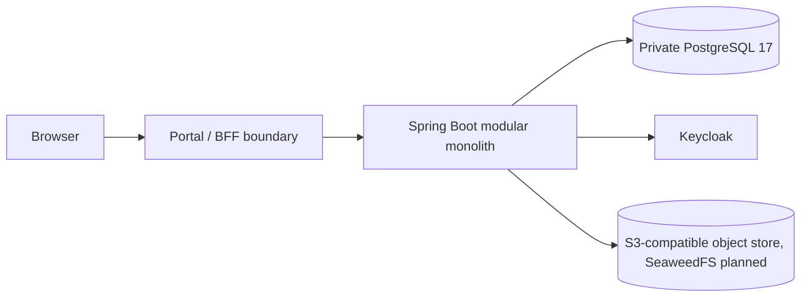

<!--
SPDX-FileCopyrightText: 2026 TRICORE contributors

SPDX-License-Identifier: Apache-2.0
-->

# Selected MVP deployment topology

**Status:** TARGET - not a verified deployed or integrated environment

The Java 21 / Spring Boot backend remains a modular monolith with four logical Core capabilities: Identity, Workflow, Data Management and API Gateway. Core owns domain, engine and ports; Infrastructure owns PostgreSQL, OIDC and object-storage adapters. Process boundaries do not redefine ownership.

The selected target uses private PostgreSQL 17, an S3-compatible object store for object content, and Keycloak. MinIO was dropped on 2026-11-05; SeaweedFS (S3 API) is the planned replacement (container v0.2.0 / R32b; adapter v0.3.0 / R43 - planned milestones), its ADR is pending and no adapter is implemented. AWS S3 deployment is not selected. Supabase Storage and filesystem-only storage are outside the new implementation scope. The diagram does not prove integrated runtime behavior.

See [ADR-007](../08-decisions/ADR-007-data-storage.md) and [deployment prerequisites](../06-deployment/prerequisites.md).
