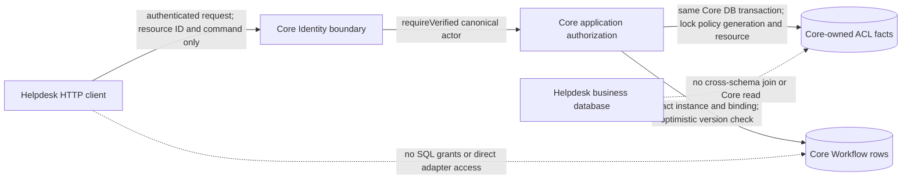

<!-- SPDX-FileCopyrightText: 2026 TRICORE contributors -->
<!-- SPDX-License-Identifier: Apache-2.0 -->

# R27 Stage 2C: authoritative Workflow authorization boundary

> **Record status (09/11/2026):** governed by [ADR-010](../08-decisions/ADR-010-core-helpdesk-service-boundary.md) (D3, D5, D8). The classes named below exist only in uncommitted local work, not on `main`. Later local work added an uncommitted `CoreOwnedWorkflowAclPort` implementation and an authorized-transition adapter. These await G0 review (planned ADR-015) and do not change the BLOCKED verdict below. Statements in the body, such as "`CoreOwnedWorkflowAclPort` has no implementation", describe the historical Stage 2C state. After review on PR #159, the wording for design A was changed from "selected" to "proposed", and the lock order now refers to ADR-010. No approval is implied.

**Status: target model and unbound contracts only. No protected Workflow HTTP route is registered.**
The source baseline is `187dbd2ea6935966f5c4cceb95ad9c3c53708a2e` plus the uncommitted Stage 1/2A/2B worktree. This document does not authorize a migration or a role grant.

## Current ownership and proposed ownership

| Fact | Current source and enforcement | Target owner / database | Trust rule |
| --- | --- | --- | --- |
| Verified actor and token roles | Backend `SpringSecurityCurrentPrincipal.requireVerified()` reads Spring's authenticated JWT; `WorkflowGatewayPrincipalGate` checks operation authority | Core Identity adapter, verified at Core ingress | Never accept actor, tenant or forwarded identity headers as proof. Token role is not resource permission. |
| Resource identity, lifecycle and owner | `HelpdeskService.snapshot()` reads `resource_registry` in the legacy Helpdesk schema | Core-owned resource registry in Core database | Exact persisted resource binding; no client-owned alias or owner flag. |
| Tenant membership | `HelpdeskService.snapshot()` reads `tenant_memberships` | Core-owned effective membership for Workflow authorization | Revocation must serialize with writes. Helpdesk can remain source for its own business membership, but its copy is not an authorization grant in Core. |
| Explicit operation grants | `HelpdeskService.snapshot()` reads `resource_acl` | Core-owned effective grants | Owner status alone cannot authorize an operation. |
| Active definition binding | `HelpdeskService.bindings()` reads `workflow_definition_bindings` | Core-owned binding | Exact definition ID and version required for CREATE. |
| Workflow definition, instance and history | `PostgresWorkflowPersistence` reads/writes Workflow tables | Core Workflow database and role | Authorization and mutation must use one Core transaction and one revocation order. |
| Ticket, assignee and business lifecycle | `HelpdeskService` and Helpdesk SQL | Helpdesk database and role | Core must not query or encode these concepts. |

These proposed Core-owned ACL tables and role grants do not yet exist. The current Helpdesk code keeps all rows in a local disposable database and locks the tenant before reading ACL facts and mutating Workflow rows. That local transaction cannot be stretched across two HTTP services.

## Trust boundary and data flow

The proposed provisioning path is a separate authenticated Core command from an authorized service principal. It must validate the requested resource, membership and binding and commit a new Core policy generation. Ordinary Workflow requests cannot provision their own grants. No provisioning endpoint is implemented here. Grants and revokes driven by Helpdesk assignment would use this same command path with `PENDING_SYNCHRONIZATION` until Core acknowledges them (ADR-010, review A3). This is PROPOSED and requires G0.

## Designs considered

| Design | Consistency guarantee if fully implemented | Cost and limitation | Decision |
| --- | --- | --- | --- |
| **A. Core owns effective ACL facts** | Serialize grant/revoke and Workflow writes on a Core-owned policy generation/resource lock; read facts and mutate Workflow in one transaction. A revocation committed first denies the later operation. A write committed first may complete before revocation. | Requires new Core schema, roles, provisioning/revocation protocol and transaction refactor. Helpdesk's business membership and Core's effective grant may temporarily differ until the Core command succeeds; never report revocation complete before Core confirms it. | **Proposed target — pending ADR-010 acceptance and G0 review.** Not implemented. |
| **B. Helpdesk owns ACL and returns decisions/signed snapshots** | A plain check has no immediate-revocation guarantee. A lease/fencing protocol could defer revocation until outstanding Core operations complete. | Network partitions, clock skew, lease expiry and unknown commit outcomes require a distributed protocol and tests. A version checked over HTTP before commit still has a race. | Not proposed for immediate revocation without a proven lease/fence protocol. |

The proposed rule is commit-order linearization **within Core's database only**. Helpdesk cannot claim its own membership edit immediately revokes Core access. It must send the revocation command to Core and await a durable Core acknowledgment. If acknowledgment is lost, the revocation outcome is unknown and must be reconciled before reporting success. Any delay before that acknowledgment is an explicit authorization lag, not an invisible grace period.

## Failure modes and required outcomes

| Condition | Required behavior | Unverified implementation work |
| --- | --- | --- |
| Missing, invalid or forged actor/header | 401; only the Core JWT verifier may establish actor identity. | Move/wire trusted `CurrentPrincipal` at Core ingress and run authenticated HTTP negatives. |
| Missing, stale or mismatched policy facts | Fail closed as `AUTHORIZATION_UNAVAILABLE` (503), never ALLOWED. A request cannot choose the minimum policy generation. | Core-owned generation read and serialization; no cache-as-authority. |
| Revoked membership or inactive resource | Hidden 404 after the Core revocation commits; resource existence is not disclosed. | Revoke/write race tests on two database connections. |
| Visible resource without exact grant | 403 after visibility is established. Scope/role alone is insufficient. | Exact grant and definition-binding tests. |
| Concurrent transition or stale expected version | 409 `VERSION_CONFLICT`; no partial instance/history update. | Execute authenticated HTTP and PostgreSQL race tests. |
| Activation version/replay | 409 on stale version or already activated snapshot. | Add `expectedVersion` to activation path; current runtime lacks it. |
| Retry after confirmed rejection | Client may resubmit only under the API's explicit idempotency policy; a new check is required. | Design request key retention and conflict semantics. |
| Lost response after COMMIT | 503 `COMMIT_OUTCOME_UNKNOWN`; no blind retry. Authorize an authoritative read and reconcile by instance ID/history or a durable idempotency record. | Implement and test lost-commit-response recovery. |
| ACL service/database timeout or inconsistent snapshot | 503, no Workflow mutation. | Failure injection and rollback proof. |

`WorkflowAuthorizationFacts` is an immutable, actor/resource-scoped value with fail-closed checks. Constructing it does **not** prove the facts came from Core storage. `CoreOwnedWorkflowAclPort` has no implementation and cannot authorize writes by itself. The existing `WorkflowAuthorization` and `TenantResourceWorkflowAccessPolicy` remain unchanged for legacy Helpdesk tests; they are not wired into the new Core HTTP process. `CurrentPrincipal.requireVerified()` remains the required ingress boundary. No token role, DTO value or self-constructed principal can replace it.

## Transaction and service contract required before route activation

1. Core must lock the effective policy generation/resource and load the exact instance and definition through its own database role, in a single transaction with the write. The authorization decision must be computed from those locked facts. The current `WorkflowRuntime`/`PostgresWorkflowPersistence` methods start their own transactions and therefore cannot be called after a detached ACL check as if it were atomic. GRANT, REVOKE, CREATE, ACTIVATE, TRANSITION and READ/HISTORY all follow the single proposed lock order in [ADR-010](../08-decisions/ADR-010-core-helpdesk-service-boundary.md#proposed-shared-lock-order-and-consistency-model-adr-010-addition-review-r2): policy generation, then exact facts, then instance, then history. READ/HISTORY consistency semantics remain subject to G0 review.
2. Core must compare the client `expectedVersion` with the authoritative instance for activation and transition. CREATE needs an exact active definition binding and duplicate-instance protection. READ and history need current ACL checks; their independent reads do not form a common snapshot.
3. Helpdesk may send authenticated commands, but it must not receive Core-table grants, use `PostgresWorkflowPersistence`, send an actor header as proof, or query Core schema. Core must not query Helpdesk schema. Cross-schema SQL, foreign keys and joins are prohibited.
4. The existing Flyway V1–V4 bytes and checksums remain pinned. New schema/role work requires separately reviewed migrations and live privilege evidence; none is performed in Stage 2C.

## Acceptance tests still required

- Authenticated Core HTTP: valid actor with exact grant/binding; absent or forged bearer/header; wrong actor/resource; revoked member; hidden versus visible denied resource; stale policy generation.
- Two-connection PostgreSQL races: grant/revoke against CREATE/ACTIVATE/TRANSITION/READ, stale version, duplicate ID, rollback, and lost commit response. Verify no partial history mutation and role isolation. These tests must also cover the T08 list in ADR-010 (shared lock order, stale policy generation, lock timeout/deadlock failing closed, deterministic commit order). T08 is NOT RUN.
- Architecture: Helpdesk consumer cannot import Core JDBC classes or gain Core-table SQL privileges. Current `HelpdeskService` directly uses `PostgresWorkflowPersistence`, so a blanket rule would fail today; this remains a migration blocker, not an exception to be silently approved.
- Existing backend Identity, authorization, negative, Workflow persistence and architecture tests must continue to pass. Environment-gated PostgreSQL tests are not evidence of a pass when skipped.

**Stage 2C verdict: BLOCKED for HTTP authorization and two-service separation.** The contract/value tests verify only local fail-closed behavior, not fact provenance, transaction ordering, rights to schema changes, or authenticated HTTP behavior.
