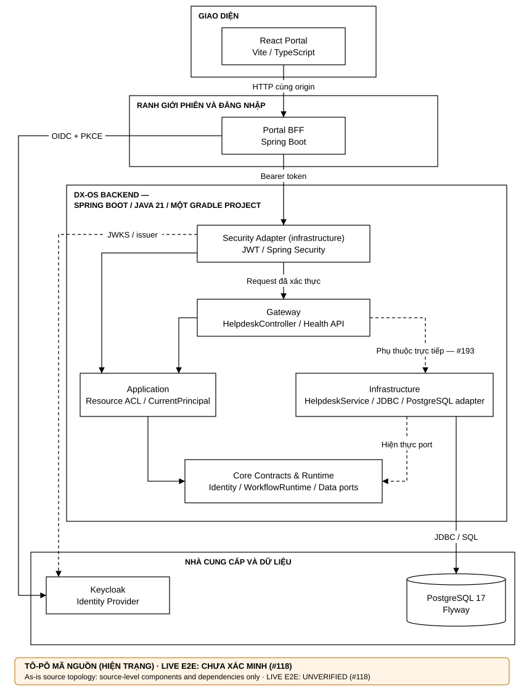
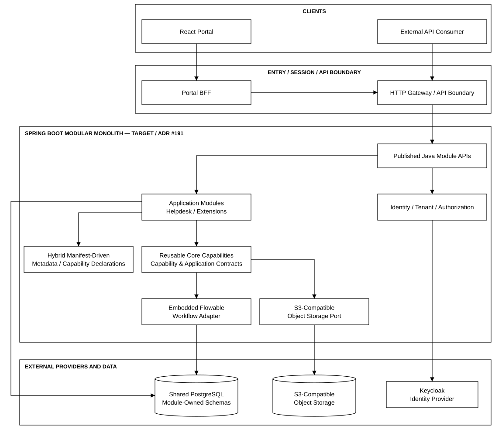

<!--

SPDX-FileCopyrightText: 2026 TRICORE contributors

SPDX-License-Identifier: Apache-2.0

-->

# OpenTrix architecture

[Documentation index](README.md) · [Development](DEVELOPMENT.md) · [Deployment](DEPLOYMENT.md) · [API](API.md)

> **Ngôn ngữ / Language:** [Tiếng Việt](#kiến-trúc-opentrix--tiếng-việt) · [English](#opentrix-architecture--english)

> **Trạng thái tài liệu / Document status:** DRAFT · **Cập nhật / Updated:** 2026-11-11 · **Hiện trạng tại / As-is at:** `5938d8e`

> **Bằng chứng / Evidence:** [`09-evidence/phase-2/block-a-architecture.md`](09-evidence/phase-2/block-a-architecture.md) · **Kiến trúc mục tiêu / Target architecture:** #191

---

## Kiến trúc OpenTrix — Tiếng Việt

OpenTrix là nền tảng DX-OS Open-Core cung cấp các năng lực dùng chung (Identity, Workflow, Data) cho ứng dụng dịch vụ nội bộ, với ứng dụng minh họa là IT Helpdesk. Mục 1–5 mô tả **hiện trạng đã có trong mã nguồn**; mục 6 mô tả **kiến trúc mục tiêu nhóm đã chọn, chờ ADR #191**.

### 1. Tô-pô hệ thống (hiện trạng)

Mũi tên mô tả luồng giao tiếp và quan hệ phụ thuộc ở mức kiến trúc; đường nét đứt đánh dấu quan hệ đặc biệt: hiện thực port hoặc phụ thuộc cần sửa. Luồng React → BFF → Backend → PostgreSQL với Keycloak thật **chưa có bằng chứng end-to-end** (#118).

### 2. Ranh giới năng lực

| Năng lực | Hiện trạng đã có | Chưa có (Issue) |

| --- | --- | --- |

| **Backend** | Một ứng dụng Spring Boot (`DxosApplication`), một project Gradle; package `gateway`, `application`, `core`, `infrastructure`. | Chuẩn hóa module và Java API công khai theo Modular Monolith (#191). |

| **Identity** | OAuth2 Resource Server; kiểm tra JWT theo issuer, thời hạn, audience, subject, loại token; principal chuẩn từ issuer + subject. Portal BFF: OIDC, PKCE, session, CSRF, chuyển tiếp token. | E2E với Keycloak thật (#118); tenant và migration quyền (#191). |

| **Phân quyền** | Quyền kỹ thuật ở gateway (`WorkflowGatewayPrincipalGate`, `workflow:*`); quyền tài nguyên/tenant ở application (`WorkflowAuthorization`, `TenantResourceWorkflowAccessPolicy`). | — |

| **Workflow** | Engine tự viết `WorkflowRuntime` qua `WorkflowPersistencePort`, lưu PostgreSQL. | Embedded Flowable (#191); API workflow tổng quát chưa đăng ký production (#115). |

| **Gateway** | Ranh giới HTTP do Spring Security trong backend. | Năng lực API Gateway chuyên dụng (#116). |

| **Dữ liệu có cấu trúc** | PostgreSQL 17, migration Flyway. | Schema theo module và database role (#191). |

| **Dữ liệu phi cấu trúc** | Hợp đồng `ObjectStoragePort` và contract test (fake in-memory). | Adapter production qua S3-compatible API (#181, #192). |

| **Cách ly module** | ArchUnit `CoreDependencyRulesTest`: Core không phụ thuộc Application/Infrastructure/JDBC; Identity, Workflow, Data không phụ thuộc chéo; có negative canary. | Luật cho Application/Gateway (#90); tách `HelpdeskService` khỏi infrastructure (#193). |

| **Hợp đồng API** | Helpdesk 9 thao tác tại `/api/v1/mvp/requests`; `GET /api/v1/health`. | Đặc tả OpenAPI (#112); Capability/Application Contract (#191). |

| **Ứng dụng** | IT Helpdesk (Golden Path). | Facility — hoãn sau hạn nộp (P3). |

### 3. Phân định trách nhiệm dữ liệu

- **PostgreSQL (backend sở hữu):** trạng thái workflow (`PostgresWorkflowPersistence`) và dữ liệu Helpdesk; schema quản lý bằng Flyway. Hiện dùng chung một schema, chưa tách theo module.

- **Lưu trữ đối tượng:** mới có hợp đồng `ObjectStoragePort`; chưa có nhà cung cấp chạy thật. ADR-007 (MinIO) đang được thay thế (#181).

- **Keycloak:** quản lý danh tính người dùng; backend không lưu mật khẩu.

### 4. Chuỗi tương tác chính (hiện trạng)

#### A. Xác thực và phân quyền

1\. Người dùng mở React Portal; Portal gọi Portal BFF cùng origin.

2\. Portal BFF thực hiện đăng nhập OIDC với PKCE tới Keycloak và giữ session phía máy chủ; CSRF được bật.

3\. BFF chuyển tiếp yêu cầu tới backend kèm Bearer token.

4\. Backend xác minh JWT (issuer, thời hạn, audience, subject, loại token) và tạo principal chuẩn từ issuer + subject; không tin header `user`, `role`, `tenant` do client gửi.

5\. Gateway kiểm tra quyền kỹ thuật; application kiểm tra quyền tài nguyên và tenant trước khi thực thi.

#### B. Vòng đời yêu cầu Helpdesk

1\. Helpdesk chỉ bật khi `dxos.helpdesk.enabled=true`; ở chế độ ứng viên yêu cầu PostgreSQL disposable trên loopback.

2\. Client gọi các thao tác tại `/api/v1/mvp/requests`: tạo, liệt kê, xem chi tiết, xem lịch sử, phân loại (`/triage`), giao việc (`/assign`), bắt đầu (`/start`), hoàn tất (`/resolve`), xác nhận (`/confirm`).

3\. Mỗi chuyển trạng thái đi qua `WorkflowRuntime`; trạng thái và lịch sử lưu PostgreSQL.

4\. Hiện nghiệp vụ và JDBC nằm chung trong `HelpdeskService` (infrastructure); việc tách use case theo dõi ở #193.

### 5. Bảo mật và phân lập

- **Xác minh token:** issuer, thời hạn, audience, subject và loại token đều được kiểm tra.

- **Định danh:** principal chuẩn từ OIDC issuer + subject; không tin header danh tính từ client.

- **Hai lớp phân quyền:** token hợp lệ không đồng nghĩa có quyền với tài nguyên; quyền kỹ thuật ở gateway không thay thế quyền tài nguyên/tenant ở application.

- **Phiên trình duyệt:** BFF giữ session, bật CSRF; token không lộ ra trình duyệt.

- **Cách ly Core:** ArchUnit chặn Core phụ thuộc framework và các tầng ngoài.

- **Giới hạn hiện tại:** chưa có API Gateway (#116), chưa có bằng chứng E2E trình duyệt (#118), API workflow tổng quát cố ý chưa mở (#115).

- **Phát hành và bản quyền:** tài liệu kiến trúc không chứng minh quyền phân phối mã nguồn hay việc chấp nhận phát hành (#138, #190).

### 6. Kiến trúc mục tiêu — đã chọn, chờ ADR #191

Tám lựa chọn dưới đây do nhóm chốt ngày 2026-11-11. Chưa có ADR được merge và **chưa triển khai**; chỉ ghi nhận là chấp nhận chính thức sau khi #191 merge.

| Ranh giới           | Lựa chọn của nhóm                                                                                             | Cần làm rõ khi viết ADR / contract                                                 |
| ------------------- | ------------------------------------------------------------------------------------------------------------- | ---------------------------------------------------------------------------------- |
| Backend             | Spring Boot Modular Monolith                                                                                  | Cấu trúc package/module và deployment thực tế                                      |
| Core / Application  | Core cung cấp năng lực dùng chung; ứng dụng chứa chính sách nghiệp vụ                                         | Danh mục capability và quy tắc phụ thuộc cụ thể                                    |
| Application         | **Hybrid Manifest-Driven:** manifest khai báo metadata/capabilities; **Java module** thực thi nghiệp vụ       | Schema manifest, validation, versioning và discovery/loading                       |
| Workflow            | **Embedded Flowable**                                                                                         | BPMN definitions, adapter, migration, transaction, engine schema                   |
| Module API          | **Published Java interfaces**                                                                                 | Danh sách interfaces được công bố và quy tắc compatibility                         |
| Module isolation    | **Strict Module API + ArchUnit**                                                                              | Các ArchUnit rules thực tế và CI result                                            |
| Dual contract       | **Capability Contract + Application Contract**                                                                | Schema/format, ownership, versioning và mapping ra HTTP/OpenAPI                    |
| Contract governance | **Documentation + CI**                                                                                        | Check cụ thể: contract diff, link check, tests, breaking-change gate               |
| Dữ liệu             | **Shared PostgreSQL, Module-Owned Schemas**; truy cập giới hạn bởi **database roles** và **module contracts** | Grant, migration theo module, kiểm thử từ chối cross-schema; nơi lưu bảng Flowable |
| Identity            | **Keycloak** quản lý identity; **backend** quản lý tenant/resource authorization; có permission migration     | Cấu trúc tenant, kế thừa quyền, cơ chế migration                                   |
| Lưu trữ             | **S3-compatible API** qua storage port/adapter                                                                | Nhà cung cấp, bucket layout, encryption, retention, ACL (#181, #192)               |

**Hai loại hợp đồng:**

- **Capability Contract:** mô tả năng lực dùng chung mà Core cung cấp và các bảo đảm/điều kiện sử dụng của năng lực đó.

- **Application Contract:** mô tả hành vi nghiệp vụ mà ứng dụng công bố và cách ứng dụng tiêu thụ capability.

- Dual Contract không có nghĩa là Java API + HTTP API. **Capability-driven** không có nghĩa manifest được phép thực thi code tùy ý.

**Luồng mục tiêu (tóm tắt):**

- **Helpdesk với Flowable embedded:** client gọi Application Contract của Helpdesk → backend xác minh principal, tenant/resource ACL → Helpdesk gọi published Workflow Capability API → adapter điều khiển Flowable embedded; business guards không mặc nhiên chuyển hết vào BPMN.

- **Hybrid manifest-driven application:** module cung cấp manifest → hệ thống kiểm tra theo schema/version → resolve capability qua published Java Module API → Java application module xử lý nghiệp vụ.

- **Lưu trữ S3:** kiểm tra principal và tenant/resource ACL → gọi storage port → adapter thực hiện thao tác S3-compatible; object key và business reference theo ownership contract.

**Tài liệu liên quan:** [ADR](08-decisions/) · [Bằng chứng kiểm kê](09-evidence/phase-2/) · #191 · #193 · #90

---

## OpenTrix architecture — English

OpenTrix is a DX-OS Open-Core platform providing shared capabilities (Identity, Workflow, Data) for internal service applications, with IT Helpdesk as the demonstration application. Sections 1–5 describe **what exists in source today**; section 6 describes **the target architecture chosen by the team, pending ADR #191**.

### 1. System topology (as-is)

See the as-is diagram in the Vietnamese section. Key boundaries:

- **Client to session:** React Portal calls Portal BFF on the same origin; the BFF performs OIDC login with PKCE against Keycloak and keeps a server-side session with CSRF.

- **Session to backend:** the BFF relays requests to the backend with a Bearer token.

- **Backend:** one Spring Boot application (Java 21, one Gradle project) with `gateway`, `application`, `core` and `infrastructure` packages; data in PostgreSQL 17 with Flyway.

- Arrows represent architecture-level communication and dependencies. Dashed arrows mark special relations: port implementation or the dependency to be fixed (#193).

- The full React → BFF → Backend → PostgreSQL path with a real Keycloak has **no end-to-end evidence yet** (#118).

### 2. Capability boundaries

| Capability | Delivered | Not delivered (issue) |

| --- | --- | --- |

| **Backend** | One Spring Boot application (`DxosApplication`), one Gradle project; `gateway`, `application`, `core`, `infrastructure` packages. | Modules and published Java APIs per the Modular Monolith target (#191). |

| **Identity** | OAuth2 Resource Server; JWT validated for issuer, expiry, audience, subject, token type; canonical principal from issuer + subject. Portal BFF: OIDC, PKCE, session, CSRF, token relay. | E2E with a real Keycloak (#118); tenant model and permission migration (#191). |

| **Authorization** | Technical authorities at the gateway (`WorkflowGatewayPrincipalGate`, `workflow:*`); resource/tenant authorization in application (`WorkflowAuthorization`, `TenantResourceWorkflowAccessPolicy`). | — |

| **Workflow** | In-house `WorkflowRuntime` through `WorkflowPersistencePort`, persisted in PostgreSQL. | Embedded Flowable (#191); generic workflow API not registered in production (#115). |

| **Gateway** | HTTP boundary handled by Spring Security in the backend. | Dedicated API Gateway capability (#116). |

| **Structured data** | PostgreSQL 17 with Flyway migrations. | Module-owned schemas and database roles (#191). |

| **Unstructured data** | `ObjectStoragePort` contract and contract tests (in-memory fake). | Production adapter via an S3-compatible API (#181, #192). |

| **Module isolation** | ArchUnit `CoreDependencyRulesTest`: Core has no dependency on Application/Infrastructure/JDBC; Identity, Workflow and Data stay independent; includes a negative canary. | Rules for Application/Gateway (#90); move `HelpdeskService` out of infrastructure (#193). |

| **API contracts** | Helpdesk's 9 operations at `/api/v1/mvp/requests`; `GET /api/v1/health`. | OpenAPI specification (#112); Capability/Application Contracts (#191). |

| **Applications** | IT Helpdesk (Golden Path). | Facility — deferred past the deadline (P3). |

### 3. Data ownership

- **PostgreSQL (backend-owned):** workflow state (`PostgresWorkflowPersistence`) and Helpdesk data, with Flyway-managed schema. A single shared schema today; not yet split per module.

- **Object storage:** only the `ObjectStoragePort` contract exists; no running provider. ADR-007 (MinIO) is being superseded (#181).

- **Keycloak:** owns user identity; the backend stores no passwords.

### 4. Key execution flows (as-is)

#### A. Authentication and authorization

1\. The user opens React Portal, which calls Portal BFF on the same origin.

2\. Portal BFF performs OIDC login with PKCE against Keycloak and keeps a server-side session; CSRF is enforced.

3\. The BFF relays requests to the backend with a Bearer token.

4\. The backend validates the JWT (issuer, expiry, audience, subject, token type) and builds the canonical principal from issuer + subject; client-supplied `user`, `role` or `tenant` headers are never trusted.

5\. The gateway checks technical authorities; the application checks resource and tenant authorization before executing.

#### B. Helpdesk request lifecycle

1\. Helpdesk is enabled only when `dxos.helpdesk.enabled=true`; candidate mode requires a disposable PostgreSQL on loopback.

2\. Clients call the operations at `/api/v1/mvp/requests`: create, list, detail, history, triage (`/triage`), assign (`/assign`), start (`/start`), resolve (`/resolve`), confirm (`/confirm`).

3\. Each state transition goes through `WorkflowRuntime`; state and history are stored in PostgreSQL.

4\. Business logic and JDBC currently share `HelpdeskService` (infrastructure); extracting the use case is tracked in #193.

### 5. Security and isolation

- **Token validation:** issuer, expiry, audience, subject and token type are all checked.

- **Identity:** canonical principal from OIDC issuer + subject; client identity headers are not trusted.

- **Two authorization layers:** a valid token does not grant access to a resource; gateway technical authorities never replace application resource/tenant checks.

- **Browser session:** the BFF holds the session with CSRF; tokens are not exposed to the browser.

- **Core isolation:** ArchUnit blocks Core from depending on frameworks or outer layers.

- **Current limits:** no API Gateway yet (#116), no browser E2E evidence (#118), generic workflow API intentionally closed (#115).

- **Release and rights:** architecture documentation does not prove distribution rights or release acceptance (#138, #190).

### 6. Target architecture — chosen, pending ADR #191

These eight selections were confirmed by the team on 2026-11-11. No ADR has been merged and they are **not implemented**; they become formally accepted only after #191 is merged. The target diagram is in the Vietnamese section; its arrows show dependency/concept flow, not working connections.

| Boundary | Team selection | To be specified in the ADR / contracts |

| --- | --- | --- |

| Backend | Spring Boot Modular Monolith | Package/module layout and actual deployment |

| Core / Application | Reusable capabilities vs. business policies | Capability catalogue and concrete dependency rules |

| Application | **Hybrid Manifest-Driven:** manifest declares metadata/capabilities; **Java modules** execute business logic | Manifest schema, validation, versioning, discovery/loading |

| Workflow | **Embedded Flowable** | BPMN definitions, adapter, migration, transactions, engine schema |

| Module API | **Published Java interfaces** | Exported interface inventory and compatibility rules |

| Module isolation | **Strict Module API + ArchUnit** | Actual ArchUnit rules and CI results |

| Dual contracts | **Capability Contract + Application Contract** | Schema/format, ownership, versioning, HTTP/OpenAPI mapping |

| Contract governance | **Documentation + CI** | Concrete checks: contract diff, link check, tests, breaking-change gate |

| Data | **Shared PostgreSQL, Module-Owned Schemas**; access limited by **database roles** and **module contracts** | Grants, per-module migrations, negative cross-schema tests; where Flowable tables live |

| Identity | **Keycloak** owns identity; **backend** owns tenant/resource authorization; permission migration | Tenant structure, permission inheritance, migration mechanics |

| Storage | **S3-compatible API** through a storage port/adapter | Provider, bucket layout, encryption, retention, ACL (#181, #192) |

**Two contract types:**

- **Capability Contract:** a reusable capability provided by Core, with its guarantees and conditions of use.

- **Application Contract:** the business behaviour an application publishes and how it consumes capabilities.

- Dual contracts do not mean Java API versus HTTP API. **Capability-driven** does not mean a manifest may execute arbitrary code.

**Target flows (summary):**

- **Helpdesk with embedded Flowable:** the client invokes the Helpdesk Application Contract → backend validates principal and tenant/resource ACL → Helpdesk calls the published Workflow Capability API → the adapter drives embedded Flowable; business guards are not moved wholesale into BPMN.

- **Hybrid manifest-driven application:** a module supplies a manifest → validated against its schema/version → capabilities resolved through published Java Module APIs → the Java application module executes business logic.

- **S3 storage:** principal and tenant/resource ACL checks → storage port → adapter performs S3-compatible operations; object keys and business references follow the ownership contract.

**Related:** [ADRs](08-decisions/) · [Audit evidence](09-evidence/phase-2/) · #191 · #193 · #90
