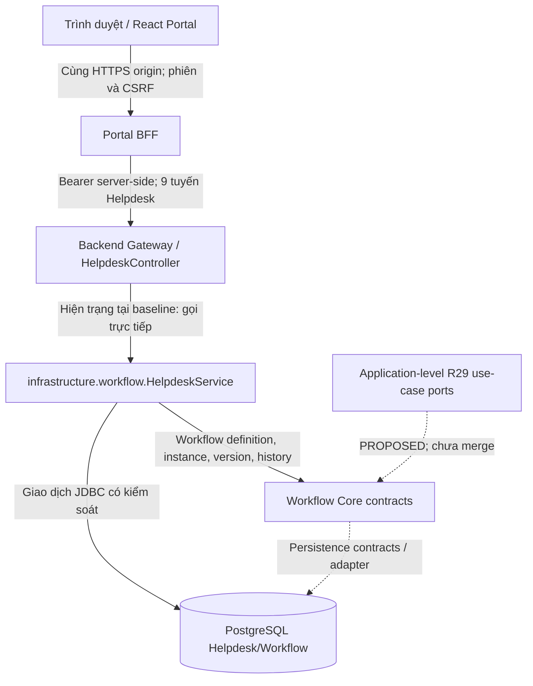

<!--
SPDX-FileCopyrightText: 2026 TRICORE contributors
SPDX-License-Identifier: Apache-2.0
-->

# Tích hợp / Integration

> **Owner / Phụ trách:** @ngang02012007-crypto · **Documentation issue:** [#194](https://github.com/tricore-opentrix/opentrix/issues/194) · **Priority:** P1 (đủ dùng / usable draft) · **Status:** DOCUMENTATION DRAFT — REVIEW REQUIRED.  
> **Audited source baseline:** [`832c75fc3164cf170eed3bb8f1e380d24dd65aba`](https://github.com/tricore-opentrix/opentrix/commit/832c75fc3164cf170eed3bb8f1e380d24dd65aba), consistent with the local `API.md` and `TESTING.md` drafts supplied for this documentation set. Later source changes must be checked separately.  
> **Evidence convention:** `SOURCE-CONFIRMED` = inspected source/declared tests; `HISTORICAL` = source-specific previous observation; `UNVERIFIED` = no same-baseline runtime evidence; `PROPOSED` = not accepted runtime. No application tests, Keycloak login, HTTP request, database provision, or browser E2E was executed while drafting this page.

## Tiếng Việt

### A. Hiện trạng — bằng chứng Giai đoạn 2

Các mục 1–5 dưới đây mô tả mã nguồn đã quan sát và giới hạn nghiệm thu tại baseline; đối chiếu [Khối C Giai đoạn 2](09-evidence/phase-2/block-c-application.md). Các bảng `PROPOSED` được hiểu là mục tiêu, không phải runtime.

### 1. Mô hình tích hợp với Core

OpenTrix là **modular monolith** Java 21/Spring Boot, không phải tập hợp các microservice đã triển khai độc lập. Các lớp `core`, `application`, `gateway`, `infrastructure` biểu thị ranh giới trách nhiệm; **không** chứng minh rằng mọi lời gọi đã được tách thành các dịch vụ độc lập. Portal React và Portal BFF là thành phần tích hợp riêng. [README dự án](../README.md) và [ranh giới Core/Application](01-architecture/core-application-boundary.md) là tài liệu định hướng; mã nguồn/runtime có giá trị xác nhận hiện trạng.



- **Frontend/Portal:** chế độ mặc định là MOCK; `integration-local` có entry point riêng, không tự động bật LIVE. [frontend/src/main.tsx](../frontend/src/main.tsx), [LocalHelpdeskIntegration.tsx](../frontend/src/features/helpdesk/LocalHelpdeskIntegration.tsx).
- **Browser–BFF:** ứng dụng local dùng HTTPS cùng origin, gọi `GET /bff/session`, giữ CSRF trong bộ nhớ, không đưa OAuth bearer token vào JavaScript/browser storage. [sameOriginTransport.ts](../frontend/src/services/mvp/http/sameOriginTransport.ts), [BFF runbook](../portal-bff/README.md).
- **BFF–Backend:** BFF chỉ chuyển tiếp chín tuyến Helpdesk được cho phép, sử dụng bearer từ phiên server, không tin `actorId` hoặc identity header do trình duyệt tự cung cấp. Backend vẫn kiểm tra JWT, authority, tenant/resource ACL và nghiệp vụ. [PortalBackendClient.java](../portal-bff/src/main/java/com/tricore/dxos/portal/PortalBackendClient.java), [HelpdeskController.java](../backend/src/main/java/com/tricore/dxos/gateway/helpdesk/HelpdeskController.java).
- **Application/Core:** hiện trạng HelpdeskController gọi trực tiếp `infrastructure.workflow.HelpdeskService`; package `application.helpdesk` mới là placeholder. Hợp đồng typed use case R29 trong [PR #145](https://github.com/tricore-opentrix/opentrix/pull/145) đã **đóng, chưa merge**; không nhận đó là handler hiện hành.
- **Persist/Workflow:** việc ghi dữ liệu nghiệp vụ, Workflow và history được ràng buộc bởi transactional/authorization checks của hiện trạng Helpdesk. Đây **không** phải bằng chứng về transaction hai dịch vụ độc lập hoặc R29 reconciliation đã triển khai. [HelpdeskService.java](../backend/src/main/java/com/tricore/dxos/infrastructure/workflow/HelpdeskService.java), [Block C](09-evidence/phase-2/block-c-application.md).

### 2. Hợp đồng Core và các ranh giới

| Ranh giới | Hiện trạng có thể xác nhận | Không được suy diễn |
| --- | --- | --- |
| Identity | Backend dùng JWT issuer/audience/subject/authority chính xác; BFF dùng OAuth Authorization Code + PKCE, server session và CSRF. | MOCK login, BFF session hay header trình duyệt tự chứng minh quyền Core. |
| Gateway | `HelpdeskController` đăng ký có điều kiện với `dxos.helpdesk.enabled=true`; validate các DTO. | Generic Workflow controller mở công khai; `/api/v1/requests/*` cũ còn hoạt động. |
| Workflow | Định nghĩa `it-helpdesk@1`, state/version/history và kiểm `expectedVersion`. | Người gọi được tự đặt transition tùy ý hay bypass authorization. |
| Assignment | `expectedAssignmentVersion` độc lập với Workflow `expectedVersion`; Assign không làm tăng Workflow version. | Đồng nhất hai counter; dùng status UI làm bằng chứng cấp quyền. |
| Data | Helpdesk/Workflow có mã JDBC và test PostgreSQL có điều kiện kích hoạt. | Full-stack LIVE hoặc provider storage/Facility đã nghiệm thu. |
| Error/recovery | Backend phân biệt 401/403/hidden 404/409/503; BFF không tự retry POST khi có `COMMIT_OUTCOME_UNKNOWN`. | Thấy 502/503 là chắc chắn thao tác chưa commit, rồi gửi lại POST. |

**Nguyên tắc phân quyền:** Token thật và vai trò kỹ thuật chỉ là một phần; còn cần membership tenant đang hoạt động, quyền trên tài nguyên, vai trò nghiệp vụ và trạng thái/version phù hợp. Resource ẩn và không tồn tại phải giữ tính chống dò tìm qua scoped 404 khi contract áp dụng. Thao tác ghi bị từ chối không được làm thay đổi trạng thái/historical facts. Tham chiếu [API.md](API.md), [SecurityConfig.java](../backend/src/main/java/com/tricore/dxos/infrastructure/identity/security/SecurityConfig.java), [HelpdeskService.java](../backend/src/main/java/com/tricore/dxos/infrastructure/workflow/HelpdeskService.java).

**Ranh giới thiết kế tương lai:** R27 Core/Helpdesk split, R28 Core ACL, hợp đồng R29 durable intent/idempotency, lost-ACK recovery và R33 Portal-BFF candidate phải được duyệt riêng. Không đưa các thiết kế này vào danh mục `IMPLEMENTED` chỉ vì có tài liệu/PR lịch sử. [PR #145](https://github.com/tricore-opentrix/opentrix/pull/145), [PR #156](https://github.com/tricore-opentrix/opentrix/pull/156), [Issue #118](https://github.com/tricore-opentrix/opentrix/issues/118).

### 3. Ví dụ: IT Helpdesk

**Các tuyến hiện hành** có prefix Backend `/api/v1/mvp/requests`, tương ứng qua BFF là `/bff/api/v1/mvp/requests`. Có **9** tuyến: Create (POST collection), List (GET collection), Detail (GET `/{id}`), History (GET `/{id}/history`), và năm POST hành động Triage, Assign, Start, Resolve, Confirm. Tuyến chỉ được đăng ký khi cấu hình Helpdesk opt-in thỏa điều kiện; không suy ra server đang chạy. [HelpdeskController.java](../backend/src/main/java/com/tricore/dxos/gateway/helpdesk/HelpdeskController.java), [R31 API crosswalk](verification/r31/r31-helpdesk-api-crosswalk.md).

| Use case | Actor theo chính sách nghiệp vụ | Payload/chuyển trạng thái | Version/history |
| --- | --- | --- | --- |
| **Create** | Submitter/Requester được xác thực và thuộc tenant | `title`, `description`, `requestType="IT_HELPDESK"`; tạo `SUBMITTED` | Workflow `version=0`; assignment `0` |
| **Triage** | Coordinator có quyền TRANSITION/READ | `expectedVersion`; `SUBMITTED → TRIAGED` | Workflow +1, history `triage` |
| **Assign/Reassign** | Coordinator, assignee worker hợp lệ cùng tenant | `assigneeId`, `expectedAssignmentVersion`; ở `TRIAGED` | Assignment +1; Workflow **không** tăng, history **không** thêm transition |
| **Start** | Worker đang được giao và đủ quyền | `expectedVersion`; `TRIAGED → IN_PROGRESS` | Workflow +1, history `start_work` |
| **Resolve** | Worker đang được giao và đủ quyền | `expectedVersion`, `resolution`; `IN_PROGRESS → RESOLVED` | Workflow +1, history `resolve` |
| **Confirm** | Requester ban đầu đủ điều kiện | `expectedVersion`; `RESOLVED → CONFIRMED` | Workflow +1, history `confirm`; kết thúc |

**Golden Path:** Create → Triage → Assign → Start → Resolve → Confirm. Kết thúc `CONFIRMED`, Workflow version **4**, bốn bản ghi chuyển trạng thái; không có HTTP `/close` hoặc trạng thái `CLOSED` của luồng này. Việc gán người xử lý không tương đương chuyển trạng thái. `allowedActions` là gợi ý cho người dùng, **không** thay cho ủy quyền của Backend. Đọc [definition.sql](../backend/src/main/resources/db/helpdesk/definition.sql) và [HelpdeskHttpPostgresTest.java](../backend/src/test/java/com/tricore/dxos/infrastructure/workflow/HelpdeskHttpPostgresTest.java).

Ví dụ minh họa **không phải kết quả đã thực thi**:

```json
{"title":"Yêu cầu hỗ trợ máy in (MOCK example)","description":"Không in được tại phòng học; dữ liệu tổng hợp.","requestType":"IT_HELPDESK"}
```

Backend POST thành công trả `201` và `RequestView`; BFF chuyển tiếp theo chính sách riêng và không đảm bảo chuyển tiếp `Location` header từ Backend. Dùng ID do server trả về để đọc lại bản ghi; không tự đặt requester ID, tenant hoặc role trong payload. Ví dụ này không đại diện cho phép thử LIVE. Xem [API.md](API.md) để biết DTO, API errors và sự khác biệt Backend/BFF.

### 4. Luồng tích hợp và hướng dẫn chạy an toàn

```mermaid
sequenceDiagram
    participant U as Browser/Portal
    participant B as Portal BFF
    participant A as Backend Helpdesk API
    participant W as HelpdeskService / Workflow
    participant D as PostgreSQL
    U->>B: GET /bff/session (HTTPS, same origin)
    B-->>U: authenticated + csrfToken (hoặc anonymous)
    U->>B: POST /bff/api/v1/mvp/requests + X-CSRF-TOKEN
    B->>A: POST /api/v1/mvp/requests + server-side Bearer
    A->>W: Kiểm JWT/authority, business/tenant/resource
    W->>D: Transaction request + workflow + ACL
    D-->>W: Commit outcome
    W-->>A: RequestView
    A-->>B: 201 JSON (Backend Location không bảo đảm được chuyển tiếp)
    B-->>U: 201 JSON
    Note over U,D: Sơ đồ contract nguồn; KHÔNG phải bằng chứng chạy E2E thực tế
```

**Chế độ và bằng chứng cần tách biệt:**

| Chế độ | Cách chọn/điều kiện | Chứng minh được điều gì |
| --- | --- | --- |
| `MOCK` | `frontend`: `npm.cmd run dev` với cấu hình mặc định; URL mẫu `http://127.0.0.1:5173`. | Giao diện và dữ liệu minh họa; **không** chứng minh Backend, DB hay quyền thật. |
| `integration-local` bundle | `frontend`: `npm.cmd run build:integration-local`; cần BFF/Backend/Keycloak/PostgreSQL/Caddy được cấu hình riêng. | Chỉ chứng minh bundle build nếu có log PASS; build **không** khởi động stack. |
| Local guarded Backend | Theo [Helpdesk local runbook](../scripts/README-helpdesk-local.md) với PostgreSQL disposable, exact issuer/subject, runtime login và loopback guard. | Có thể kiểm chứng Backend/DB khi thực sự chạy test; fixture không thay thế LIVE browser. |
| Authenticated browser E2E | Browser HTTPS tin CA, ba người dùng Keycloak thật, phiên BFF, Backend và DB riêng đã cấu hình. | Chỉ là **VERIFIED** khi thu đủ bằng chứng sáu bước, negative cases, reload/restart, SHA và environment. |

**Không khởi động dịch vụ bằng cách thay URL/port tùy tiện.** Issuer `localhost:8180` và `127.0.0.1:8182` là hai giá trị khác nhau, không dùng token của môi trường này để xác thực môi trường kia. Chạy các bước tạo DB/role chỉ khi sở hữu fixture disposable. Không in hoặc commit token, secret, cookie hay dữ liệu định danh thật. Hướng dẫn cấu hình: [BFF runbook](../portal-bff/README.md), [Helpdesk runbook](../scripts/README-helpdesk-local.md), [DEVELOPMENT.md](DEVELOPMENT.md).

**Kiểm chứng luồng chính và ngoại lệ:**

1. Ghim exact commit SHA, build mode và bằng chứng sở hữu database thử nghiệm.
2. Xác nhận đăng nhập real provider và BFF session/CSRF trên HTTPS trước khi gọi Helpdesk.
3. Requester tạo yêu cầu mới; Coordinator Triage và Assign đúng worker đủ điều kiện; Worker Start rồi Resolve; Requester Confirm.
4. Đọc detail/history: `CONFIRMED`, version 4, bốn history transitions; kiểm assignment version độc lập. Reload và restart Backend trên **cùng** fixture, không setup lại.
5. Kiểm các trường hợp âm tính: 401 chưa xác thực/phiên hết hạn; 403 sai quyền hoặc CSRF; scoped 404 tài nguyên ẩn/không tồn tại; 409 stale workflow/assignment; kiểm rollback và không đổi history.
6. Mất phản hồi POST có thể là `COMMIT_OUTCOME_UNKNOWN`: **không** POST lại tự động; dùng GET detail/history có quyền để đối chiếu kết quả trước khi quyết định khôi phục.
7. Lưu đầu ra đã khử bí mật, test counts gồm skips, environment, SHA, command và file evidence. Không coi build xanh hoặc test giả lập là LIVE PASS.

Chi tiết lệnh chạy test, điều kiện bỏ qua và cảnh báo fixture: [TESTING.md](TESTING.md). Nguồn kiểm kê [Block C](09-evidence/phase-2/block-c-application.md) tại cùng baseline ghi nhận browser E2E cần bằng chứng bổ sung.

### 5. Giới hạn hiện tại, trạng thái và truy vết

| ID | Phát biểu có thể đưa vào tài liệu | Phạm vi bằng chứng | Trạng thái / Điều kiện tiếp theo |
| --- | --- | --- | --- |
| INT-01 | React Portal có MOCK và `integration-local` tách biệt | [main.tsx](../frontend/src/main.tsx), [LocalHelpdeskIntegration.tsx](../frontend/src/features/helpdesk/LocalHelpdeskIntegration.tsx) | `SOURCE-CONFIRMED`; browser LIVE `UNVERIFIED` |
| INT-02 | BFF có session/PKCE/CSRF và forwarding có giới hạn | [PortalSecurity.java](../portal-bff/src/main/java/com/tricore/dxos/portal/PortalSecurity.java), [PortalBackendClient.java](../portal-bff/src/main/java/com/tricore/dxos/portal/PortalBackendClient.java) | `SOURCE-CONFIRMED`; real callback/refresh/logout `UNVERIFIED` |
| INT-03 | Backend khai báo chín Helpdesk route guarded | [HelpdeskController.java](../backend/src/main/java/com/tricore/dxos/gateway/helpdesk/HelpdeskController.java), [HelpdeskConfiguration.java](../backend/src/main/java/com/tricore/dxos/infrastructure/workflow/HelpdeskConfiguration.java) | `SOURCE-CONFIRMED`; runtime registration tùy cấu hình |
| INT-04 | Workflow Golden Path và kiểm version có mã/test | [HelpdeskService.java](../backend/src/main/java/com/tricore/dxos/infrastructure/workflow/HelpdeskService.java), [HelpdeskHttpPostgresTest.java](../backend/src/test/java/com/tricore/dxos/infrastructure/workflow/HelpdeskHttpPostgresTest.java) | `SOURCE-CONFIRMED`; DB test execution at baseline `UNVERIFIED` |
| INT-05 | Generic Workflow controller không được công bố như production route | [WorkflowHttpExposureTest.java](../backend/src/test/java/com/tricore/dxos/gateway/workflow/controller/WorkflowHttpExposureTest.java), [API.md](API.md) | `SOURCE-CONFIRMED` code/config; no public adapter claim |
| INT-06 | R29 typed commands, R33 wiring là ứng viên lịch sử | [PR #145](https://github.com/tricore-opentrix/opentrix/pull/145), [PR #156](https://github.com/tricore-opentrix/opentrix/pull/156) | `HISTORICAL`, closed/unmerged; integration `BLOCKED` |
| INT-07 | Full Browser→Keycloak→BFF→Backend→PostgreSQL Golden Path | [Issue #118](https://github.com/tricore-opentrix/opentrix/issues/118), [Block C](09-evidence/phase-2/block-c-application.md) | `UNVERIFIED` at audited baseline; need reproducible proof |
| INT-08 | Reuse Facility / MinIO / APISIX / Node-RED | [README dự án](../README.md) | `PROPOSED`/not release-accepted; do not advertise as LIVE |

**Pending review / Cần xác nhận:**

- **Yến (API/Identity/Application):** xác nhận phân quyền từng actor, route/error parity với OpenAPI runtime tại SHA cụ thể ([#112](https://github.com/tricore-opentrix/opentrix/issues/112)), boundary R29 và đồng bộ Core ACL; không dùng PR cũ thay kết quả duyệt mới.
- **Bảo (BFF/Architecture/CI):** kiểm đường đi BFF/gateway, mode `integration-local`, CI per-suite pass/skip, HTTPS/Keycloak và thiết kế tách dịch vụ trong tương lai.
- **Ánh (Portal/Application):** đối chiếu frontend với `API.md`/`TESTING.md`, thực hiện và lưu evidence MOCK khác LIVE, bảo đảm source links cùng SHA, cập nhật tài liệu khi code đổi.

**Không được tự công bố:** end-to-end authenticated LIVE, production-grade fault recovery, idempotency ledger, R29 handlers đã merge, object storage provider hoặc Facility workflow đã chạy. Tài liệu này không thay thế kiểm thử acceptance hay xác nhận phát hành.

### B. Mục tiêu — PROPOSED, chưa nghiệm thu

- **PROPOSED · [#112](https://github.com/tricore-opentrix/opentrix/issues/112):** xuất và kiểm chứng OpenAPI Helpdesk runtime, để các ví dụ tích hợp bám đúng contract hiện hành; chưa có OpenAPI chính thức được nghiệm thu.
- **PROPOSED · [#118](https://github.com/tricore-opentrix/opentrix/issues/118):** browser E2E với Keycloak thật, ba principal, BFF, Backend và PostgreSQL ở SHA cụ thể; đối chiếu negative cases và persistence.
- **PROPOSED · [#166](https://github.com/tricore-opentrix/opentrix/issues/166):** chốt Core–Helpdesk split, R29 intent/reconciliation với reviewer; không sử dụng PR #145 đã đóng như code merge.
- **PROPOSED · [#194](https://github.com/tricore-opentrix/opentrix/issues/194):** giữ tài liệu đồng nhất với API/TESTING/README, kiểm tra liên kết và hoàn tất review chéo.

## English

### A. Current state — Phase 2 source evidence

Sections 1–5 document observed code and its verification boundaries at the pinned baseline, cross-referenced against [Phase 2 Block C](09-evidence/phase-2/block-c-application.md). Future-state components remain PROPOSED, not merged runtime.

### 1. Integration model with Core

OpenTrix is a **Java/Spring Boot modular monolith** with logical Core, Application, Gateway and Infrastructure boundaries; it does not imply separately deployed backend microservices. The React Portal and Portal BFF are integration components. Source-confirmed local integration is distinct from an accepted browser-to-database LIVE journey.

The default React mode presents MOCK data. The `integration-local` entry point uses a same-origin, HTTPS-only transport, bootstraps `/bff/session` and retains only CSRF in browser memory. The BFF owns the OAuth Authorization Code + PKCE session, forwards an allowed set of nine Helpdesk routes using its server-side bearer, and leaves final JWT, tenant, ACL and business authorization to Backend. At the audited baseline, `HelpdeskController` calls `infrastructure.workflow.HelpdeskService` directly; the proposed `application.helpdesk` use-case layer has not replaced it. See [main.tsx](../frontend/src/main.tsx), [sameOriginTransport.ts](../frontend/src/services/mvp/http/sameOriginTransport.ts), [HelpdeskController.java](../backend/src/main/java/com/tricore/dxos/gateway/helpdesk/HelpdeskController.java), and [Block C](09-evidence/phase-2/block-c-application.md).

### 2. Core contracts

Identity requires actual JWT signature/issuer/audience/subject/technical authority validation and active tenant membership plus business/resource eligibility. Gateway validates fixed Helpdesk DTOs; the generic Workflow HTTP adapter is **not a production endpoint**. Workflow owns definition/state/version/history mechanisms; Helpdesk owns the business lifecycle and assignment rules. Assignment uses `expectedAssignmentVersion` independently of Workflow's `expectedVersion`. Current transaction behavior in the modular monolith does not prove the proposed distributed intent/reconciliation contract. See [API.md](API.md), [HelpdeskService.java](../backend/src/main/java/com/tricore/dxos/infrastructure/workflow/HelpdeskService.java), and [R31](verification/r31/r31-helpdesk-api-crosswalk.md).

### 3. Example: IT Helpdesk

The guarded Backend base is `/api/v1/mvp/requests`; browser BFF base is `/bff/api/v1/mvp/requests`. There are nine routes: collection **POST/GET**, detail **GET**, history **GET**, and five **POST** actions (`triage`, `assign`, `start`, `resolve`, `confirm`). The business Golden Path is **Create → Triage → Assign → Start → Resolve → Confirm**, moving through `SUBMITTED → TRIAGED → IN_PROGRESS → RESOLVED → CONFIRMED`. Assign/reassign remains in `TRIAGED` and advances only `assignmentVersion`; the terminal Workflow version is **4**, with four transition history entries. There is **no** Helpdesk `/close` route. See the detailed Vietnamese table above and [definition.sql](../backend/src/main/resources/db/helpdesk/definition.sql).

### 4. Integration flow

1. Use a trusted local HTTPS origin; browser gets the server session and CSRF via `GET /bff/session`.
2. Browser calls the BFF's allowlisted route, with `X-CSRF-TOKEN` for writes; BFF forwards a server-held bearer to the private Backend.
3. Backend enforces authentication, authority, tenant/resource visibility, applicable business role, state and version. It commits guarded business/Workflow effects and returns `RequestView`.
4. Verify against real isolated identities and an exclusively owned disposable PostgreSQL fixture before claiming end-to-end behavior. A MOCK UI, fake fetch, build, health response or CI green result is **not** full-stack acceptance.
5. On unknown write outcomes, **do not automatically replay POST**. Reconcile through authorized detail/history reads. Preserve scoped 404 and version-conflict behavior.

For commands, fixture prerequisites, test skips and evidence capture, use [DEVELOPMENT.md](DEVELOPMENT.md), [TESTING.md](TESTING.md), [BFF runbook](../portal-bff/README.md) and [Helpdesk runbook](../scripts/README-helpdesk-local.md). Do not run database fixtures against shared environments.

### 5. Current limitations

- `SOURCE-CONFIRMED`: the two frontend modes, BFF security/transport, nine guarded Backend Helpdesk routes and source-level Workflow/Helpdesk tests.
- `HISTORICAL`: PRs [#145](https://github.com/tricore-opentrix/opentrix/pull/145) and [#156](https://github.com/tricore-opentrix/opentrix/pull/156) are closed/unmerged candidates, not merged runtime evidence.
- `UNVERIFIED`: same-SHA, three-principal real Keycloak browser E2E with BFF/Backend/PostgreSQL and full negative/restart evidence; exact suite-level execution/skip counts for the audited baseline.
- `PROPOSED`: future separate Core/Helpdesk transaction/intent/reconciliation contracts and Facility/storage/gateway automation targets. These must not be presented as production capabilities.

**Review owners:** Yến — API/authorization/contracts and runtime OpenAPI parity; Bảo — BFF/architecture/CI; Ánh — Portal/application mapping, evidence, relative links and user-facing claim integrity. A document review is not permission to announce LIVE or release acceptance.

### B. Target — PROPOSED, not yet accepted

- **PROPOSED · [#112](https://github.com/tricore-opentrix/opentrix/issues/112):** export and review the runtime OpenAPI specification; the current source-derived crosswalk is not a verified public Swagger contract.
- **PROPOSED · [#118](https://github.com/tricore-opentrix/opentrix/issues/118):** run and capture the three-principal real-provider browser-to-database acceptance at an exact SHA.
- **PROPOSED · [#166](https://github.com/tricore-opentrix/opentrix/issues/166):** independently review future Core/Helpdesk service boundaries and reconciliation before implementation claims.
- **PROPOSED · [#194](https://github.com/tricore-opentrix/opentrix/issues/194):** maintain canonical documentation navigation, source traceability and review records.

## References / Nguồn và truy vết

- [Root README](../README.md), [docs index](README.md), [API.md](API.md), [TESTING.md](TESTING.md), [DEVELOPMENT.md](DEVELOPMENT.md).
- [Frontend entry point](../frontend/src/main.tsx), [integration composition](../frontend/src/features/helpdesk/LocalHelpdeskIntegration.tsx), [same-origin transport](../frontend/src/services/mvp/http/sameOriginTransport.ts).
- [Portal BFF runbook](../portal-bff/README.md), [PortalBackendClient](../portal-bff/src/main/java/com/tricore/dxos/portal/PortalBackendClient.java), [PortalSecurity](../portal-bff/src/main/java/com/tricore/dxos/portal/PortalSecurity.java).
- [HelpdeskController](../backend/src/main/java/com/tricore/dxos/gateway/helpdesk/HelpdeskController.java), [HelpdeskService](../backend/src/main/java/com/tricore/dxos/infrastructure/workflow/HelpdeskService.java), [Helpdesk definition](../backend/src/main/resources/db/helpdesk/definition.sql).
- [R31 crosswalk](verification/r31/r31-helpdesk-api-crosswalk.md), [Phase 2 Block C](09-evidence/phase-2/block-c-application.md), [Issue #118](https://github.com/tricore-opentrix/opentrix/issues/118), [PR #145](https://github.com/tricore-opentrix/opentrix/pull/145), [PR #156](https://github.com/tricore-opentrix/opentrix/pull/156).

**Publication gate:** Before PR, verify `docs/API.md`, `docs/TESTING.md`, and `docs/DEVELOPMENT.md` are present on the target branch; the supplied API/TESTING drafts themselves require review for correct relative paths when placed in `docs/`. A link to a planned file is not evidence that the file is merged. Recheck source at the proposed PR HEAD, run Markdown/link checks if available, and report checks actually executed rather than invented PASS.
