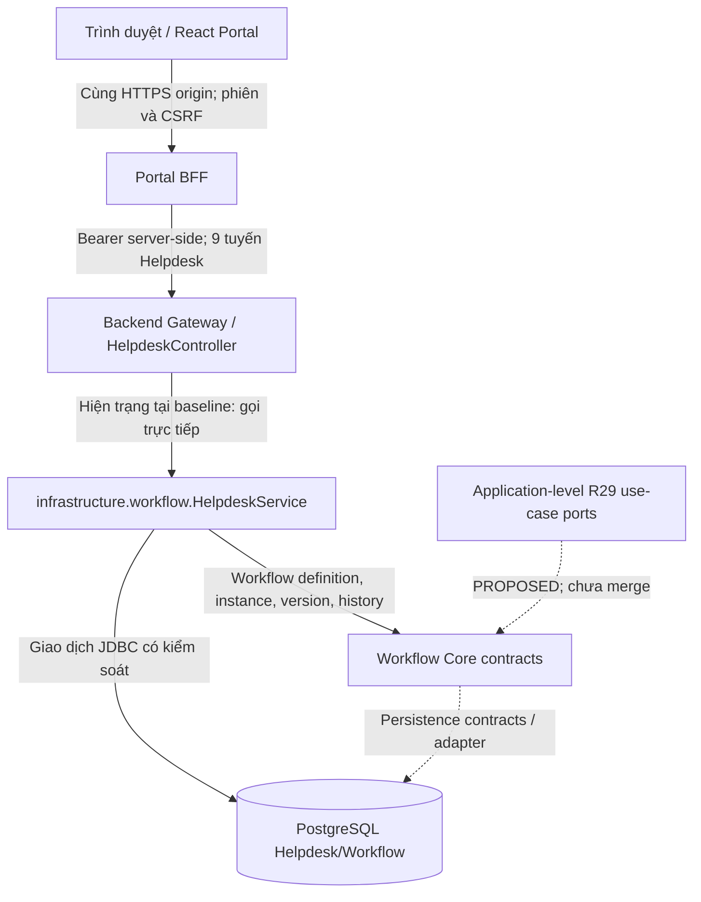
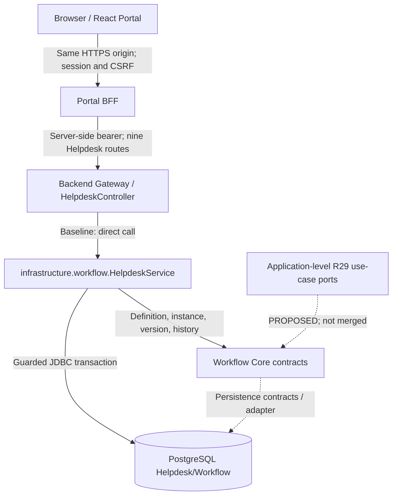
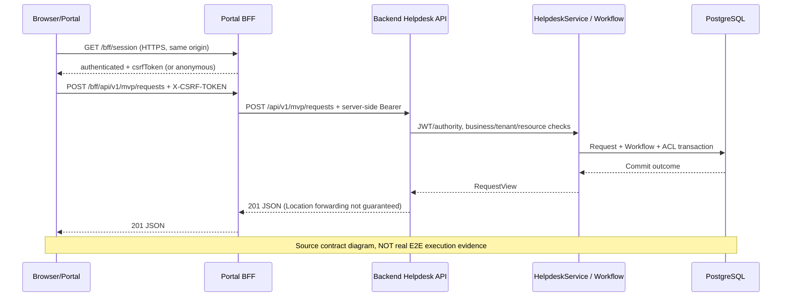

<!--
SPDX-FileCopyrightText: 2026 TRICORE contributors
SPDX-License-Identifier: Apache-2.0
-->

# Tích hợp / Integration

[Docs](README.md) · [Architecture](ARCHITECTURE.md) · [API](API.md) · [Testing](TESTING.md) · [Integration](INTEGRATION.md)

[Tiếng Việt](#vi) · [English](#en)

> **Owner / Phụ trách:** @ngang02012007-crypto · **Issue:** [#196](https://github.com/tricore-opentrix/opentrix/issues/196), [#194](https://github.com/tricore-opentrix/opentrix/issues/194) · **Status / Trạng thái:** DRAFT — REVIEW REQUIRED / BẢN NHÁP — CHỜ REVIEW.
>
> **Source baseline / Mốc source:** [832c75fc3164cf170eed3bb8f1e380d24dd65aba](https://github.com/tricore-opentrix/opentrix/commit/832c75fc3164cf170eed3bb8f1e380d24dd65aba). **Phase 2 evidence / Bằng chứng kiểm kê:** [5938d8e7cb117aa6bc8226ace1d786be2f7be703](https://github.com/tricore-opentrix/opentrix/commit/5938d8e7cb117aa6bc8226ace1d786be2f7be703). Các mốc khác nhau được giữ riêng; tài liệu không xác nhận runtime mới. / These revisions remain distinct; documentation is not new runtime acceptance.

<a id="vi"></a>

## Tiếng Việt

### A. Hiện trạng — bằng chứng Giai đoạn 2

Các mục 1–5 dưới đây mô tả mã nguồn đã quan sát và giới hạn nghiệm thu tại baseline; đối chiếu [Khối C Giai đoạn 2](09-evidence/phase-2/block-c-application.md). Các bảng `PROPOSED` được hiểu là mục tiêu, không phải runtime.

### 1. Mô hình tích hợp với Core

OpenTrix là **modular monolith** Java 21/Spring Boot, không phải tập hợp các microservice đã triển khai độc lập. Các lớp `core`, `application`, `gateway`, `infrastructure` biểu thị ranh giới trách nhiệm; **không** chứng minh rằng mọi lời gọi đã được tách thành các dịch vụ độc lập. Portal React và Portal BFF là thành phần tích hợp riêng. [README dự án](../README.md) và [ranh giới Core/Application](01-architecture/core-application-boundary.md) là tài liệu định hướng; mã nguồn/runtime có giá trị xác nhận hiện trạng.



- **Frontend/Portal:** chế độ mặc định là MOCK; `integration-local` có entry point riêng, không tự động bật LIVE. [frontend/src/main.tsx](https://github.com/tricore-opentrix/opentrix/blob/832c75fc3164cf170eed3bb8f1e380d24dd65aba/frontend/src/main.tsx), [LocalHelpdeskIntegration.tsx](https://github.com/tricore-opentrix/opentrix/blob/832c75fc3164cf170eed3bb8f1e380d24dd65aba/frontend/src/features/helpdesk/LocalHelpdeskIntegration.tsx).
- **Browser–BFF:** ứng dụng local dùng HTTPS cùng origin, gọi `GET /bff/session`, giữ CSRF trong bộ nhớ, không đưa OAuth bearer token vào JavaScript/browser storage. [sameOriginTransport.ts](https://github.com/tricore-opentrix/opentrix/blob/832c75fc3164cf170eed3bb8f1e380d24dd65aba/frontend/src/services/mvp/http/sameOriginTransport.ts), [BFF runbook](../portal-bff/README.md).
- **BFF–Backend:** BFF chỉ chuyển tiếp chín tuyến Helpdesk được cho phép, sử dụng bearer từ phiên server, không tin `actorId` hoặc identity header do trình duyệt tự cung cấp. Backend vẫn kiểm tra JWT, authority, tenant/resource ACL và nghiệp vụ. [PortalBackendClient.java](https://github.com/tricore-opentrix/opentrix/blob/832c75fc3164cf170eed3bb8f1e380d24dd65aba/portal-bff/src/main/java/com/tricore/dxos/portal/PortalBackendClient.java), [HelpdeskController.java](https://github.com/tricore-opentrix/opentrix/blob/832c75fc3164cf170eed3bb8f1e380d24dd65aba/backend/src/main/java/com/tricore/dxos/gateway/helpdesk/HelpdeskController.java).
- **Application/Core:** hiện trạng HelpdeskController gọi trực tiếp `infrastructure.workflow.HelpdeskService`; package `application.helpdesk` mới là placeholder. Hợp đồng typed use case R29 trong [PR #145](https://github.com/tricore-opentrix/opentrix/pull/145) đã **đóng, chưa merge**; không nhận đó là handler hiện hành.
- **Persist/Workflow:** việc ghi dữ liệu nghiệp vụ, Workflow và history được ràng buộc bởi transactional/authorization checks của hiện trạng Helpdesk. Đây **không** phải bằng chứng về transaction hai dịch vụ độc lập hoặc R29 reconciliation đã triển khai. [HelpdeskService.java](https://github.com/tricore-opentrix/opentrix/blob/832c75fc3164cf170eed3bb8f1e380d24dd65aba/backend/src/main/java/com/tricore/dxos/infrastructure/workflow/HelpdeskService.java), [Block C](09-evidence/phase-2/block-c-application.md).

### 2. Hợp đồng Core và các ranh giới

| Ranh giới | Hiện trạng có thể xác nhận | Không được suy diễn |
| --- | --- | --- |
| Identity | Backend dùng JWT issuer/audience/subject/authority chính xác; BFF dùng OAuth Authorization Code + PKCE, server session và CSRF. | MOCK login, BFF session hay header trình duyệt tự chứng minh quyền Core. |
| Gateway | `HelpdeskController` đăng ký có điều kiện với `dxos.helpdesk.enabled=true`; validate các DTO. | Generic Workflow controller mở công khai; `/api/v1/requests/*` cũ còn hoạt động. |
| Workflow | Định nghĩa `it-helpdesk@1`, state/version/history và kiểm `expectedVersion`. | Người gọi được tự đặt transition tùy ý hay bypass authorization. |
| Assignment | `expectedAssignmentVersion` độc lập với Workflow `expectedVersion`; Assign không làm tăng Workflow version. | Đồng nhất hai counter; dùng status UI làm bằng chứng cấp quyền. |
| Data | Helpdesk/Workflow có mã JDBC và test PostgreSQL có điều kiện kích hoạt. | Full-stack LIVE hoặc provider storage/Facility đã nghiệm thu. |
| Error/recovery | Backend phân biệt 401/403/hidden 404/409/503; BFF không tự retry POST khi có `COMMIT_OUTCOME_UNKNOWN`. | Thấy 502/503 là chắc chắn thao tác chưa commit, rồi gửi lại POST. |

**Nguyên tắc phân quyền:** Token thật và vai trò kỹ thuật chỉ là một phần; còn cần membership tenant đang hoạt động, quyền trên tài nguyên, vai trò nghiệp vụ và trạng thái/version phù hợp. Resource ẩn và không tồn tại phải giữ tính chống dò tìm qua scoped 404 khi contract áp dụng. Thao tác ghi bị từ chối không được làm thay đổi trạng thái/historical facts. Tham chiếu [API.md](API.md), [SecurityConfig.java](https://github.com/tricore-opentrix/opentrix/blob/832c75fc3164cf170eed3bb8f1e380d24dd65aba/backend/src/main/java/com/tricore/dxos/infrastructure/identity/security/SecurityConfig.java), [HelpdeskService.java](https://github.com/tricore-opentrix/opentrix/blob/832c75fc3164cf170eed3bb8f1e380d24dd65aba/backend/src/main/java/com/tricore/dxos/infrastructure/workflow/HelpdeskService.java).

**Ranh giới thiết kế lịch sử/chưa nghiệm thu:** R27 Core/Helpdesk split, R28 Core ACL, hợp đồng R29 durable intent/idempotency, lost-ACK recovery và R33 Portal-BFF candidate phải được duyệt riêng. Không đưa các thiết kế này vào danh mục `IMPLEMENTED` chỉ vì có tài liệu/PR lịch sử. [PR #145](https://github.com/tricore-opentrix/opentrix/pull/145), [PR #156](https://github.com/tricore-opentrix/opentrix/pull/156), [Issue #118](https://github.com/tricore-opentrix/opentrix/issues/118).

### 3. Ví dụ: IT Helpdesk

**Các tuyến hiện hành** có prefix Backend `/api/v1/mvp/requests`, tương ứng qua BFF là `/bff/api/v1/mvp/requests`. Có **9** tuyến: Create (POST collection), List (GET collection), Detail (GET `/{id}`), History (GET `/{id}/history`), và năm POST hành động Triage, Assign, Start, Resolve, Confirm. Tuyến chỉ được đăng ký khi cấu hình Helpdesk opt-in thỏa điều kiện; không suy ra server đang chạy. [HelpdeskController.java](https://github.com/tricore-opentrix/opentrix/blob/832c75fc3164cf170eed3bb8f1e380d24dd65aba/backend/src/main/java/com/tricore/dxos/gateway/helpdesk/HelpdeskController.java), [R31 API crosswalk](verification/r31/r31-helpdesk-api-crosswalk.md).

| Use case | Actor theo chính sách nghiệp vụ | Payload/chuyển trạng thái | Version/history |
| --- | --- | --- | --- |
| **Create** | Submitter/Requester được xác thực và thuộc tenant | `title`, `description`, `requestType="IT_HELPDESK"`; tạo `SUBMITTED` | Workflow `version=0`; assignment `0` |
| **Triage** | Coordinator có quyền TRANSITION/READ | `expectedVersion`; `SUBMITTED → TRIAGED` | Workflow +1, history `triage` |
| **Assign/Reassign** | Coordinator, assignee worker hợp lệ cùng tenant | `assigneeId`, `expectedAssignmentVersion`; ở `TRIAGED` | Assignment +1; Workflow **không** tăng, history **không** thêm transition |
| **Start** | Worker đang được giao và đủ quyền | `expectedVersion`; `TRIAGED → IN_PROGRESS` | Workflow +1, history `start_work` |
| **Resolve** | Worker đang được giao và đủ quyền | `expectedVersion`, `resolution`; `IN_PROGRESS → RESOLVED` | Workflow +1, history `resolve` |
| **Confirm** | Requester ban đầu đủ điều kiện | `expectedVersion`; `RESOLVED → CONFIRMED` | Workflow +1, history `confirm`; kết thúc |

**Golden Path:** Create → Triage → Assign → Start → Resolve → Confirm. Kết thúc `CONFIRMED`, Workflow version **4**, bốn bản ghi chuyển trạng thái; không có HTTP `/close` hoặc trạng thái `CLOSED` của luồng này. Việc gán người xử lý không tương đương chuyển trạng thái. `allowedActions` là gợi ý cho người dùng, **không** thay cho ủy quyền của Backend. Đọc [definition.sql](https://github.com/tricore-opentrix/opentrix/blob/832c75fc3164cf170eed3bb8f1e380d24dd65aba/backend/src/main/resources/db/helpdesk/definition.sql) và [HelpdeskHttpPostgresTest.java](https://github.com/tricore-opentrix/opentrix/blob/832c75fc3164cf170eed3bb8f1e380d24dd65aba/backend/src/test/java/com/tricore/dxos/infrastructure/workflow/HelpdeskHttpPostgresTest.java).

Ví dụ minh họa **không phải kết quả đã thực thi**:

```json
{"title":"Yêu cầu hỗ trợ máy in (MOCK example)","description":"Không in được tại phòng học; dữ liệu tổng hợp.","requestType":"IT_HELPDESK"}
```

Backend POST thành công trả `201` và `RequestView`; BFF chuyển tiếp theo chính sách riêng và không đảm bảo chuyển tiếp `Location` header từ Backend. Dùng ID do server trả về để đọc lại bản ghi; không tự đặt requester ID, tenant hoặc role trong payload. Ví dụ này không đại diện cho phép thử LIVE. Xem [API.md](API.md) để biết DTO, API errors và sự khác biệt Backend/BFF.

### 4. Luồng tích hợp và hướng dẫn chạy an toàn

```mermaid
sequenceDiagram
    participant U as Browser/Portal
    participant B as Portal BFF
    participant A as Backend Helpdesk API
    participant W as HelpdeskService / Workflow
    participant D as PostgreSQL
    U->>B: GET /bff/session (HTTPS, same origin)
    B-->>U: authenticated + csrfToken (hoặc anonymous)
    U->>B: POST /bff/api/v1/mvp/requests + X-CSRF-TOKEN
    B->>A: POST /api/v1/mvp/requests + server-side Bearer
    A->>W: Kiểm JWT/authority, business/tenant/resource
    W->>D: Transaction request + workflow + ACL
    D-->>W: Commit outcome
    W-->>A: RequestView
    A-->>B: 201 JSON (Backend Location không bảo đảm được chuyển tiếp)
    B-->>U: 201 JSON
    Note over U,D: Sơ đồ contract nguồn; KHÔNG phải bằng chứng chạy E2E thực tế
```

**Chế độ và bằng chứng cần tách biệt:**

| Chế độ | Cách chọn/điều kiện | Chứng minh được điều gì |
| --- | --- | --- |
| `MOCK` | `frontend`: `npm.cmd run dev` với cấu hình mặc định; URL mẫu `http://127.0.0.1:5173`. | Giao diện và dữ liệu minh họa; **không** chứng minh Backend, DB hay quyền thật. |
| `integration-local` bundle | `frontend`: `npm.cmd run build:integration-local`; cần BFF/Backend/Keycloak/PostgreSQL/Caddy được cấu hình riêng. | Chỉ chứng minh bundle build nếu có log PASS; build **không** khởi động stack. |
| Local guarded Backend | Theo [Helpdesk local runbook](../scripts/README-helpdesk-local.md) với PostgreSQL disposable, exact issuer/subject, runtime login và loopback guard. | Có thể kiểm chứng Backend/DB khi thực sự chạy test; fixture không thay thế LIVE browser. |
| Authenticated browser E2E | Browser HTTPS tin CA, ba người dùng Keycloak thật, phiên BFF, Backend và DB riêng đã cấu hình. | Chỉ là **VERIFIED** khi thu đủ bằng chứng sáu bước, negative cases, reload/restart, SHA và environment. |

**Không khởi động dịch vụ bằng cách thay URL/port tùy tiện.** Issuer `localhost:8180` và `127.0.0.1:8182` là hai giá trị khác nhau, không dùng token của môi trường này để xác thực môi trường kia. Chạy các bước tạo DB/role chỉ khi sở hữu fixture disposable. Không in hoặc commit token, secret, cookie hay dữ liệu định danh thật. Hướng dẫn cấu hình: [BFF runbook](../portal-bff/README.md), [Helpdesk runbook](../scripts/README-helpdesk-local.md), [DEVELOPMENT.md](DEVELOPMENT.md).

**Kiểm chứng luồng chính và ngoại lệ:**

1. Ghim exact commit SHA, build mode và bằng chứng sở hữu database thử nghiệm.
2. Xác nhận đăng nhập real provider và BFF session/CSRF trên HTTPS trước khi gọi Helpdesk.
3. Requester tạo yêu cầu mới; Coordinator Triage và Assign đúng worker đủ điều kiện; Worker Start rồi Resolve; Requester Confirm.
4. Đọc detail/history: `CONFIRMED`, version 4, bốn history transitions; kiểm assignment version độc lập. Reload và restart Backend trên **cùng** fixture, không setup lại.
5. Kiểm các trường hợp âm tính: 401 chưa xác thực/phiên hết hạn; 403 sai quyền hoặc CSRF; scoped 404 tài nguyên ẩn/không tồn tại; 409 stale workflow/assignment; kiểm rollback và không đổi history.
6. Mất phản hồi POST có thể là `COMMIT_OUTCOME_UNKNOWN`: **không** POST lại tự động; dùng GET detail/history có quyền để đối chiếu kết quả trước khi quyết định khôi phục.
7. Lưu đầu ra đã khử bí mật, test counts gồm skips, environment, SHA, command và file evidence. Không coi build xanh hoặc test giả lập là LIVE PASS.

Chi tiết lệnh chạy test, điều kiện bỏ qua và cảnh báo fixture: [TESTING.md](TESTING.md). Nguồn kiểm kê [Block C](09-evidence/phase-2/block-c-application.md) tại cùng baseline ghi nhận browser E2E cần bằng chứng bổ sung.

### 5. Giới hạn hiện tại, trạng thái và truy vết

| ID | Phát biểu có thể đưa vào tài liệu | Phạm vi bằng chứng | Trạng thái / Điều kiện tiếp theo |
| --- | --- | --- | --- |
| INT-01 | React Portal có MOCK và `integration-local` tách biệt | [main.tsx](https://github.com/tricore-opentrix/opentrix/blob/832c75fc3164cf170eed3bb8f1e380d24dd65aba/frontend/src/main.tsx), [LocalHelpdeskIntegration.tsx](https://github.com/tricore-opentrix/opentrix/blob/832c75fc3164cf170eed3bb8f1e380d24dd65aba/frontend/src/features/helpdesk/LocalHelpdeskIntegration.tsx) | `SOURCE-CONFIRMED`; browser LIVE `UNVERIFIED` |
| INT-02 | BFF có session/PKCE/CSRF và forwarding có giới hạn | [PortalSecurity.java](https://github.com/tricore-opentrix/opentrix/blob/832c75fc3164cf170eed3bb8f1e380d24dd65aba/portal-bff/src/main/java/com/tricore/dxos/portal/PortalSecurity.java), [PortalBackendClient.java](https://github.com/tricore-opentrix/opentrix/blob/832c75fc3164cf170eed3bb8f1e380d24dd65aba/portal-bff/src/main/java/com/tricore/dxos/portal/PortalBackendClient.java) | `SOURCE-CONFIRMED`; real callback/refresh/logout `UNVERIFIED` |
| INT-03 | Backend khai báo chín Helpdesk route guarded | [HelpdeskController.java](https://github.com/tricore-opentrix/opentrix/blob/832c75fc3164cf170eed3bb8f1e380d24dd65aba/backend/src/main/java/com/tricore/dxos/gateway/helpdesk/HelpdeskController.java), [HelpdeskConfiguration.java](https://github.com/tricore-opentrix/opentrix/blob/832c75fc3164cf170eed3bb8f1e380d24dd65aba/backend/src/main/java/com/tricore/dxos/infrastructure/workflow/HelpdeskConfiguration.java) | `SOURCE-CONFIRMED`; runtime registration tùy cấu hình |
| INT-04 | Workflow Golden Path và kiểm version có mã/test | [HelpdeskService.java](https://github.com/tricore-opentrix/opentrix/blob/832c75fc3164cf170eed3bb8f1e380d24dd65aba/backend/src/main/java/com/tricore/dxos/infrastructure/workflow/HelpdeskService.java), [HelpdeskHttpPostgresTest.java](https://github.com/tricore-opentrix/opentrix/blob/832c75fc3164cf170eed3bb8f1e380d24dd65aba/backend/src/test/java/com/tricore/dxos/infrastructure/workflow/HelpdeskHttpPostgresTest.java) | `SOURCE-CONFIRMED`; DB test execution at baseline `UNVERIFIED` |
| INT-05 | Generic Workflow controller không được công bố như production route | [WorkflowHttpExposureTest.java](https://github.com/tricore-opentrix/opentrix/blob/832c75fc3164cf170eed3bb8f1e380d24dd65aba/backend/src/test/java/com/tricore/dxos/gateway/workflow/controller/WorkflowHttpExposureTest.java), [API.md](API.md) | `SOURCE-CONFIRMED` code/config; no public adapter claim |
| INT-06 | R29 typed commands, R33 wiring là ứng viên lịch sử | [PR #145](https://github.com/tricore-opentrix/opentrix/pull/145), [PR #156](https://github.com/tricore-opentrix/opentrix/pull/156) | `HISTORICAL`, closed/unmerged; integration `BLOCKED` |
| INT-07 | Full Browser→Keycloak→BFF→Backend→PostgreSQL Golden Path | [Issue #118](https://github.com/tricore-opentrix/opentrix/issues/118), [Block C](09-evidence/phase-2/block-c-application.md) | `UNVERIFIED` at audited baseline; need reproducible proof |
| INT-08 | Tái sử dụng Facility / storage / APISIX / Node-RED | [README](../README.md), [#181](https://github.com/tricore-opentrix/opentrix/issues/181), [#191](https://github.com/tricore-opentrix/opentrix/issues/191) | Facility P3; MinIO là hướng lịch sử đã bị thay thế theo #181; các mục tiêu khác chưa nghiệm thu, không quảng bá LIVE |

**Pending review / Cần xác nhận:**

- **Yến (API/Identity/Application):** xác nhận phân quyền từng actor, route/error parity với OpenAPI runtime tại SHA cụ thể ([#112](https://github.com/tricore-opentrix/opentrix/issues/112)), boundary R29 và đồng bộ Core ACL; không dùng PR cũ thay kết quả duyệt mới.
- **Bảo (BFF/Architecture/CI):** kiểm đường đi BFF/gateway, mode `integration-local`, CI per-suite pass/skip, HTTPS/Keycloak và thiết kế tách dịch vụ trong tương lai.
- **Ánh (Portal/Application):** đối chiếu frontend với `API.md`/`TESTING.md`, thực hiện và lưu evidence MOCK khác LIVE, bảo đảm source links cùng SHA, cập nhật tài liệu khi code đổi.

**Không được tự công bố:** end-to-end authenticated LIVE, production-grade fault recovery, idempotency ledger, R29 handlers đã merge, object storage provider hoặc Facility workflow đã chạy. Tài liệu này không thay thế kiểm thử acceptance hay xác nhận phát hành.

### B. Mục tiêu — PROPOSED, chưa nghiệm thu

- **PROPOSED · [#112](https://github.com/tricore-opentrix/opentrix/issues/112):** xuất và kiểm chứng OpenAPI Helpdesk runtime, để các ví dụ tích hợp bám đúng contract hiện hành; chưa có OpenAPI chính thức được nghiệm thu.
- **PROPOSED · [#118](https://github.com/tricore-opentrix/opentrix/issues/118):** browser E2E với Keycloak thật, ba principal, BFF, Backend và PostgreSQL ở SHA cụ thể; đối chiếu negative cases và persistence.
- **HISTORICAL · [#166](https://github.com/tricore-opentrix/opentrix/issues/166):** ứng viên R29 đã đóng không phải kế hoạch triển khai đang được duyệt; giữ nguồn lịch sử, không dùng PR #145 thay code merge.
- **PROPOSED · [#191](https://github.com/tricore-opentrix/opentrix/issues/191), [#193](https://github.com/tricore-opentrix/opentrix/issues/193):** hướng Modular Monolith/module API và tách use case Helpdesk khỏi infrastructure cần quyết định/review riêng; không quảng bá service split lịch sử là kiến trúc đích hiện hành.
- **PROPOSED · [#194](https://github.com/tricore-opentrix/opentrix/issues/194):** giữ tài liệu đồng nhất với API/TESTING/README, kiểm tra liên kết và hoàn tất review chéo.

<a id="en"></a>

## English

### A. Current state — Phase 2 source evidence

Sections 1–5 describe inspected source and acceptance limits at the pinned baseline; compare with [Phase 2 Block C](09-evidence/phase-2/block-c-application.md). PROPOSED tables describe targets, not accepted runtime.

### 1. Integration model with Core

OpenTrix is a **Java 21/Spring Boot modular monolith**, not a set of independently deployed backend microservices. Core, Application, Gateway and Infrastructure express responsibility boundaries, not separate deployed services. React Portal and Portal BFF are separate integration components. The [project README](../README.md) and [Core/Application design](01-architecture/core-application-boundary.md) provide design context; inspected source/runtime evidence establishes current behavior.



- **Frontend/Portal:** default mode is MOCK; `integration-local` has a separate entry point and does not automatically enable LIVE. Sources: [main.tsx](https://github.com/tricore-opentrix/opentrix/blob/832c75fc3164cf170eed3bb8f1e380d24dd65aba/frontend/src/main.tsx), [LocalHelpdeskIntegration.tsx](https://github.com/tricore-opentrix/opentrix/blob/832c75fc3164cf170eed3bb8f1e380d24dd65aba/frontend/src/features/helpdesk/LocalHelpdeskIntegration.tsx).
- **Browser–BFF:** local integration uses same-origin HTTPS, calls GET /bff/session and retains only CSRF in memory, never OAuth bearer tokens in JavaScript/browser storage. Sources: [sameOriginTransport.ts](https://github.com/tricore-opentrix/opentrix/blob/832c75fc3164cf170eed3bb8f1e380d24dd65aba/frontend/src/services/mvp/http/sameOriginTransport.ts), [BFF runbook](../portal-bff/README.md).
- **BFF–Backend:** only nine allowlisted Helpdesk routes, using the server session's bearer. Browser-supplied actorId/identity headers are not trusted. Backend independently checks JWT, authorities, tenant/resource ACL and business policy. Sources: [PortalBackendClient](https://github.com/tricore-opentrix/opentrix/blob/832c75fc3164cf170eed3bb8f1e380d24dd65aba/portal-bff/src/main/java/com/tricore/dxos/portal/PortalBackendClient.java), [HelpdeskController](https://github.com/tricore-opentrix/opentrix/blob/832c75fc3164cf170eed3bb8f1e380d24dd65aba/backend/src/main/java/com/tricore/dxos/gateway/helpdesk/HelpdeskController.java).
- **Application/Core:** at the baseline, HelpdeskController calls infrastructure.workflow.HelpdeskService directly; application.helpdesk is a placeholder. R29 typed use cases in [#145](https://github.com/tricore-opentrix/opentrix/pull/145) are closed/unmerged candidates, not current handlers.
- **Persistence/Workflow:** guarded transactional/authorization checks bind current Helpdesk business, Workflow and history writes. This does not prove independently deployed service transactions or implemented R29 reconciliation. Sources: [HelpdeskService](https://github.com/tricore-opentrix/opentrix/blob/832c75fc3164cf170eed3bb8f1e380d24dd65aba/backend/src/main/java/com/tricore/dxos/infrastructure/workflow/HelpdeskService.java), [Block C](09-evidence/phase-2/block-c-application.md).

### 2. Core contracts and boundaries

| Boundary | Source-confirmed current state | Do not infer |
| --- | --- | --- |
| Identity | Backend checks exact JWT issuer/audience/subject/authority; BFF uses Authorization Code + PKCE, server session and CSRF | MOCK login, a BFF session or browser headers alone establish Core authorization |
| Gateway | HelpdeskController is conditional on dxos.helpdesk.enabled=true and validates DTOs | The generic Workflow controller is public or removed /api/v1/requests/* routes remain active |
| Workflow | it-helpdesk@1 definitions, state/version/history and expectedVersion checks | Arbitrary client transitions or authorization bypass |
| Assignment | expectedAssignmentVersion is independent of expectedVersion; Assign does not increment Workflow version | Counters are interchangeable or UI state establishes authorization |
| Data | JDBC implementation and conditionally enabled PostgreSQL tests | LIVE full-stack, production storage or Facility acceptance |
| Error/recovery | Backend distinguishes 401/403/hidden404/409/503; BFF does not retry unknown writes | A 502/503 guarantees no commit and permits replaying POST |

**Authorization:** genuine tokens and technical roles are necessary but insufficient; active tenant membership, resource grants, business eligibility and valid state/version also apply. Hidden and missing resources retain scoped-404 anti-enumeration behavior where the contract applies. Rejected writes must not change state/history. See [API](API.md), [SecurityConfig](https://github.com/tricore-opentrix/opentrix/blob/832c75fc3164cf170eed3bb8f1e380d24dd65aba/backend/src/main/java/com/tricore/dxos/infrastructure/identity/security/SecurityConfig.java), [HelpdeskService](https://github.com/tricore-opentrix/opentrix/blob/832c75fc3164cf170eed3bb8f1e380d24dd65aba/backend/src/main/java/com/tricore/dxos/infrastructure/workflow/HelpdeskService.java).

**Historical/future design boundary:** R27 Core/Helpdesk split, R28 ACL, R29 durable intent/idempotency/lost-ACK recovery and R33 Portal-BFF candidates require separate valid decisions. Historical documents/PRs do not make them IMPLEMENTED. Preserve [#145](https://github.com/tricore-opentrix/opentrix/pull/145), [#156](https://github.com/tricore-opentrix/opentrix/pull/156), [#118](https://github.com/tricore-opentrix/opentrix/issues/118) as traceable context.

### 3. Example: IT Helpdesk

Backend base: /api/v1/mvp/requests; corresponding browser base: /bff/api/v1/mvp/requests. Nine routes: POST/GET collection, GET detail, GET history and five POST actions Triage/Assign/Start/Resolve/Confirm. Guarded registration depends on Helpdesk opt-in; it does not establish a running server. Sources: [controller](https://github.com/tricore-opentrix/opentrix/blob/832c75fc3164cf170eed3bb8f1e380d24dd65aba/backend/src/main/java/com/tricore/dxos/gateway/helpdesk/HelpdeskController.java), [R31](verification/r31/r31-helpdesk-api-crosswalk.md).

| Use case | Business actor policy | Payload/state | Version/history |
| --- | --- | --- | --- |
| Create | Authenticated tenant Submitter/Requester | title, description, requestType=IT_HELPDESK; creates SUBMITTED | Workflow 0; assignment 0 |
| Triage | Coordinator with TRANSITION/READ | expectedVersion; SUBMITTED -> TRIAGED | Workflow +1; triage history |
| Assign/reassign | Coordinator; eligible active same-tenant worker | assigneeId, expectedAssignmentVersion; TRIAGED | Assignment +1; Workflow/history unchanged |
| Start | Current assigned worker with required grants | expectedVersion; TRIAGED -> IN_PROGRESS | Workflow +1; start_work history |
| Resolve | Current assigned worker with required grants | expectedVersion, resolution; IN_PROGRESS -> RESOLVED | Workflow +1; resolve history |
| Confirm | Eligible original requester | expectedVersion; RESOLVED -> CONFIRMED | Workflow +1; confirm history; terminal |

**Golden Path:** Create → Triage → Assign → Start → Resolve → Confirm. Terminal state CONFIRMED, Workflow version **4**, four transition entries. There is no /close route or CLOSED state in this flow. Assignment is not a Workflow transition. allowedActions is a UI hint, never Backend authorization. Sources: [definition](https://github.com/tricore-opentrix/opentrix/blob/832c75fc3164cf170eed3bb8f1e380d24dd65aba/backend/src/main/resources/db/helpdesk/definition.sql), [HelpdeskHttpPostgresTest](https://github.com/tricore-opentrix/opentrix/blob/832c75fc3164cf170eed3bb8f1e380d24dd65aba/backend/src/test/java/com/tricore/dxos/infrastructure/workflow/HelpdeskHttpPostgresTest.java).

Synthetic example, **not an executed result**:

```json
{"title":"Printer support request (MOCK example)","description":"Cannot print in a classroom; synthetic data.","requestType":"IT_HELPDESK"}
```

Successful Backend creation returns 201 and RequestView. The BFF applies its own forwarding policy and does not guarantee propagation of Backend Location. Read using the returned server ID; never supply requester/tenant/role fields. This example is not LIVE evidence. [API](API.md) defines DTOs, errors and Backend/BFF differences.

### 4. Integration flow and safe execution



**Separate modes and evidence:**

| Mode | Selection/prerequisites | What it establishes |
| --- | --- | --- |
| MOCK | frontend: npm.cmd run dev with defaults; example 127.0.0.1:5173 | UI/demo records, not real Backend/DB/authorization |
| integration-local bundle | frontend: npm.cmd run build:integration-local; separately configured BFF/Backend/Keycloak/PostgreSQL/Caddy | Build only when retained successful output exists; does not start stack |
| Guarded local Backend | [Helpdesk runbook](../scripts/README-helpdesk-local.md), owned disposable PG, exact issuer/subject, runtime login/loopback guard | Backend/DB behavior only when tests actually execute; fixture does not replace LIVE browser |
| Authenticated browser E2E | Browser trusts HTTPS CA, three real users, configured BFF/Backend/DB | VERIFIED only with all six steps, negatives, reload/restart, SHA/environment evidence |

Do not start services by arbitrarily replacing ports/URLs. localhost:8180 and 127.0.0.1:8182 issuers are distinct; tokens are not interchangeable. Provision DB/roles only for exclusively owned disposable fixtures. Never print/commit tokens, secrets, cookies or genuine identity data. Configuration references: [BFF](../portal-bff/README.md), [Helpdesk](../scripts/README-helpdesk-local.md), [DEVELOPMENT](DEVELOPMENT.md).

**Verify main and exceptional paths:**

1. Pin exact commit/build mode and establish disposable DB ownership.
2. Verify real-provider login and BFF session/CSRF over trusted HTTPS before Helpdesk calls.
3. Requester creates; Coordinator triages/assigns an eligible worker; assigned Worker starts/resolves; Requester confirms.
4. Read detail/history: CONFIRMED, version4, four transitions; separate assignment counter. Reload and restart Backend against the **same** fixture without repeating setup.
5. Check 401 anonymous/expired sessions, 403 insufficient rights/CSRF, scoped404 hidden/missing, 409 stale Workflow/assignment; rejected writes preserve state/history and rollback behavior.
6. Lost POST response may be COMMIT_OUTCOME_UNKNOWN. Never auto replay; reconcile via authorized detail/history before recovery decisions.
7. Retain sanitized output, test/skip counts, environment, SHA, command and evidence paths. Build green and fake tests are not LIVE PASS.

[TESTING](TESTING.md) supplies commands, gates and fixture warnings; [Block C](09-evidence/phase-2/block-c-application.md) records the remaining baseline browser-evidence gap.

### 5. Current limitations, status and traceability

| ID | Documentable claim | Evidence scope | Status/next condition |
| --- | --- | --- | --- |
| INT-01 | Separate Portal MOCK/integration-local modes | [main.tsx](https://github.com/tricore-opentrix/opentrix/blob/832c75fc3164cf170eed3bb8f1e380d24dd65aba/frontend/src/main.tsx), [LocalHelpdeskIntegration](https://github.com/tricore-opentrix/opentrix/blob/832c75fc3164cf170eed3bb8f1e380d24dd65aba/frontend/src/features/helpdesk/LocalHelpdeskIntegration.tsx) | SOURCE-CONFIRMED; LIVE browser UNVERIFIED |
| INT-02 | BFF session/PKCE/CSRF/allowlisted forwarding | [PortalSecurity](https://github.com/tricore-opentrix/opentrix/blob/832c75fc3164cf170eed3bb8f1e380d24dd65aba/portal-bff/src/main/java/com/tricore/dxos/portal/PortalSecurity.java), [PortalBackendClient](https://github.com/tricore-opentrix/opentrix/blob/832c75fc3164cf170eed3bb8f1e380d24dd65aba/portal-bff/src/main/java/com/tricore/dxos/portal/PortalBackendClient.java) | SOURCE-CONFIRMED; real callback/refresh/logout UNVERIFIED |
| INT-03 | Nine guarded Helpdesk routes declared | [HelpdeskController](https://github.com/tricore-opentrix/opentrix/blob/832c75fc3164cf170eed3bb8f1e380d24dd65aba/backend/src/main/java/com/tricore/dxos/gateway/helpdesk/HelpdeskController.java), [HelpdeskConfiguration](https://github.com/tricore-opentrix/opentrix/blob/832c75fc3164cf170eed3bb8f1e380d24dd65aba/backend/src/main/java/com/tricore/dxos/infrastructure/workflow/HelpdeskConfiguration.java) | SOURCE-CONFIRMED; runtime registration depends on configuration |
| INT-04 | Golden Path/version code and tests | [HelpdeskService](https://github.com/tricore-opentrix/opentrix/blob/832c75fc3164cf170eed3bb8f1e380d24dd65aba/backend/src/main/java/com/tricore/dxos/infrastructure/workflow/HelpdeskService.java), [HelpdeskHttpPostgresTest](https://github.com/tricore-opentrix/opentrix/blob/832c75fc3164cf170eed3bb8f1e380d24dd65aba/backend/src/test/java/com/tricore/dxos/infrastructure/workflow/HelpdeskHttpPostgresTest.java) | SOURCE-CONFIRMED; baseline DB test execution UNVERIFIED |
| INT-05 | Generic Workflow controller is not a production route | [WorkflowHttpExposureTest](https://github.com/tricore-opentrix/opentrix/blob/832c75fc3164cf170eed3bb8f1e380d24dd65aba/backend/src/test/java/com/tricore/dxos/gateway/workflow/controller/WorkflowHttpExposureTest.java), [API](API.md) | SOURCE-CONFIRMED code/config, no public-adapter claim |
| INT-06 | R29 commands/R33 wiring are historical candidates | [#145](https://github.com/tricore-opentrix/opentrix/pull/145), [#156](https://github.com/tricore-opentrix/opentrix/pull/156) | HISTORICAL, closed/unmerged; integration BLOCKED |
| INT-07 | Full Browser→Keycloak→BFF→Backend→PostgreSQL path | [#118](https://github.com/tricore-opentrix/opentrix/issues/118), [Block C](09-evidence/phase-2/block-c-application.md) | UNVERIFIED at audited baseline; reproducible proof needed |
| INT-08 | Facility reuse / storage / APISIX / Node-RED | [README](../README.md), [#181](https://github.com/tricore-opentrix/opentrix/issues/181), [#191](https://github.com/tricore-opentrix/opentrix/issues/191) | Facility P3; MinIO is superseded historical direction under #181; other targets are unaccepted, not LIVE |

**Review responsibilities:** Yến checks actor authorization, exact-SHA runtime OpenAPI parity under #112, R29 boundaries and Core ACL alignment; historical approval does not substitute for a current decision. Bảo checks BFF/gateway paths, integration-local, CI per-suite pass/skip, HTTPS/Keycloak and any separately proposed service boundary. Ánh maintains Portal/API/TESTING mapping, distinct MOCK/LIVE evidence, source-SHA traceability and documentation when code changes.

Do not independently announce authenticated LIVE E2E, production-grade recovery, idempotency ledger, merged R29 handlers, a working storage provider or Facility workflow. Document review does not replace acceptance or release clearance.

### B. Target — PROPOSED, not yet accepted

- **PROPOSED · [#112](https://github.com/tricore-opentrix/opentrix/issues/112):** export/review runtime OpenAPI and align examples; no officially accepted runtime specification yet.
- **PROPOSED · [#118](https://github.com/tricore-opentrix/opentrix/issues/118):** exact-SHA three-principal Keycloak/BFF/Backend/PostgreSQL browser evidence, negatives and persistence.
- **HISTORICAL · [#166](https://github.com/tricore-opentrix/opentrix/issues/166):** closed R29 candidate, not an active approved implementation plan; preserve history without presenting #145 as merged code.
- **PROPOSED · [#191](https://github.com/tricore-opentrix/opentrix/issues/191), [#193](https://github.com/tricore-opentrix/opentrix/issues/193):** Modular Monolith/module APIs and moving Helpdesk use cases out of infrastructure require separate decisions/review; a historical service split is not the current target.
- **PROPOSED · [#194](https://github.com/tricore-opentrix/opentrix/issues/194):** consistent canonical API/TESTING/README navigation, link checks and independent review.

## References / Nguồn và truy vết

- [Root README](../README.md), [docs index](README.md), [API.md](API.md), [TESTING.md](TESTING.md), [DEVELOPMENT.md](DEVELOPMENT.md).
- [Frontend entry point](https://github.com/tricore-opentrix/opentrix/blob/832c75fc3164cf170eed3bb8f1e380d24dd65aba/frontend/src/main.tsx), [integration composition](https://github.com/tricore-opentrix/opentrix/blob/832c75fc3164cf170eed3bb8f1e380d24dd65aba/frontend/src/features/helpdesk/LocalHelpdeskIntegration.tsx), [same-origin transport](https://github.com/tricore-opentrix/opentrix/blob/832c75fc3164cf170eed3bb8f1e380d24dd65aba/frontend/src/services/mvp/http/sameOriginTransport.ts).
- [Portal BFF runbook](../portal-bff/README.md), [PortalBackendClient](https://github.com/tricore-opentrix/opentrix/blob/832c75fc3164cf170eed3bb8f1e380d24dd65aba/portal-bff/src/main/java/com/tricore/dxos/portal/PortalBackendClient.java), [PortalSecurity](https://github.com/tricore-opentrix/opentrix/blob/832c75fc3164cf170eed3bb8f1e380d24dd65aba/portal-bff/src/main/java/com/tricore/dxos/portal/PortalSecurity.java).
- [HelpdeskController](https://github.com/tricore-opentrix/opentrix/blob/832c75fc3164cf170eed3bb8f1e380d24dd65aba/backend/src/main/java/com/tricore/dxos/gateway/helpdesk/HelpdeskController.java), [HelpdeskService](https://github.com/tricore-opentrix/opentrix/blob/832c75fc3164cf170eed3bb8f1e380d24dd65aba/backend/src/main/java/com/tricore/dxos/infrastructure/workflow/HelpdeskService.java), [Helpdesk definition](https://github.com/tricore-opentrix/opentrix/blob/832c75fc3164cf170eed3bb8f1e380d24dd65aba/backend/src/main/resources/db/helpdesk/definition.sql).
- [R31 crosswalk](verification/r31/r31-helpdesk-api-crosswalk.md), [Phase 2 Block C](09-evidence/phase-2/block-c-application.md), [Issue #118](https://github.com/tricore-opentrix/opentrix/issues/118), [PR #145](https://github.com/tricore-opentrix/opentrix/pull/145), [PR #156](https://github.com/tricore-opentrix/opentrix/pull/156).

**Điều kiện công bố / Publication gate:** Kiểm các trang canonical và link/anchor trên nhánh dự kiến công bố, đối chiếu source SHA, ghi đúng kết quả checks và independent review. / Check canonical pages and links/anchors on the publication branch, reconcile source SHA and record actual checks and independent review. A link to a planned page is not evidence that it has merged. No runtime PASS is claimed by this documentation revision.
