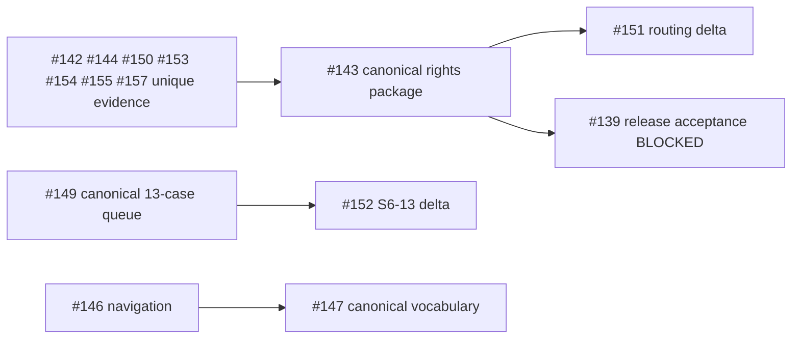
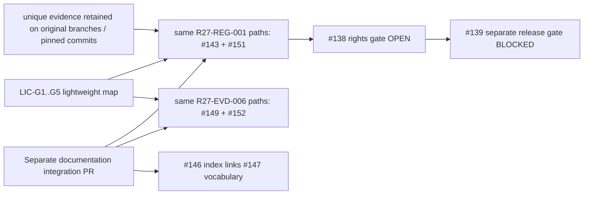

<!--
SPDX-FileCopyrightText: 2026 TRICORE contributors
SPDX-License-Identifier: Apache-2.0
-->

# OpenTrix PR consolidation audit

Document status: Draft; independent review required. Technical evidence is claim-specific. Rights remain PENDING; Issue #138 stays OPEN; R24 #139 stays Draft/BLOCKED.

## Frozen audit scope

- Repository: `https://github.com/tricore-opentrix/opentrix`; default branch `main`; inspected Git baseline `187dbd2ea6935966f5c4cceb95ad9c3c53708a2e`.
- Audit date: 2026-11-09 (Asia/Saigon). API snapshots are observations, not timeless decisions.
- Inspected 27 PRs: {'MERGED': 7, 'OPEN': 3, 'CLOSED': 2, 'DRAFT': 15}. DRAFT is an OPEN subset; MERGED is a CLOSED subset.
- Discovery: all paginated repository PRs, title search for licensing/SPDX/REUSE/SBOM/provenance/rights/R23/R24/attribution, the user-required list, and #141 discovered through the release freeze dependency. Other development PRs were enumerated but are not counted as audited.
- Tools: Git 2.45.1.windows.1; gh 2.103.0; Python 3.11.3; local REUSE 6.3.0. Hosted workflow uses `fsfe/reuse-action@v5`; tool versions are not equated.
- Read full Git diffs via `git diff BASE...HEAD` (including the large #154 crosswalk), Git blobs, paginated changed-file/review/comment/check APIs, and GraphQL review threads. No legal clearance or exhaustive historical author adjudication is claimed.
- No PR closure, merge, source-rights decision, branch deletion, force-push, tag, release, package or container publication is authorized by this audit.

## Disposition and safe integration plan

- KEEP canonical #143 (`R27-REG-001`) and #149 (`R27-EVD-006`). CONSOLIDATE only #151 into #143 and #152 into #149; neither correction is currently redundant.
- Prepare the corrected packages at their existing canonical paths in a **separate branch/PR**, because contributor-owned PR branches must not be pushed without explicit authorization. #143/#149 remain the canonical source lineage; the new PR is an integration vehicle, not a competing rights system. Maintainers may instead apply the reviewed integration delta to those canonical PRs after authorization. Original branches and immutable references remain intact.
- Keep #146 index and #147 vocabulary as separate linked documents, maintained together. Remove only repeated enum/ID definitions from the imported index; retain the vocabulary document ID/path and historical exact-SHA reviews. New content needs fresh review.
- KEEP #142/#144/#150/#154/#155; #157 remains BLOCKED on independent review. Their source-history, contributor, surviving-content and archive scopes are distinct, despite related subject matter. Link them from the existing register companion and Step-6 queue, without copying datasets.
- #153 is already CLOSED unmerged and contains unique evidence. It is **not proven SUPERSEDED** by #155. Preserve its immutable crosswalk and narrative links; do not delete or silently discard its wider caveats.
- #129 is already CLOSED **unmerged**, not an open closure candidate. DO-NOT-MERGE applies permanently to its missing-SPDX payload.
- #139 remains BLOCKED. #131 R23 generation/policy and #148 license/NOTICE assessment remain distinct. Reuse existing generated inventory; no second inventory or manual license decision system.
- #158/#159/#160 are OUT-OF-SCOPE. #158 removes only `docs/09-evidence/.gitkeep` in the proposed new-index subtree; it neither adds nor removes `docs/09-evidence/license-compliance/README.md`. Distinct paths: no direct path conflict. This does not establish that all of #158 is merge-ready.
- No open PR is established to be wholly redundant. Merged PRs are historical KEEP records, not candidates for reopening or deletion.

## Exact overlap and conservation findings

### #143 + #151

#151 base is exactly #143 HEAD `6cb5a32897563df018cf79dd66b92a20a3e823f1`; #151 HEAD is `146ff78f3ea0f177b5dbb712679971dbd61302e0`.

- `r27-rights-remediation-register-187dbd2.csv`: diff hunk `@@ -346,13 +346,13 @@`; header plus 357 data rows retained. Only data rows 348-357 (the ten `ARCHIVE_METADATA` records) change. Only `additional_contributor_check` and `independent_reviewer` change. All other columns, all 347 tracked-source records, record keys, source blob SHA-1s, archive SHA-256s, declarations/authority statuses and evidence references are unchanged.
- `r27-contributor-declarations-and-routing-187dbd2.md`: hunks at old lines 58 and 71 separate non-S6-13 root coordination, introduce portion-specific S6-13 routing, and append recorded declaration/review references. No first-person declaration is replaced by coordinator inference.
- `r27-independent-review-gates-187dbd2.md`: one row at old line 70 changes to portion-level routing. Upstream/generated obligations and mixed `44283466` remain unresolved.
- All **357 `licensing_authority=RIGHTS_PENDING`** values remain unchanged. Yến coordinates; Bảo/Yến attest only their portions; Ánh reviews mixed portions only if independent; otherwise obtain a noncontributor reviewer.

### #149 + #152

#152 base is exactly #149 HEAD `329670d5768c34020828523c65a321494a5b1518`; #152 HEAD is `4618777ce3525afe63a45cb67f99363f20ed26d1`.

- `r27-step6-contributor-rights-action-matrix.csv`: only S6-13 data row 13, hunk at old line 11. Changed columns: `scope`, `exact_source_reference`, `evidence_coordinator`, `independent_reviewer`, `existing_evidence`, `required_new_evidence`. Other 12 cases are byte-equivalent records. Case IDs, frozen candidate SHA, `external_origin_fact=UNKNOWN`, `rights_status=PENDING`, and `step6_stage=EVIDENCE_REQUEST` remain unchanged.
- `r27-step6-contributor-provenance-verification.md`: routing paragraph at old line 14 plus appended S6-13 section at old line 71. It preserves first-person requirements, portion independence, declaration links and #138.
- All **13 work cases remain PENDING**. Original `.license` sidecar unchanged.

### #146 + #147

No changed-file intersection: #146 adds `docs/verification/r27/README.md`; #147 adds `r27-status-and-id-vocabulary.md`. Narrative overlap is #146's `Convention (proposal; not retroactive)` definitions versus #147 sections 1-3. Replace those repeated definitions with a canonical link; preserve historical checkpoint text and document IDs `R27-REG-DOC-001` / `R27-REG-DOC-002`. The new LIC README maps five evidence groups only; it does not replace the R27 source-document register or status vocabulary.

### Unique evidence and closed #153

The following packages have distinct paths and blobs. None is deleted or absorbed merely because it concerns provenance:

| PR | Unique evidence preserved | Relationship |
| --- | --- | --- |
| #142 | Identity source-origin register, G3/G4 source matrix, declarations and historical prompt evidence | Historical `5daa145d` observations are not the same as #150 frozen-candidate reconciliation |
| #144 | Ánh Data/Frontend/Portal/asset disposition queue | Contributor/portion routing, not a replacement rights register |
| #150 | Identity S6-01/S6-02 exact-source verification CSV/report | Adds candidate reconciliation and unresolved origin checks |
| #153 | 22 selected frozen blobs plus wider Identity/root/exception/CHANGELOG caveats | CLOSED unmerged; #155 covers only the 15 Group C paths; preserve both report and crosswalk links |
| #154 | Historical Git/blob crosswalk (602 CSV data records with multiline fields) and bounded technical narrative | Historical mapping, not 34,094 copyright decisions |
| #155 | 15-path Group C survival check; six same blobs and nine leading-header-only differences | Does not adjudicate human creative role or V5 copied SQL licensing |
| #157 | Archive member crosswalk and verifier/reproduction documentation | Four unresolved threads and CHANGES_REQUESTED remain; later comment is not a new approval |

## Review, canary and policy evidence

- Formal reviews, review comments and issue comments are separate. The matrix records each formal state and its commit. Existing approval does not transfer to the integration SHA.
- #157 has four unresolved threads; #158 has seventeen. #143 has no formal APPROVED verdict at its audited HEAD. #149/#151/#152/#146/#147 have scoped documentation approvals; no rights clearance follows.
- #129 [run 41989872939](https://github.com/tricore-opentrix/opentrix/actions/runs/41989872939), HEAD `a87204ca1ea17ac83cce983cb3235d2ecc6511e5`, completed FAILURE; repo-hygiene failed. Its only added blob is `b33bd1e393d0fba80da91631d3bdfd95a0cb2110`, absent from main. Recorded contemporary discussion captures the expected missing-header failure. Current main protection requires backend/portal-bff/frontend/repo-hygiene with strict update and code-owner review. **Historical UI merge-box proof was not reproduced**; current protection is not silently backdated.
- #131 source parser rejects unsupported WITH expressions and retains only reviewed Classpath spellings; the Logback 1.5.34 EPL-2.0 choice is exact-version-specific. Obsolete Hibernate ORM LGPL exception is absent. This checks implementation policy, not lawful redistribution of every package.
- R23 historical [run 42014580376](https://github.com/tricore-opentrix/opentrix/actions/runs/42014580376) / [artifact 13408716648](https://github.com/tricore-opentrix/opentrix/actions/runs/42014580376/artifacts/13408716648) records 67 backend + 53 Portal BFF + 11 frontend = 131 runtime components. No fresh SBOM generation/download or upstream-license completeness review is claimed in this audit. Existing 131-component inventory and all distribution PENDING obligations remain authoritative for that snapshot.
- #148 LIC-01..LIC-10 remain unresolved substantive obligations: original contributor authority, upstream NOTICE/texts, included Gradle wrapper text, Identity fixtures, mixed Data/UI portions, SVG/fonts/icons, historical exceptions and archive metadata. Future containers/binaries are outside source-only acceptance.

## Before and proposed after





## Closure order (proposal only)

1. Freeze/review the integration SHA, validate original/corrected blobs and all row invariants. Independent reviewers must inspect actual portions; no self-approval.
2. After the corrected canonical paths are preserved through an independently approved merge, obtain explicit user authorization to close #151, then #152 unmerged, linking original and integrated SHAs. No closure before preservation.
3. If the separate integration PR is the chosen landing vehicle, #143/#149/#146/#147 can become CLOSE-CANDIDATE **only after** exact final-content checks and fresh scoped review establish that all of their evidence is retained. Seek separate explicit closure authorization in order #143, #149, #147, #146. They are currently KEEP, not SUPERSEDED.
4. #129/#153 are already closed; no repeated closure. No closure proposed for unique evidence #142/#144/#150/#154/#155/#157, distinct #148, historical #122, or blocked #139.
5. Keep Issue #138 OPEN until genuine rights criteria are met. Release publication needs a separate explicit decision even after documentation merges.

## Reproduction and limitations

Read-only discovery and per-PR commands (substitute the matrix's frozen values):

```sh
gh repo view tricore-opentrix/opentrix --json nameWithOwner,defaultBranchRef,url
gh api --paginate 'repos/tricore-opentrix/opentrix/pulls?state=all&per_page=100'
gh api repos/tricore-opentrix/opentrix/pulls/151
gh api --paginate 'repos/tricore-opentrix/opentrix/pulls/151/files?per_page=100'
gh api --paginate repos/tricore-opentrix/opentrix/pulls/151/reviews
gh api --paginate repos/tricore-opentrix/opentrix/issues/151/comments
gh api --paginate repos/tricore-opentrix/opentrix/pulls/151/comments
git fetch origin refs/pull/151/head:refs/remotes/audit/pr-151
git diff 6cb5a32897563df018cf79dd66b92a20a3e823f1...146ff78f3ea0f177b5dbb712679971dbd61302e0
git rev-parse 146ff78f3ea0f177b5dbb712679971dbd61302e0:docs/verification/r27/r27-rights-remediation-register-187dbd2.csv
git diff --check
python -m reuse lint
python -m unittest discover -s scripts -p 'test_r23_*.py'
python -m unittest discover -s scripts -p 'test_r24_*.py'
```

GraphQL reviewThreads pagination was checked (`hasNextPage=false` for audited PRs); unresolved and outdated threads remain distinct. Check runs record their actual `head_sha` where applicable; old merged PR head checks may be unavailable, never assumed PASS. Main-blob equality is only exact current-path equality, not a test that later legitimate edits invalidate a historical merge. See per-PR preservation summary below.

### Initial baseline validation (before integration)

Tested `187dbd2ea6935966f5c4cceb95ad9c3c53708a2e` in a new clone; no original R27 worktree touched.

| Command | Exit | Result / scope |
| --- | ---: | --- |
| `python -m reuse lint` (6.3.0) | 1 | FAIL: one invalid detected expression in unchanged `scripts/r23-compliance.py`; metadata coverage 335/335. Not a new regression; no claim of local lint PASS |
| `python -m unittest discover -s scripts -p test_r23_*.py` | 0 | PASS: 4 policy tests, not SBOM regeneration or upstream license clearance |
| `python -m unittest discover -s scripts -p test_r24_*.py` | 1 | FAIL on Windows baseline: standalone release-notes/archive mismatch and consequent assertions; not release acceptance. No source fix bundled |
| CSV routing preservation comparison | 0 | PASS: 357 rows / ten two-column routing changes; 13 cases / only S6-13 changed; original rights and hashes retained |

The new documentation must not be represented as fully verified while required checks fail. Final integration checks and exact tested commits are recorded in the integration section after implementation. Hosted v5 success must not mask local v6.3.0 failure.

## Per-PR frozen evidence manifest

The linked full diff and saved Git diff SHA-256 let a reviewer reproduce every inspected delta, including large files omitted from REST patch fields. Lists below are navigation evidence, not a new license/rights inventory.

### PR #59 — KEEP

- [PR](https://github.com/tricore-opentrix/opentrix/pull/59); [full frozen diff](https://github.com/tricore-opentrix/opentrix/compare/af21ae5ff59d8eb9b3c0fef0bc8a78295aeb588d...42f8899f68ec8d963a3cc63ffcadcf973913c67f); state `MERGED`; mergeability `None/unknown`.
- HEAD `42f8899f68ec8d963a3cc63ffcadcf973913c67f`; base `af21ae5ff59d8eb9b3c0fef0bc8a78295aeb588d`; Git diff SHA-256 `e31f96c01448a2daf6759689122630e2aec5e76fd86aa1b8f2400178e4b220e8`.
- Apache-2.0 LICENSE and initial NOTICE history. Target: #59 / existing paths.
- 2 changed paths; 1 exact resulting blobs at current main. Other paths can be unmerged, subsequently changed, or removed; counts alone do not prove redundancy.
- Review decision `APPROVED`; unresolved threads 0; [formal reviews](https://github.com/tricore-opentrix/opentrix/pull/59/files), [check evidence](https://github.com/tricore-opentrix/opentrix/commit/42f8899f68ec8d963a3cc63ffcadcf973913c67f/checks). Full individual states/SHAs are in the matrix.
- CI snapshot: frontend:success; portal-bff:success; repo-hygiene:success; backend:success.

### PR #122 — KEEP

- [PR](https://github.com/tricore-opentrix/opentrix/pull/122); [full frozen diff](https://github.com/tricore-opentrix/opentrix/compare/0e789cffa11447f3acef25d0e582bf25ed46c7b4...35e90c47ae95da23dac75c157a4a816d3b73ce08); state `OPEN`; mergeability `True/behind`.
- HEAD `35e90c47ae95da23dac75c157a4a816d3b73ce08`; base `0e789cffa11447f3acef25d0e582bf25ed46c7b4`; Git diff SHA-256 `105843e277843d0d4f9d46ccc8cf9fd48104f512761a53a324e28de5c993bc5a`.
- Historical R25 inventory, 37 exceptions, immutable Flyway checksum record and baseline lint output. Target: #122 / existing paths.
- 4 changed paths; 0 exact resulting blobs at current main. Other paths can be unmerged, subsequently changed, or removed; counts alone do not prove redundancy.
- Review decision `REVIEW_REQUIRED`; unresolved threads 0; [formal reviews](https://github.com/tricore-opentrix/opentrix/pull/122/files), [check evidence](https://github.com/tricore-opentrix/opentrix/commit/35e90c47ae95da23dac75c157a4a816d3b73ce08/checks). Full individual states/SHAs are in the matrix.
- CI snapshot: portal-bff:success; backend:success; frontend:success; repo-hygiene:success.

| Path | Git blob SHA-1 | Change |
| --- | --- | --- |
| `docs/verification/r25/exception-review.csv` | `613351b7cb62698308d0112fb57caa5537295abf` | added: +38/-0 |
| `docs/verification/r25/flyway-v1-v4-sha256.csv` | `b021aa1cd7695b5dc039c2ff0853580863d96405` | added: +5/-0 |
| `docs/verification/r25/ownership-inventory.csv` | `a93567efe303015ba9111554fe98a792a993a99c` | added: +357/-0 |
| `docs/verification/r25/reuse-lint-baseline.txt` | `ecc7cbfd1ddebfe19d0f6723bd331133c28852b8` | added: +384/-0 |


### PR #127 — KEEP

- [PR](https://github.com/tricore-opentrix/opentrix/pull/127); [full frozen diff](https://github.com/tricore-opentrix/opentrix/compare/733117cba591dc54c71f8e19e8d94c91a19658b4...4d0f10552938bf25afdfbc8aeec6e0ffa686fa5c); state `MERGED`; mergeability `None/unknown`.
- HEAD `4d0f10552938bf25afdfbc8aeec6e0ffa686fa5c`; base `733117cba591dc54c71f8e19e8d94c91a19658b4`; Git diff SHA-256 `11219d1bb65e79bd6fc706a37d56751eb933bcda852ae367c1b853ac42a78812`.
- Repository-wide SPDX coverage and REUSE enforcement implementation. Target: #127 / existing paths.
- 302 changed paths; 258 exact resulting blobs at current main. Other paths can be unmerged, subsequently changed, or removed; counts alone do not prove redundancy.
- Review decision `APPROVED`; unresolved threads 0; [formal reviews](https://github.com/tricore-opentrix/opentrix/pull/127/files), [check evidence](https://github.com/tricore-opentrix/opentrix/commit/4d0f10552938bf25afdfbc8aeec6e0ffa686fa5c/checks). Full individual states/SHAs are in the matrix.
- CI snapshot: frontend:success; repo-hygiene:success; portal-bff:success; backend:success.

### PR #129 — DO-NOT-MERGE

- [PR](https://github.com/tricore-opentrix/opentrix/pull/129); [full frozen diff](https://github.com/tricore-opentrix/opentrix/compare/fa16f30d5c67a49186b1c36f2babe58d54a15e38...a87204ca1ea17ac83cce983cb3235d2ecc6511e5); state `CLOSED`; mergeability `True/behind`.
- HEAD `a87204ca1ea17ac83cce983cb3235d2ecc6511e5`; base `fa16f30d5c67a49186b1c36f2babe58d54a15e38`; Git diff SHA-256 `3241f93f90fdd68aca9e9e20134c16c42fdfce29b93621946b1714b902a811c7`.
- Deliberate missing-SPDX negative merge-gate canary; already CLOSED unmerged. Target: #129 / existing paths.
- 1 changed paths; 0 exact resulting blobs at current main. Other paths can be unmerged, subsequently changed, or removed; counts alone do not prove redundancy.
- Review decision `REVIEW_REQUIRED`; unresolved threads 0; [formal reviews](https://github.com/tricore-opentrix/opentrix/pull/129/files), [check evidence](https://github.com/tricore-opentrix/opentrix/commit/a87204ca1ea17ac83cce983cb3235d2ecc6511e5/checks). Full individual states/SHAs are in the matrix.
- CI snapshot: repo-hygiene:failure; backend:success; portal-bff:success; frontend:success.

| Path | Git blob SHA-1 | Change |
| --- | --- | --- |
| `verification/r22-missing-spdx-canary.md` | `b33bd1e393d0fba80da91631d3bdfd95a0cb2110` | added: +3/-0 |


### PR #131 — KEEP

- [PR](https://github.com/tricore-opentrix/opentrix/pull/131); [full frozen diff](https://github.com/tricore-opentrix/opentrix/compare/84a7ca9e5b5f1012b95f676c86c2ec1d95dd3ea7...10817cd92361511291a1d5d8ac777725d68c7786); state `MERGED`; mergeability `None/unknown`.
- HEAD `10817cd92361511291a1d5d8ac777725d68c7786`; base `84a7ca9e5b5f1012b95f676c86c2ec1d95dd3ea7`; Git diff SHA-256 `e60dbd8c2f388deab59f680641c3981697c6d1bed3a29a8ec8005044594dc976`.
- Canonical R23 executable SBOM generation and fail-closed license policy. Target: #131 / existing paths.
- 7 changed paths; 6 exact resulting blobs at current main. Other paths can be unmerged, subsequently changed, or removed; counts alone do not prove redundancy.
- Review decision `APPROVED`; unresolved threads 0; [formal reviews](https://github.com/tricore-opentrix/opentrix/pull/131/files), [check evidence](https://github.com/tricore-opentrix/opentrix/commit/10817cd92361511291a1d5d8ac777725d68c7786/checks). Full individual states/SHAs are in the matrix.
- CI snapshot: repo-hygiene:success; portal-bff:success; backend:success; r23-compliance:success; frontend:success.

| Path | Git blob SHA-1 | Change |
| --- | --- | --- |
| `.github/workflows/ci.yml` | `58f631af0fc694410ee01e0c1ec5891b80a43194` | modified: +60/-0 |
| `THIRD-PARTY-NOTICES.md` | `106e61f892def4f297c586c7503af56f818d84ff` | added: +148/-0 |
| `backend/build.gradle` | `7625b62e9ad46285ad16dcb8668e0481eb38c02f` | modified: +5/-0 |
| `docs/06-deployment/r23-plan.md` | `cc1b02c94f6e8544f61cce972fe99f70a2078b3f` | added: +67/-0 |
| `portal-bff/build.gradle` | `4ed140592af53595a9eb992e11471b7fdd15e78a` | modified: +5/-0 |
| `scripts/r23-compliance.py` | `773c5903b9a25cab7beec7dc8dbadce79992b98f` | added: +217/-0 |
| `scripts/test_r23_compliance.py` | `a75eaf711320fe0212174a8adc820af3e7e7038c` | added: +143/-0 |


### PR #133 — KEEP

- [PR](https://github.com/tricore-opentrix/opentrix/pull/133); [full frozen diff](https://github.com/tricore-opentrix/opentrix/compare/88162e9c3acbc8cad8ce7b15c2bd328226e1f545...e81719ecf9cd16b63b5487218d6e24ec0bec4350); state `MERGED`; mergeability `None/unknown`.
- HEAD `e81719ecf9cd16b63b5487218d6e24ec0bec4350`; base `88162e9c3acbc8cad8ce7b15c2bd328226e1f545`; Git diff SHA-256 `04cceba7fa5de56e0f4cffca1ce10aef7fd50376dc35a73a933a6b8b5a9a4529`.
- Merged JDBC dependency cleanup; obsolete Hibernate ORM waiver removed later in #131. Target: #133 / existing paths.
- 3 changed paths; 2 exact resulting blobs at current main. Other paths can be unmerged, subsequently changed, or removed; counts alone do not prove redundancy.
- Review decision `APPROVED`; unresolved threads 0; [formal reviews](https://github.com/tricore-opentrix/opentrix/pull/133/files), [check evidence](https://github.com/tricore-opentrix/opentrix/commit/e81719ecf9cd16b63b5487218d6e24ec0bec4350/checks). Full individual states/SHAs are in the matrix.
- CI snapshot: repo-hygiene:success; frontend:success; backend:success; portal-bff:success.

### PR #134 — KEEP

- [PR](https://github.com/tricore-opentrix/opentrix/pull/134); [full frozen diff](https://github.com/tricore-opentrix/opentrix/compare/3e049488dda57cf155ef1804f524b96c9e499e25...dc67bda58758d4ebc4f51bf421eb5ab082fba12c); state `MERGED`; mergeability `None/unknown`.
- HEAD `dc67bda58758d4ebc4f51bf421eb5ab082fba12c`; base `3e049488dda57cf155ef1804f524b96c9e499e25`; Git diff SHA-256 `3fb3f8c30c41b0b108689c7fae269d0117da703944c19937d446e2258250f755`.
- Gated R24 release tooling; not publication authorization. Target: #134 / existing paths.
- 10 changed paths; 5 exact resulting blobs at current main. Other paths can be unmerged, subsequently changed, or removed; counts alone do not prove redundancy.
- Review decision `APPROVED`; unresolved threads 0; [formal reviews](https://github.com/tricore-opentrix/opentrix/pull/134/files), [check evidence](https://github.com/tricore-opentrix/opentrix/commit/dc67bda58758d4ebc4f51bf421eb5ab082fba12c/checks). Full individual states/SHAs are in the matrix.
- CI snapshot: repo-hygiene:success; publish:skipped; portal-bff:success; frontend:success; r23-compliance:success; backend:success; candidate:success.

### PR #139 — BLOCKED

- [PR](https://github.com/tricore-opentrix/opentrix/pull/139); [full frozen diff](https://github.com/tricore-opentrix/opentrix/compare/187dbd2ea6935966f5c4cceb95ad9c3c53708a2e...2f6b8d7608214983be92db1f5ba0e4b8703885db); state `DRAFT`; mergeability `True/blocked`.
- HEAD `2f6b8d7608214983be92db1f5ba0e4b8703885db`; base `187dbd2ea6935966f5c4cceb95ad9c3c53708a2e`; Git diff SHA-256 `c195c7519ee75bbc886e8d8a5eae1f07371b8282ec9762edabe68e772a5a7418`.
- Unique source-only acceptance records, exact-source ledger, two-run archive evidence and Backend provenance. Target: #139 / existing paths.
- 16 changed paths; 0 exact resulting blobs at current main. Other paths can be unmerged, subsequently changed, or removed; counts alone do not prove redundancy.
- Review decision `REVIEW_REQUIRED`; unresolved threads 0; [formal reviews](https://github.com/tricore-opentrix/opentrix/pull/139/files), [check evidence](https://github.com/tricore-opentrix/opentrix/commit/2f6b8d7608214983be92db1f5ba0e4b8703885db/checks). Full individual states/SHAs are in the matrix.
- CI snapshot: publish:skipped; repo-hygiene:success; candidate:success; backend:success; r23-compliance:success; frontend:success; portal-bff:success.

| Path | Git blob SHA-1 | Change |
| --- | --- | --- |
| `REUSE.toml` | `5d13d9739612c2f9eed03b7a431cb2425d5d1a84` | modified: +8/-0 |
| `docs/06-deployment/r24-acceptances/v0.2.0.json` | `ca0c45197bbc9eaf53d32771c56cd3734cc445bf` | added: +14/-0 |
| `docs/06-deployment/r24-internal-rc-2026-11-06-evidence-register.md` | `0e6bc5015a48b6699bf4c78e182c75efae27b63c` | added: +32/-0 |
| `docs/06-deployment/r24-rc1-backend-provenance-review.md` | `fdb4c5a88154adeb3162782e4ee4853fdbc29686` | added: +45/-0 |
| `docs/06-deployment/r24-rc1-candidate-verification-5daa145d.md` | `1d4b1ca7daa269f3acd37325ff90544fddf89aca` | added: +56/-0 |
| `docs/06-deployment/r24-rc1-source-scope.md` | `3dbf007b6384d1ddf2e37451c2bc015cbd729736` | added: +49/-0 |
| `docs/06-deployment/r24-v0.2.0-post-141-source-sha-checkpoint-187dbd2.md` | `406c4bd93dcbeb4f1474558baa7518025206d30d` | added: +31/-0 |
| `docs/06-deployment/r24-v0.2.0-source-only-acceptance-preflight.md` | `71e3fddf2248f833662548fb40980c4d30ebd139` | added: +45/-0 |
| `docs/06-deployment/r24-v0.2.0-source-only-two-run-verification-187dbd2.md` | `2089ac9d36abbab678322034a637342ba7e737fd` | added: +46/-0 |
| `docs/06-deployment/r27-backend-core-origin-register-5daa145d.md` | `2e2f8d67c20d1a5873228682ca220abec2885580` | added: +355/-0 |
| `docs/06-deployment/r27-bao-identity-gateway-source-rights-worksheet.md` | `67bd8d58a9b37872d1f341ace65fa11bfd65eb71` | added: +64/-0 |
| `docs/06-deployment/r27-gateway-identity-test-technical-crosscheck-5daa145d.md` | `6f78eca6c1dcd02f0d47de88db35da484d910491` | added: +52/-0 |
| `docs/verification/r27/bao-backend-core-gateway-evidence-checkpoint-187dbd2.md` | `314e41ebfc08d1f71dca2d2a147069bff2767a28` | added: +68/-0 |
| `docs/verification/r27/v0.2.0-source-only-distribution-rights-scope-187dbd2.md` | `c7870a03a5cd4325bb071abccf3a5253f1a17010` | added: +72/-0 |
| `docs/verification/r27/v0.2.0-source-only-git-rights-ledger-187dbd2.csv` | `68d6ae554da1e20b55f0c6daa660611682dc86d0` | added: +348/-0 |
| `docs/verification/r27/v0.2.0-source-only-git-rights-ledger-187dbd2.csv.license` | `a169633c210caee3c5423dc6a8a76de449ab87e3` | added: +2/-0 |


### PR #140 — KEEP

- [PR](https://github.com/tricore-opentrix/opentrix/pull/140); [full frozen diff](https://github.com/tricore-opentrix/opentrix/compare/e03fb1aeeafa59dffa18a30a4108d6a67f2c8008...d0194a1f9bab07842deee50b5c9739adec348fc1); state `MERGED`; mergeability `None/unknown`.
- HEAD `d0194a1f9bab07842deee50b5c9739adec348fc1`; base `e03fb1aeeafa59dffa18a30a4108d6a67f2c8008`; Git diff SHA-256 `34dce0729345ca2e27f806ad9ce92b7b4ba2b0e0797c09feea9250aafb593a98`.
- Merged deterministic SBOM normalization; later R24 tooling differs legitimately. Target: #140 / existing paths.
- 2 changed paths; 0 exact resulting blobs at current main. Other paths can be unmerged, subsequently changed, or removed; counts alone do not prove redundancy.
- Review decision `APPROVED`; unresolved threads 0; [formal reviews](https://github.com/tricore-opentrix/opentrix/pull/140/files), [check evidence](https://github.com/tricore-opentrix/opentrix/commit/d0194a1f9bab07842deee50b5c9739adec348fc1/checks). Full individual states/SHAs are in the matrix.
- CI snapshot: repo-hygiene:success; publish:skipped; portal-bff:success; backend:success; frontend:success; r23-compliance:success; candidate:success.

| Path | Git blob SHA-1 | Change |
| --- | --- | --- |
| `scripts/r24-release.py` | `b7229a8a5dcd10be79b3f8fb7c0e41d720f6bd02` | modified: +36/-1 |
| `scripts/test_r24_release.py` | `8887f43038ed41423fd766e26fa0c3ba383bc58a` | modified: +100/-0 |


### PR #141 — KEEP

- [PR](https://github.com/tricore-opentrix/opentrix/pull/141); [full frozen diff](https://github.com/tricore-opentrix/opentrix/compare/92bd46bd8386b07fa4618eac077caa6cd1dbd714...7c2bdbedc89fec96c7136f44254d9a08623cee3b); state `MERGED`; mergeability `None/unknown`.
- HEAD `7c2bdbedc89fec96c7136f44254d9a08623cee3b`; base `92bd46bd8386b07fa4618eac077caa6cd1dbd714`; Git diff SHA-256 `5489dd3a41d0e85660f615cf69ca1402263c8e9f8d24a38b39108f15478f002f`.
- Merged stable source-only freeze/CHANGELOG/release adjustments. Target: #141 / existing paths.
- 5 changed paths; 5 exact resulting blobs at current main. Other paths can be unmerged, subsequently changed, or removed; counts alone do not prove redundancy.
- Review decision `APPROVED`; unresolved threads 0; [formal reviews](https://github.com/tricore-opentrix/opentrix/pull/141/files), [check evidence](https://github.com/tricore-opentrix/opentrix/commit/7c2bdbedc89fec96c7136f44254d9a08623cee3b/checks). Full individual states/SHAs are in the matrix.
- CI snapshot: publish:skipped; repo-hygiene:success; backend:success; r23-compliance:success; frontend:success; portal-bff:success; candidate:success.

| Path | Git blob SHA-1 | Change |
| --- | --- | --- |
| `.github/workflows/release.yml` | `7eeb695da33432c2facacd5dc6b93ad659cc7feb` | modified: +8/-5 |
| `CHANGELOG.md` | `206411194805fc40c4ca544fd08e156e693cdd5c` | modified: +6/-3 |
| `docs/06-deployment/r24-release.md` | `ad81854b308d73034835095ef5a8cac50587c64e` | modified: +7/-7 |
| `scripts/r24-release.py` | `fd5ee8f7d3182eb077131cb1b1b8396d5e156014` | modified: +3/-0 |
| `scripts/test_r24_release.py` | `5b826195e3600564aa5120c859177632ca5b2ae4` | modified: +34/-1 |


### PR #142 — KEEP

- [PR](https://github.com/tricore-opentrix/opentrix/pull/142); [full frozen diff](https://github.com/tricore-opentrix/opentrix/compare/5daa145d3b5f20f2f16fe0799c6d0808fd6c3e33...2844530125ef884a047f976a91b3202103da3c91); state `DRAFT`; mergeability `True/behind`.
- HEAD `2844530125ef884a047f976a91b3202103da3c91`; base `5daa145d3b5f20f2f16fe0799c6d0808fd6c3e33`; Git diff SHA-256 `8d07c30f3edefd0cce5fff489453b78061b068e3745ad318d3b0a9ca1754c39b`.
- Identity history, first-person declaration, 39-record origin register and G3/G4 technical evidence. Target: #142 / existing paths.
- 7 changed paths; 0 exact resulting blobs at current main. Other paths can be unmerged, subsequently changed, or removed; counts alone do not prove redundancy.
- Review decision `REVIEW_REQUIRED`; unresolved threads 0; [formal reviews](https://github.com/tricore-opentrix/opentrix/pull/142/files), [check evidence](https://github.com/tricore-opentrix/opentrix/commit/2844530125ef884a047f976a91b3202103da3c91/checks). Full individual states/SHAs are in the matrix.
- CI snapshot: repo-hygiene:success; frontend:success; r23-compliance:success; backend:success; portal-bff:success.

| Path | Git blob SHA-1 | Change |
| --- | --- | --- |
| `REUSE.toml` | `9b6d0e719f00541d6713649f49160804b27147e7` | modified: +24/-0 |
| `docs/verification/r27/identity-contributor-declaration-yen.md` | `b1de5be471c6bbd5f42a606ee5dd007ad4f0af5e` | added: +129/-0 |
| `docs/verification/r27/identity-g3-g4-codex-call-evidence.md` | `dda38c1e1bb78a10cafa6638b4900a69bb9bf0d3` | added: +41/-0 |
| `docs/verification/r27/identity-g3-g4-per-file-source-origin-matrix-5daa145d.csv` | `e3f16d2ad78617658b68c5d5848661b8a9d33481` | added: +25/-0 |
| `docs/verification/r27/identity-historical-prompt-evidence.md` | `fe1ccba027457586eae68eb920dad8691f0008d4` | added: +18/-0 |
| `docs/verification/r27/identity-provenance-review-5daa145d.md` | `3bd9d509e0e7845f9549f97cbe7a3bcba586cee3` | added: +200/-0 |
| `docs/verification/r27/identity-source-origin-register-5daa145d.csv` | `e82771577999188d115efd1f7d46ab2265bf8e64` | added: +40/-0 |


### PR #143 — KEEP

- [PR](https://github.com/tricore-opentrix/opentrix/pull/143); [full frozen diff](https://github.com/tricore-opentrix/opentrix/compare/187dbd2ea6935966f5c4cceb95ad9c3c53708a2e...6cb5a32897563df018cf79dd66b92a20a3e823f1); state `DRAFT`; mergeability `True/blocked`.
- HEAD `6cb5a32897563df018cf79dd66b92a20a3e823f1`; base `187dbd2ea6935966f5c4cceb95ad9c3c53708a2e`; Git diff SHA-256 `cfe5fef357dd95b07229e5ed397152dd98a803f6ab0226de990eea60548eaed1`.
- Canonical R27-REG-001 remediation package, 357 records and routing companions. Target: #143 / existing paths.
- 4 changed paths; 0 exact resulting blobs at current main. Other paths can be unmerged, subsequently changed, or removed; counts alone do not prove redundancy.
- Review decision `REVIEW_REQUIRED`; unresolved threads 0; [formal reviews](https://github.com/tricore-opentrix/opentrix/pull/143/files), [check evidence](https://github.com/tricore-opentrix/opentrix/commit/6cb5a32897563df018cf79dd66b92a20a3e823f1/checks). Full individual states/SHAs are in the matrix.
- CI snapshot: repo-hygiene:success; r23-compliance:success; backend:success; portal-bff:success; frontend:success.

| Path | Git blob SHA-1 | Change |
| --- | --- | --- |
| `docs/verification/r27/r27-contributor-declarations-and-routing-187dbd2.md` | `1329a75122ed89181d4a8cb46100f768adf122b4` | added: +73/-0 |
| `docs/verification/r27/r27-independent-review-gates-187dbd2.md` | `02c23e5d5f01760793956ed007ed306cdb1ae51b` | added: +91/-0 |
| `docs/verification/r27/r27-rights-remediation-register-187dbd2.csv` | `db9a7e3af8f577a1bc11c72c03c37b833d3b21d1` | added: +358/-0 |
| `docs/verification/r27/r27-rights-remediation-register-187dbd2.csv.license` | `a169633c210caee3c5423dc6a8a76de449ab87e3` | added: +2/-0 |


### PR #144 — KEEP

- [PR](https://github.com/tricore-opentrix/opentrix/pull/144); [full frozen diff](https://github.com/tricore-opentrix/opentrix/compare/187dbd2ea6935966f5c4cceb95ad9c3c53708a2e...188969ada812e0016ed952b5ad422e210b9b0055); state `DRAFT`; mergeability `True/clean`.
- HEAD `188969ada812e0016ed952b5ad422e210b9b0055`; base `187dbd2ea6935966f5c4cceb95ad9c3c53708a2e`; Git diff SHA-256 `60b92d46fb3555a351e99158e7412a3515af5ee35c8b365efe5a9c899d0a3afc`.
- Distinct Data/Frontend/Portal/asset contributor-disposition queue. Target: #144 / existing paths.
- 1 changed paths; 0 exact resulting blobs at current main. Other paths can be unmerged, subsequently changed, or removed; counts alone do not prove redundancy.
- Review decision `APPROVED`; unresolved threads 0; [formal reviews](https://github.com/tricore-opentrix/opentrix/pull/144/files), [check evidence](https://github.com/tricore-opentrix/opentrix/commit/188969ada812e0016ed952b5ad422e210b9b0055/checks). Full individual states/SHAs are in the matrix.
- CI snapshot: repo-hygiene:success; r23-compliance:success; frontend:success; backend:success; portal-bff:success.

| Path | Git blob SHA-1 | Change |
| --- | --- | --- |
| `docs/verification/r27/anh-source-rights-disposition-queue.md` | `e269cba7dc0a1ded127a48c043358db219816225` | added: +59/-0 |


### PR #146 — KEEP

- [PR](https://github.com/tricore-opentrix/opentrix/pull/146); [full frozen diff](https://github.com/tricore-opentrix/opentrix/compare/187dbd2ea6935966f5c4cceb95ad9c3c53708a2e...8492abd20e3e7fe00ad18d687f4674fa339fe20c); state `DRAFT`; mergeability `True/clean`.
- HEAD `8492abd20e3e7fe00ad18d687f4674fa339fe20c`; base `187dbd2ea6935966f5c4cceb95ad9c3c53708a2e`; Git diff SHA-256 `4c587bdb147954703993df98f6d2038b000dcdf904d4e407350eae70ebdb5dba`.
- Canonical R27-REG-DOC-001 navigation index. Target: #146 / existing paths.
- 1 changed paths; 0 exact resulting blobs at current main. Other paths can be unmerged, subsequently changed, or removed; counts alone do not prove redundancy.
- Review decision `APPROVED`; unresolved threads 0; [formal reviews](https://github.com/tricore-opentrix/opentrix/pull/146/files), [check evidence](https://github.com/tricore-opentrix/opentrix/commit/8492abd20e3e7fe00ad18d687f4674fa339fe20c/checks). Full individual states/SHAs are in the matrix.
- CI snapshot: repo-hygiene:success; frontend:success; backend:success; portal-bff:success; r23-compliance:success.

| Path | Git blob SHA-1 | Change |
| --- | --- | --- |
| `docs/verification/r27/README.md` | `4dad6d13b6fc9b67fe484a0cf9d01874b89fb7e7` | added: +77/-0 |


### PR #147 — KEEP

- [PR](https://github.com/tricore-opentrix/opentrix/pull/147); [full frozen diff](https://github.com/tricore-opentrix/opentrix/compare/187dbd2ea6935966f5c4cceb95ad9c3c53708a2e...94a998978e811a546fdd7a8840af3e4b9686f286); state `DRAFT`; mergeability `True/clean`.
- HEAD `94a998978e811a546fdd7a8840af3e4b9686f286`; base `187dbd2ea6935966f5c4cceb95ad9c3c53708a2e`; Git diff SHA-256 `c742ac409bdcf45ab9770791f57312f2159f4b395a75f7b5b4135c3bb466a1e0`.
- Canonical R27-REG-DOC-002 vocabulary; companion to #146, not redundant. Target: #147 / existing paths.
- 1 changed paths; 0 exact resulting blobs at current main. Other paths can be unmerged, subsequently changed, or removed; counts alone do not prove redundancy.
- Review decision `APPROVED`; unresolved threads 0; [formal reviews](https://github.com/tricore-opentrix/opentrix/pull/147/files), [check evidence](https://github.com/tricore-opentrix/opentrix/commit/94a998978e811a546fdd7a8840af3e4b9686f286/checks). Full individual states/SHAs are in the matrix.
- CI snapshot: repo-hygiene:success; frontend:success; r23-compliance:success; portal-bff:success; backend:success.

| Path | Git blob SHA-1 | Change |
| --- | --- | --- |
| `docs/verification/r27/r27-status-and-id-vocabulary.md` | `9a69bd9516189d09f98e2564f7067a9e87b78c97` | added: +90/-0 |


### PR #148 — KEEP

- [PR](https://github.com/tricore-opentrix/opentrix/pull/148); [full frozen diff](https://github.com/tricore-opentrix/opentrix/compare/187dbd2ea6935966f5c4cceb95ad9c3c53708a2e...25faa214835093d591eb381be910e1efc1b8c085); state `DRAFT`; mergeability `True/clean`.
- HEAD `25faa214835093d591eb381be910e1efc1b8c085`; base `187dbd2ea6935966f5c4cceb95ad9c3c53708a2e`; Git diff SHA-256 `3a5f21de594a9afc97ab0930c9c598918b1bc4862cddbc75f4d7066b105ebf9f`.
- R27-LIC-001 LIC-01 through LIC-10 obligations and R27-RPT-001 handoff, distinct from R23 implementation. Target: #148 / existing paths.
- 2 changed paths; 0 exact resulting blobs at current main. Other paths can be unmerged, subsequently changed, or removed; counts alone do not prove redundancy.
- Review decision `APPROVED`; unresolved threads 0; [formal reviews](https://github.com/tricore-opentrix/opentrix/pull/148/files), [check evidence](https://github.com/tricore-opentrix/opentrix/commit/25faa214835093d591eb381be910e1efc1b8c085/checks). Full individual states/SHAs are in the matrix.
- CI snapshot: repo-hygiene:success; r23-compliance:success; backend:success; portal-bff:success; frontend:success.

| Path | Git blob SHA-1 | Change |
| --- | --- | --- |
| `docs/verification/r27/r27-final-source-rights-handoff-report.md` | `0f6117518818ed0c1c8e76beee617d90e604d2c8` | added: +96/-0 |
| `docs/verification/r27/r27-third-party-license-notice-assessment.md` | `58a18327a7bb939f85936168fe93ed05634aadb3` | added: +75/-0 |


### PR #149 — KEEP

- [PR](https://github.com/tricore-opentrix/opentrix/pull/149); [full frozen diff](https://github.com/tricore-opentrix/opentrix/compare/187dbd2ea6935966f5c4cceb95ad9c3c53708a2e...329670d5768c34020828523c65a321494a5b1518); state `DRAFT`; mergeability `True/clean`.
- HEAD `329670d5768c34020828523c65a321494a5b1518`; base `187dbd2ea6935966f5c4cceb95ad9c3c53708a2e`; Git diff SHA-256 `eddee658d87728ff6e95d95429438147ac1dca664e83b666ecc1176287e92f66`.
- Canonical R27-EVD-006 first-person/portion provenance queue with 13 work cases. Target: #149 / existing paths.
- 3 changed paths; 0 exact resulting blobs at current main. Other paths can be unmerged, subsequently changed, or removed; counts alone do not prove redundancy.
- Review decision `APPROVED`; unresolved threads 0; [formal reviews](https://github.com/tricore-opentrix/opentrix/pull/149/files), [check evidence](https://github.com/tricore-opentrix/opentrix/commit/329670d5768c34020828523c65a321494a5b1518/checks). Full individual states/SHAs are in the matrix.
- CI snapshot: repo-hygiene:success; portal-bff:success; backend:success; r23-compliance:success; frontend:success.

| Path | Git blob SHA-1 | Change |
| --- | --- | --- |
| `docs/verification/r27/r27-step6-contributor-provenance-verification.md` | `9e8ab14cd1c52222ff611a1daa60c0fef69c21e3` | added: +73/-0 |
| `docs/verification/r27/r27-step6-contributor-rights-action-matrix.csv` | `bf60b0bb71b9704c898a2928a94407a0f05fa607` | added: +14/-0 |
| `docs/verification/r27/r27-step6-contributor-rights-action-matrix.csv.license` | `a169633c210caee3c5423dc6a8a76de449ab87e3` | added: +2/-0 |


### PR #150 — KEEP

- [PR](https://github.com/tricore-opentrix/opentrix/pull/150); [full frozen diff](https://github.com/tricore-opentrix/opentrix/compare/187dbd2ea6935966f5c4cceb95ad9c3c53708a2e...0b4c79f1935db6974ac7b425e586110a229a9036); state `DRAFT`; mergeability `True/clean`.
- HEAD `0b4c79f1935db6974ac7b425e586110a229a9036`; base `187dbd2ea6935966f5c4cceb95ad9c3c53708a2e`; Git diff SHA-256 `3a3527c392399adc9ce70f0127b69d029faa26bb8fe1514af09f869f65b1eb3c`.
- 24-file exact-source Identity G3/G4 reconciliation; different baseline/scope from #142. Target: #150 / existing paths.
- 3 changed paths; 0 exact resulting blobs at current main. Other paths can be unmerged, subsequently changed, or removed; counts alone do not prove redundancy.
- Review decision `APPROVED`; unresolved threads 0; [formal reviews](https://github.com/tricore-opentrix/opentrix/pull/150/files), [check evidence](https://github.com/tricore-opentrix/opentrix/commit/0b4c79f1935db6974ac7b425e586110a229a9036/checks). Full individual states/SHAs are in the matrix.
- CI snapshot: repo-hygiene:success; frontend:success; portal-bff:success; r23-compliance:success; backend:success.

| Path | Git blob SHA-1 | Change |
| --- | --- | --- |
| `docs/verification/r27/r27-step6-s6-01-s6-02-identity-file-verification.csv` | `f3cefe595cefaf60e74c0e6249402646f54ca893` | added: +25/-0 |
| `docs/verification/r27/r27-step6-s6-01-s6-02-identity-file-verification.csv.license` | `a169633c210caee3c5423dc6a8a76de449ab87e3` | added: +2/-0 |
| `docs/verification/r27/r27-step6-s6-01-s6-02-identity-verification.md` | `dde6944af31412e5eaa267161bf7bd5fb53498c6` | added: +90/-0 |


### PR #151 — CONSOLIDATE

- [PR](https://github.com/tricore-opentrix/opentrix/pull/151); [full frozen diff](https://github.com/tricore-opentrix/opentrix/compare/6cb5a32897563df018cf79dd66b92a20a3e823f1...146ff78f3ea0f177b5dbb712679971dbd61302e0); state `DRAFT`; mergeability `True/clean`.
- HEAD `146ff78f3ea0f177b5dbb712679971dbd61302e0`; base `6cb5a32897563df018cf79dd66b92a20a3e823f1`; Git diff SHA-256 `17fc8baddd28e3c69531b43855f9827ea17534ace188fe22cb872067a83a0b59`.
- Ten archive-metadata routing corrections, with declaration and independence references. Target: #143 / R27-REG-001.
- 3 changed paths; 0 exact resulting blobs at current main. Other paths can be unmerged, subsequently changed, or removed; counts alone do not prove redundancy.
- Review decision `APPROVED`; unresolved threads 0; [formal reviews](https://github.com/tricore-opentrix/opentrix/pull/151/files), [check evidence](https://github.com/tricore-opentrix/opentrix/commit/146ff78f3ea0f177b5dbb712679971dbd61302e0/checks). Full individual states/SHAs are in the matrix.
- CI snapshot: repo-hygiene:success; portal-bff:success; r23-compliance:success; backend:success; frontend:success.

| Path | Git blob SHA-1 | Change |
| --- | --- | --- |
| `docs/verification/r27/r27-contributor-declarations-and-routing-187dbd2.md` | `1159e7e56f742b6836dcfc65070616fad9c09322` | modified: +11/-1 |
| `docs/verification/r27/r27-independent-review-gates-187dbd2.md` | `d65ea87209c43b0e34422cd9a92f7fc49f9799c0` | modified: +1/-1 |
| `docs/verification/r27/r27-rights-remediation-register-187dbd2.csv` | `30148667c9a09c984222daf8063e748d50dc7cc1` | modified: +10/-10 |


### PR #152 — CONSOLIDATE

- [PR](https://github.com/tricore-opentrix/opentrix/pull/152); [full frozen diff](https://github.com/tricore-opentrix/opentrix/compare/329670d5768c34020828523c65a321494a5b1518...4618777ce3525afe63a45cb67f99363f20ed26d1); state `DRAFT`; mergeability `True/clean`.
- HEAD `4618777ce3525afe63a45cb67f99363f20ed26d1`; base `329670d5768c34020828523c65a321494a5b1518`; Git diff SHA-256 `4b8851e66b02f24b58247cebe9940ad9abae8acbe6225919ed12f05a3c036bbe`.
- S6-13 action-matrix and narrative routing correction. Target: #149 / R27-EVD-006.
- 2 changed paths; 0 exact resulting blobs at current main. Other paths can be unmerged, subsequently changed, or removed; counts alone do not prove redundancy.
- Review decision `APPROVED`; unresolved threads 0; [formal reviews](https://github.com/tricore-opentrix/opentrix/pull/152/files), [check evidence](https://github.com/tricore-opentrix/opentrix/commit/4618777ce3525afe63a45cb67f99363f20ed26d1/checks). Full individual states/SHAs are in the matrix.
- CI snapshot: repo-hygiene:success; portal-bff:success; frontend:success; r23-compliance:success; backend:success.

| Path | Git blob SHA-1 | Change |
| --- | --- | --- |
| `docs/verification/r27/r27-step6-contributor-provenance-verification.md` | `5b822b06027c504609d2d2d5b8297b77e1b41b40` | modified: +14/-1 |
| `docs/verification/r27/r27-step6-contributor-rights-action-matrix.csv` | `8f34e01f76a62a80b617b0b319283bfc5c2b7dc1` | modified: +1/-1 |


### PR #153 — KEEP

- [PR](https://github.com/tricore-opentrix/opentrix/pull/153); [full frozen diff](https://github.com/tricore-opentrix/opentrix/compare/187dbd2ea6935966f5c4cceb95ad9c3c53708a2e...fde4159d324bfe483aa083074923b3ad1bf94ecd); state `CLOSED`; mergeability `True/blocked`.
- HEAD `fde4159d324bfe483aa083074923b3ad1bf94ecd`; base `187dbd2ea6935966f5c4cceb95ad9c3c53708a2e`; Git diff SHA-256 `5da26265b2ebf9e2b5e0b0600b270489f74a787394a9ce2273175abdb57fd518`.
- Closed unmerged, unique 22-row selected frozen-blob crosswalk and partial historical narrative; NOT proven superseded. Target: #153 / existing paths.
- 3 changed paths; 0 exact resulting blobs at current main. Other paths can be unmerged, subsequently changed, or removed; counts alone do not prove redundancy.
- Review decision `REVIEW_REQUIRED`; unresolved threads 0; [formal reviews](https://github.com/tricore-opentrix/opentrix/pull/153/files), [check evidence](https://github.com/tricore-opentrix/opentrix/commit/fde4159d324bfe483aa083074923b3ad1bf94ecd/checks). Full individual states/SHAs are in the matrix.
- CI snapshot: repo-hygiene:success; backend:success; frontend:success; r23-compliance:success; portal-bff:success.

| Path | Git blob SHA-1 | Change |
| --- | --- | --- |
| `docs/verification/r27/yen-git-blob-crosswalk.csv` | `ca7c15694801ab38fef658cdaf99f1f165c253f4` | added: +23/-0 |
| `docs/verification/r27/yen-git-blob-crosswalk.csv.license` | `a169633c210caee3c5423dc6a8a76de449ab87e3` | added: +2/-0 |
| `docs/verification/r27/yen-git-blob-review.md` | `faab0470fa21062522b6353f2ffdd56fcab8d662` | added: +89/-0 |


### PR #154 — KEEP

- [PR](https://github.com/tricore-opentrix/opentrix/pull/154); [full frozen diff](https://github.com/tricore-opentrix/opentrix/compare/187dbd2ea6935966f5c4cceb95ad9c3c53708a2e...fcc146370b1c5f1dbbba0747143e9dc3b9184f23); state `DRAFT`; mergeability `True/blocked`.
- HEAD `fcc146370b1c5f1dbbba0747143e9dc3b9184f23`; base `187dbd2ea6935966f5c4cceb95ad9c3c53708a2e`; Git diff SHA-256 `052401b3d8881e7393228aece1d6f56118bc382b0130264cbae9be4e206e9f50`.
- Distinct Anh historical commit/blob crosswalk, not a rights register. Target: #154 / existing paths.
- 3 changed paths; 0 exact resulting blobs at current main. Other paths can be unmerged, subsequently changed, or removed; counts alone do not prove redundancy.
- Review decision `REVIEW_REQUIRED`; unresolved threads 0; [formal reviews](https://github.com/tricore-opentrix/opentrix/pull/154/files), [check evidence](https://github.com/tricore-opentrix/opentrix/commit/fcc146370b1c5f1dbbba0747143e9dc3b9184f23/checks). Full individual states/SHAs are in the matrix.
- CI snapshot: repo-hygiene:success; frontend:success; r23-compliance:success; portal-bff:success; backend:success.

| Path | Git blob SHA-1 | Change |
| --- | --- | --- |
| `docs/verification/r27/anh-git-blob-crosswalk.csv` | `5e99a8bd0bccd1fba3a21034f417f5b0299ddea0` | added: +34095/-0 |
| `docs/verification/r27/anh-git-blob-crosswalk.csv.license` | `5bebd86ad338b189aa8848d754ad69b95fa027d6` | added: +4/-0 |
| `docs/verification/r27/anh-git-blob-crosswalk.md` | `1d46032496e6e402cf8205a3c42d2af077c2ca4b` | added: +314/-0 |


### PR #155 — KEEP

- [PR](https://github.com/tricore-opentrix/opentrix/pull/155); [full frozen diff](https://github.com/tricore-opentrix/opentrix/compare/187dbd2ea6935966f5c4cceb95ad9c3c53708a2e...47ac885fcdf0cd09453aca1413753afaa47828cc); state `DRAFT`; mergeability `True/blocked`.
- HEAD `47ac885fcdf0cd09453aca1413753afaa47828cc`; base `187dbd2ea6935966f5c4cceb95ad9c3c53708a2e`; Git diff SHA-256 `a404b48ce616e36bc8b04cd5051f55a19dcf5f2d3d96e1d4f304d148781aea19`.
- 15-path Group C historical/frozen content-survival reconciliation, 6 exact blobs plus 9 leading-header-only differences. Target: #155 / existing paths.
- 3 changed paths; 0 exact resulting blobs at current main. Other paths can be unmerged, subsequently changed, or removed; counts alone do not prove redundancy.
- Review decision `REVIEW_REQUIRED`; unresolved threads 0; [formal reviews](https://github.com/tricore-opentrix/opentrix/pull/155/files), [check evidence](https://github.com/tricore-opentrix/opentrix/commit/47ac885fcdf0cd09453aca1413753afaa47828cc/checks). Full individual states/SHAs are in the matrix.
- CI snapshot: repo-hygiene:success; portal-bff:success; backend:success; frontend:success; r23-compliance:success.

| Path | Git blob SHA-1 | Change |
| --- | --- | --- |
| `docs/verification/r27/yen-group-c-15-path-content-reconciliation.csv` | `45eef970610cc7de9113f662773a8933e69d776f` | added: +16/-0 |
| `docs/verification/r27/yen-group-c-15-path-content-reconciliation.csv.license` | `a169633c210caee3c5423dc6a8a76de449ab87e3` | added: +2/-0 |
| `docs/verification/r27/yen-group-c-content-reconciliation.md` | `f4bb64ab5276849a540fdbfea5a6278e0f121b56` | added: +43/-0 |


### PR #157 — BLOCKED

- [PR](https://github.com/tricore-opentrix/opentrix/pull/157); [full frozen diff](https://github.com/tricore-opentrix/opentrix/compare/187dbd2ea6935966f5c4cceb95ad9c3c53708a2e...59e66e570fda14ea050076cf67555faf76581db7); state `DRAFT`; mergeability `True/blocked`.
- HEAD `59e66e570fda14ea050076cf67555faf76581db7`; base `187dbd2ea6935966f5c4cceb95ad9c3c53708a2e`; Git diff SHA-256 `44ff41bccb39532d3c5eb351eb419ff14f5f32cd72ea6b2ddda1c9bcd5535bc2`.
- Frozen archive/member verification and producer; four unresolved review threads, fresh verification required. Target: #157 / existing paths.
- 5 changed paths; 0 exact resulting blobs at current main. Other paths can be unmerged, subsequently changed, or removed; counts alone do not prove redundancy.
- Review decision `CHANGES_REQUESTED`; unresolved threads 4; [formal reviews](https://github.com/tricore-opentrix/opentrix/pull/157/files), [check evidence](https://github.com/tricore-opentrix/opentrix/commit/59e66e570fda14ea050076cf67555faf76581db7/checks). Full individual states/SHAs are in the matrix.
- CI snapshot: repo-hygiene:success; portal-bff:success; r23-compliance:success; frontend:success; backend:success.

| Path | Git blob SHA-1 | Change |
| --- | --- | --- |
| `docs/evidence/r27/step2/bao/S2_BAO_Archive_Members.csv` | `60fb670ae3ba0c57e8bcb01e2f6a250f57e478f8` | added: +358/-0 |
| `docs/evidence/r27/step2/bao/S2_BAO_Archive_Members.csv.license` | `a169633c210caee3c5423dc6a8a76de449ab87e3` | added: +2/-0 |
| `docs/evidence/r27/step2/bao/S2_BAO_Archive_Verification.md` | `202a460355c1d5021e20f7cb46ac256946994c7f` | added: +110/-0 |
| `docs/evidence/r27/step2/bao/S2_BAO_Reproduction.md` | `025f91c9ec44cde0e34c373a8c212e899a2b5c60` | added: +124/-0 |
| `docs/evidence/r27/step2/bao/S2_BAO_verify_archive.py` | `b97211985b38c22f987b4ed288d90e7fc9824520` | added: +158/-0 |


### PR #158 — OUT-OF-SCOPE

- [PR](https://github.com/tricore-opentrix/opentrix/pull/158); [full frozen diff](https://github.com/tricore-opentrix/opentrix/compare/187dbd2ea6935966f5c4cceb95ad9c3c53708a2e...5b0a01c6f9d537fb07d360e805c9a6bd86aedcc3); state `OPEN`; mergeability `True/blocked`.
- HEAD `5b0a01c6f9d537fb07d360e805c9a6bd86aedcc3`; base `187dbd2ea6935966f5c4cceb95ad9c3c53708a2e`; Git diff SHA-256 `33199603456b665f24908b99f4fd9577a277679bcdf6517ab65765515bfac3a6`.
- R37 docs/Linux runbook and placeholder cleanup; leave branch untouched. Target: #158 / existing paths.
- 36 changed paths; 11 exact resulting blobs at current main. Other paths can be unmerged, subsequently changed, or removed; counts alone do not prove redundancy.
- Review decision `CHANGES_REQUESTED`; unresolved threads 17; [formal reviews](https://github.com/tricore-opentrix/opentrix/pull/158/files), [check evidence](https://github.com/tricore-opentrix/opentrix/commit/5b0a01c6f9d537fb07d360e805c9a6bd86aedcc3/checks). Full individual states/SHAs are in the matrix.
- CI snapshot: repo-hygiene:success; backend:success; portal-bff:success; r23-compliance:success; frontend:success.

| Path | Git blob SHA-1 | Change |
| --- | --- | --- |
| `GLOSSARY.md` | `30ad579cb6d86be81a2dc8d51bd0741bdcafa52e` | modified: +130/-3 |
| `README.md` | `378fc954ae85dce1a7ad9536942a0cc00a5148ee` | modified: +127/-180 |
| `backend/README.md` | `9989bc3a53234816d81b87cd5736026721a21dc1` | modified: +467/-387 |
| `docs/00-project/glossary.md` | `1065ae99332ab0171e60cdbdc407e9b1d7e07e20` | removed: +0/-135 |
| `docs/00-project/project-overview.md` | `be035165f80b3671ea4d1dae6fb83fc863a7b338` | modified: +7/-7 |
| `docs/00-project/scope-and-mvp.md` | `bfc9ffb0c7d06c11e6513115b2a7d9add3f886d4` | modified: +5/-5 |
| `docs/01-architecture/core-application-boundary.md` | `7c7b9c6c592ef57613738395dc11bb0619141499` | modified: +10/-10 |
| `docs/01-architecture/dependency-rules.md` | `bd12844141f0e60b60d2dafe015b9c4ee2499d3d` | modified: +4/-4 |
| `docs/01-architecture/deployment-topology.md` | `e5ea3aaf215eccaf7e191c7c14cb74aa9d64bf4a` | modified: +2/-2 |
| `docs/01-architecture/diagrams/.gitkeep` | `e69de29bb2d1d6434b8b29ae775ad8c2e48c5391` | removed: +0/-0 |
| `docs/01-architecture/repository-layout-and-ownership.md` | `e00cb1f655ea92dfd4407e495d1045b0d1b3a5b5` | modified: +20/-19 |
| `docs/01-architecture/system-architecture.md` | `22e8b7a08e8fb43ae17ad62f46524d5ebaa1ad1e` | modified: +20/-20 |
| `docs/02-core/data/data-architecture.md` | `ae11a74d38d05568cd1b5731f72c6729ce37b3e9` | modified: +20/-20 |
| `docs/02-core/data/storage-adapters.md` | `24ec937d432285aa372e637c3930e405a4ece070` | modified: +7/-7 |
| `docs/03-applications/facility/.gitkeep` | `e69de29bb2d1d6434b8b29ae775ad8c2e48c5391` | removed: +0/-0 |
| `docs/03-applications/helpdesk/.gitkeep` | `e69de29bb2d1d6434b8b29ae775ad8c2e48c5391` | removed: +0/-0 |
| `docs/04-integration/.gitkeep` | `e69de29bb2d1d6434b8b29ae775ad8c2e48c5391` | removed: +0/-0 |
| `docs/05-testing/.gitkeep` | `e69de29bb2d1d6434b8b29ae775ad8c2e48c5391` | removed: +0/-0 |
| `docs/06-deployment/prerequisites.md` | `253724a580742fb3741436efb14877dde06c0869` | modified: +2/-2 |
| `docs/06-deployment/r23-plan.md` | `66b767e352047bd4f7b7623f8992365f9c2c29e9` | modified: +1/-1 |
| `docs/06-deployment/runbook-linux.md` | `78f358e15f5cdee757c4f0082e396977d6ba341a` | added: +217/-0 |
| `docs/07-open-source/.gitkeep` | `e69de29bb2d1d6434b8b29ae775ad8c2e48c5391` | removed: +0/-0 |
| `docs/08-decisions/ADR-007-data-storage.md` | `db9faf4868ba1c8c381a727266bc3466ad970bd0` | modified: +1/-1 |
| `docs/08-decisions/ADR-008-dashboard-tool.md` | `8649f3f252a23d1eac0886d42052cfe0195ff7ee` | modified: +2/-2 |
| `docs/09-evidence/.gitkeep` | `e69de29bb2d1d6434b8b29ae775ad8c2e48c5391` | removed: +0/-0 |
| `docs/10-reviews/.gitkeep` | `e69de29bb2d1d6434b8b29ae775ad8c2e48c5391` | removed: +0/-0 |
| `docs/11-poc/.gitkeep` | `e69de29bb2d1d6434b8b29ae775ad8c2e48c5391` | removed: +0/-0 |
| `docs/README.md` | `b4956e2d5c0d5a9524c073349e83dba59caaa016` | modified: +12/-33 |
| `docs/verification/issue53-helpdesk-local-closeout-20261029.md` | `bc8a034f1547b66ee4940e8ca8eea1cc18521cf7` | modified: +1/-1 |
| `docs/verification/r37-docs-cleanup-20261108.md` | `1d5ce66e7238c24341f48ff0bd43c83a0b3f0afb` | added: +108/-0 |
| `docs/verification/r37-linux-build-20261108.md` | `6c68136197a4eea0ca362eb300442bcfe5083c02` | added: +109/-0 |
| `frontend/DEMO_GUIDE.md` | `7028dabf2a11ccf80a1514b426bf376fcc1d857d` | modified: +35/-33 |
| `frontend/DRAFT_PR.md` | `6161930e8f8e93aa39c20212136fdcb9f7a38350` | removed: +0/-55 |
| `frontend/README.md` | `cab09f887b7e1152d3c964e38ccb395283ae6805` | modified: +71/-67 |
| `scripts/README.md` | `92ea583fce02fd23f83bc5303a717159ddadb9b9` | modified: +62/-52 |
| `scripts/check_md_links.py` | `dd2f6aa8b2613b78c5c58cab8623934c6167ad05` | added: +75/-0 |


### PR #159 — OUT-OF-SCOPE

- [PR](https://github.com/tricore-opentrix/opentrix/pull/159); [full frozen diff](https://github.com/tricore-opentrix/opentrix/compare/187dbd2ea6935966f5c4cceb95ad9c3c53708a2e...ef4b9484369c94ed7e5674e4b056b0d8f673e1ba); state `OPEN`; mergeability `True/blocked`.
- HEAD `ef4b9484369c94ed7e5674e4b056b0d8f673e1ba`; base `187dbd2ea6935966f5c4cceb95ad9c3c53708a2e`; Git diff SHA-256 `49541730819afcc94fc8c41121cf98a5dfa4c0ccb800da78d74225c36883bcd2`.
- ADR-010 and Core HTTP/authorization proposal; leave untouched. Target: #159 / existing paths.
- 3 changed paths; 0 exact resulting blobs at current main. Other paths can be unmerged, subsequently changed, or removed; counts alone do not prove redundancy.
- Review decision `REVIEW_REQUIRED`; unresolved threads 0; [formal reviews](https://github.com/tricore-opentrix/opentrix/pull/159/files), [check evidence](https://github.com/tricore-opentrix/opentrix/commit/ef4b9484369c94ed7e5674e4b056b0d8f673e1ba/checks). Full individual states/SHAs are in the matrix.
- CI snapshot: repo-hygiene:success; frontend:success; r23-compliance:success; backend:success; portal-bff:success.

| Path | Git blob SHA-1 | Change |
| --- | --- | --- |
| `docs/01-architecture/r27-core-authorization-boundary.md` | `941faeb55e1ff76efe8f10865d1aa1db0bb84faf` | added: +78/-0 |
| `docs/01-architecture/r27-core-workflow-http-contract.md` | `4f92bdc4f0d3c96ab7f134c1d7dc2f3978e53cd4` | added: +81/-0 |
| `docs/08-decisions/ADR-010-core-helpdesk-service-boundary.md` | `f13376b2e143ebf53c7b37bb99f34548a14c2743` | added: +208/-0 |


### PR #160 — OUT-OF-SCOPE

- [PR](https://github.com/tricore-opentrix/opentrix/pull/160); [full frozen diff](https://github.com/tricore-opentrix/opentrix/compare/187dbd2ea6935966f5c4cceb95ad9c3c53708a2e...eb6d7b0effbd9ebdc467a4a197097db37a5f9cd8); state `DRAFT`; mergeability `True/blocked`.
- HEAD `eb6d7b0effbd9ebdc467a4a197097db37a5f9cd8`; base `187dbd2ea6935966f5c4cceb95ad9c3c53708a2e`; Git diff SHA-256 `9458850e4b4c3b5f2ac867cf3802e093937275a57c775f5a3f451f280daaf37a`.
- ADR-015 G0 proposed contract; leave Draft and untouched. Target: #160 / existing paths.
- 1 changed paths; 0 exact resulting blobs at current main. Other paths can be unmerged, subsequently changed, or removed; counts alone do not prove redundancy.
- Review decision `REVIEW_REQUIRED`; unresolved threads 0; [formal reviews](https://github.com/tricore-opentrix/opentrix/pull/160/files), [check evidence](https://github.com/tricore-opentrix/opentrix/commit/eb6d7b0effbd9ebdc467a4a197097db37a5f9cd8/checks). Full individual states/SHAs are in the matrix.
- CI snapshot: repo-hygiene:success; frontend:success; backend:success; portal-bff:success; r23-compliance:success.

| Path | Git blob SHA-1 | Change |
| --- | --- | --- |
| `docs/08-decisions/ADR-015-core-workflow-acl-v3-g0.md` | `e2ea6a8f74e2e11ecfdeda47b3321ddf2cdd517a` | added: +451/-0 |

## Integration verification record

The read-only audit was committed separately at `86a533e` before importing any canonical evidence package. Its staged diff-check initially detected one extra blank line at EOF (exit 2); that whitespace was corrected in the integration change. No failure is represented as PASS.

Prepared on `docs/license-evidence-consolidation`, based on frozen `main@187dbd2ea6935966f5c4cceb95ad9c3c53708a2e`, in a new clone under `C:/Users/Admin/opentrix-consolidation`. Existing contributor-owned branches, original R27 worktrees and frozen source files were not modified.

### Exact retained content

- Register CSV equals #151 blob `30148667c9a09c984222daf8063e748d50dc7cc1` byte-for-byte; its original 357 composite keys, 347 source blob hashes, ten archive hashes and 357 RIGHTS_PENDING values are preserved.
- Action matrix equals #152 blob `8f34e01f76a62a80b617b0b319283bfc5c2b7dc1` byte-for-byte: 13 unique case IDs and all PENDING; the other 12 records equal #149.
- Both CSV sidecars equal original #143/#149 blobs. Independent-review gates equal #151 blob `d65ea87209c43b0e34422cd9a92f7fc49f9799c0`. Vocabulary equals #147 blob `9a69bd9516189d09f98e2564f7067a9e87b78c97`.
- Original #151 declaration/routing narrative and #152 queue narrative are retained as exact prefixes; only immutable supporting-evidence links are appended. #146 keeps document IDs and historical checkpoints; repeated ID/status definitions are replaced by the #147 link. No datasets are copied into the LIC navigation directory.
- All 347 register source blob IDs were recomputed from the frozen source Git tree. No source, SQL migration, resource, runtime configuration, GitHub workflow, R23/R24 script, LICENSE, NOTICE, REUSE.toml or third-party inventory is changed.

### Commands and results

| Command / comparison | Exit | Result / tested scope |
| --- | ---: | --- |
| CSV/Git preservation verifier | 0 | PASS: exact retained blobs, counts, keys, status/column restrictions, 347 frozen source blobs |
| Relative and immutable-blob link verifier | 0 | PASS for supported inline Markdown destinations: 18 relative destinations and 65 GitHub blob targets; no exhaustive external HTTP/anchor validation claimed |
| `python <audit-tools>/check_md_links.py` (exact #158 checker blob `dd2f6aa8b2613b78c5c58cab8623934c6167ad05`) | 1 | FAIL: 34 legacy missing relative targets; every broken path/link and missing target independently checked against frozen main. No new evidence link failure detected within supported subset |
| `python -m reuse lint` (6.3.0) | 1 | FAIL: pre-existing invalid SPDX expression in `scripts/r23-compliance.py`. Initial rerun also detected six generated `.pyc` files; those local test byproducts were removed, and bytecode output disabled before clean rerun. No ignore rule or tracked code changed to conceal the baseline error |
| `python -m unittest discover -s scripts -p test_r23_*.py` | 0 | PASS: 4 existing policy tests; not fresh SBOM generation |
| `python -m unittest discover -s scripts -p test_r24_*.py` | 1 | FAIL: 20 tests, 6 failures and 3 errors, standalone release-note/archive mismatch on Windows; reproduced with per-process `core.autocrlf=false`. No distribution gate exercised against real artifacts |
| `git diff --check <baseline>` / `git diff --cached --check` after staging all imports | 2 | FAIL: original imported Markdown hard-break/trailing spaces. Earlier unstaged/tracked-only check returned 0 but excluded new imports. Original evidence bytes were preserved rather than silently normalized; this is not a PASS |
| `git diff --exit-code <baseline> -- .github backend frontend portal-bff scripts infra REUSE.toml LICENSE NOTICE THIRD-PARTY-NOTICES.md` | 0 | PASS: protected source/runtime/release inputs unchanged |

These local results concern the prepared integration tree on the stated baseline; final content commit SHA and hosted CI are attached in the integration PR. Adding this verification record changes documentation only. No new upstream license review, complete source-rights decision, archive download/rebuild, Linux install, R27 service test or release acceptance was performed. Those claims remain NOT_VERIFIED / PENDING / BLOCKED as applicable.

### Remaining blockers by evidence group

- LIC-G1: local v6.3.0 lint expression defect remains; metadata alone cannot establish ownership. Historical R25 exceptions need disposition.
- LIC-G2: existing inventory is reused, but upstream license/NOTICE and actual source-only packaging obligations in LIC-01..LIC-10 remain PENDING; no fresh artifact inspection in this task.
- LIC-G3: 357 RIGHTS_PENDING rows and 13 PENDING cases; first-person scope, fixture/V5 origins, mixed portions and collective-label authority unresolved. Closed #153 evidence preserved, not assumed cleared.
- LIC-G4: fresh exact-integration-SHA independent documentation review, per-portion source-rights independence and #157 unresolved threads. No old review is transferred automatically.
- LIC-G5: #138 remains OPEN; #139 Draft/BLOCKED; acceptance JSON retains null/empty evidence/review fields. Changed future distribution inputs require re-freeze and repeat reproducibility; no source tag/release publication authorized.

### Reproducible routing and frozen-blob assertions

Run from a clone containing the audited PR refs (fetch #143/#149/#151/#152 if needed). This snippet reproduces the critical preservation tests; it does not adjudicate rights.

```python
import csv, io, subprocess
def blob(ref, path):
    return subprocess.check_output(["git", "show", ref + ":" + path])
def rows(data):
    return list(csv.DictReader(io.StringIO(data.decode("utf-8"))))
root = "docs/verification/r27/"
reg = root + "r27-rights-remediation-register-187dbd2.csv"
mat = root + "r27-step6-contributor-rights-action-matrix.csv"
from pathlib import Path
a = rows(blob("6cb5a32897563df018cf79dd66b92a20a3e823f1", reg))
b = rows(Path(reg).read_bytes())
assert Path(reg).read_bytes() == blob("146ff78f3ea0f177b5dbb712679971dbd61302e0", reg)
assert len(a) == len(b) == 357
assert len({(x["entry_type"], x["tracked_git_path"], x["archive_member"]) for x in b}) == 357
assert sum(x != y for x, y in zip(a, b)) == 10
for x, y in zip(a, b):
    assert {k for k in x if x[k] != y[k]} <= {"additional_contributor_check", "independent_reviewer"}
    assert y["licensing_authority"] == "RIGHTS_PENDING"
    if x["entry_type"] == "TRACKED_GIT_PATH":
        actual = subprocess.check_output(["git", "rev-parse", "187dbd2ea6935966f5c4cceb95ad9c3c53708a2e:" + x["tracked_git_path"]]).decode().strip()
        assert actual == x["git_blob_sha1"]
c = rows(blob("329670d5768c34020828523c65a321494a5b1518", mat))
d = rows(Path(mat).read_bytes())
assert Path(mat).read_bytes() == blob("4618777ce3525afe63a45cb67f99363f20ed26d1", mat)
assert len(c) == len(d) == 13 and c[:12] == d[:12]
assert len({x["case_id"] for x in d}) == 13
for x, y in zip(c, d):
    for key in ("case_id", "source_candidate_sha", "external_origin_fact", "rights_status", "step6_stage"):
        assert x[key] == y[key]
    assert y["rights_status"] == "PENDING"
print("ROUTING_AND_FROZEN_BLOB_PRESERVATION_PASS")
```

The per-PR diff hashes above are SHA-256 of the raw bytes from `git diff --no-ext-diff BASE...HEAD`, without PowerShell text redirection/newline conversion. Large REST patches are not used as a substitute for the full Git diff.
